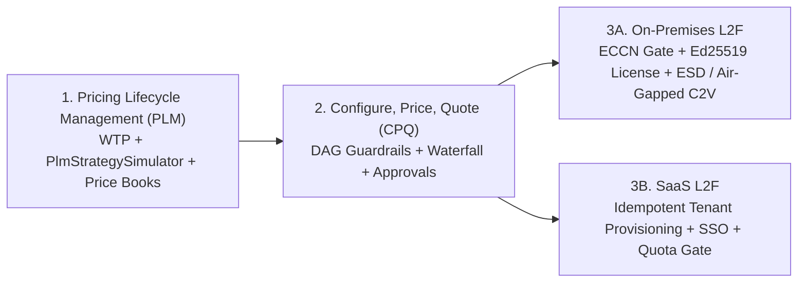

# Commercial & Product Lifecycle UAT / TDD Specifications

This directory contains the executable **Test-Driven Development (TDD)** and **User Acceptance Testing (UAT)** specifications governing **Project Aegis** commercial product management, pricing strategy simulation, quoting guardrails, and customer fulfillment lifecycles.

## Specification Suite

| Specification | Scope | Core TDD & UAT Focus |
| :--- | :--- | :--- |
| **[Pricing Lifecycle Management (PLM)](pricing-lifecycle-management.md)** | Strategic portfolio monetization, Van Westendorp WTP modeling, Good/Better/Best packaging fences, **Pricing Strategy Simulation (`PlmStrategySimulator`)**, pocket-margin leakage audits, and cohort migration. | Seeded cohort replay (`Run A == Run B`), elasticity $\epsilon_d$ guardrails, anti-cannibalization fences, contractual uplift caps (`UAT-PLM-01` – `UAT-PLM-06`). |
| **[CPQ Product Management Lifecycle](cpq-product-management-lifecycle.md)** | Deal-level Configure-Price-Quote workflows, DAG bundle dependencies (`REQUIRES`/`EXCLUDES`), guided selling guardrails, approval routing matrices, and price book waterfalls. | Acyclic DAG write-gate validation, 128-bit `decimal` pricing waterfalls, ASC 606 SSP penny-exact allocations, snapshot pinning (`UAT-CPQ-01` – `UAT-CPQ-05`). |
| **[On-Premises Lead-to-Fulfillment (L2F)](lead-to-fulfillment-onprem.md)** | End-to-end enterprise/defense self-hosted delivery from technical qualification and PoC sizing to export compliance (`ECCN 5D002`/ITAR), cryptographic licensing, and air-gapped deployment. | Ed25519/RSA hardware-bound licenses, SHA-256/Cosign bundle verification, zero-egress `C2V`/`V2C` air-gapped activation, HA failover & acceptance sign-off (`UAT-01` – `UAT-06`). |
| **[SaaS Lead-to-Fulfillment (L2F)](lead-to-fulfillment-saas.md)** | Cloud-hosted PLG and Enterprise subscription lifecycle from trial sign-up and checkout to automated multi-tenant provisioning, SSO onboarding, and ratable revenue recognition. | Idempotent webhook provisioning (`< 30s`), zero-loss trial-to-paid upgrades (`< 5s`), strict row/schema tenant isolation, ratable ASC 606 schedules (`UAT-SAAS-01` – `UAT-SAAS-03`). |

## End-to-End Architecture Flow

