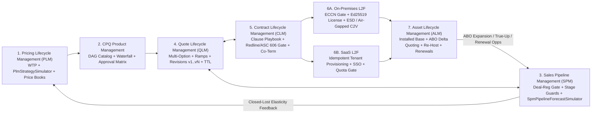

# Commercial & Product Lifecycle UAT / TDD Specifications

This directory contains the executable **Test-Driven Development (TDD)** and **User Acceptance Testing (UAT)** specifications governing **Project Aegis** commercial product management, pricing strategy simulation, quoting guardrails, and customer fulfillment lifecycles.

## Specification Suite

| Specification | Scope | Core TDD & UAT Focus |
| :--- | :--- | :--- |
| **[Pricing Lifecycle Management (PLM)](pricing-lifecycle-management.md)** | Strategic portfolio monetization, Van Westendorp WTP modeling, Good/Better/Best packaging fences, **Pricing Strategy Simulation (`PlmStrategySimulator`)**, pocket-margin leakage audits, and cohort migration. | Seeded cohort replay (`Run A == Run B`), elasticity $\epsilon_d$ guardrails, anti-cannibalization fences, contractual uplift caps (`UAT-PLM-01` – `UAT-PLM-06`). |
| **[Sales Pipeline Management (SPM) for CPQ](sales-pipeline-management-cpq.md)** | Opportunity intake, territory & partner deal-registration exclusivity locks, artifact-gated MEDDPICC stage transitions, quote-locked ARR bucket partitioning, **Seeded Pipeline Forecast Simulation (`SpmPipelineForecastSimulator`)**, and Closed-Won/Lost attribution. | 90-day partner deal-reg locks, CPQ/QLM/CLM stage-exit gates, 0-drift ARR bucket conservation, `SeededRng` P10/P50/P90 replay, PLM loss-elasticity feedback (`UAT-SPM-01` – `UAT-SPM-06`). |
| **[CPQ Product Management Lifecycle](cpq-product-management-lifecycle.md)** | Catalog & pricing rule design, DAG bundle dependencies (`REQUIRES`/`EXCLUDES`), guided selling guardrails, approval routing matrices, and price book waterfalls. | Acyclic DAG write-gate validation, 128-bit `decimal` pricing waterfalls, ASC 606 SSP penny-exact allocations, snapshot pinning (`UAT-CPQ-01` – `UAT-CPQ-05`). |
| **[Quote Lifecycle Management (QLM) for CPQ](quote-lifecycle-management-cpq.md)** | Operational deal quote execution, multi-option comparison, single primary quote CRM sync, multi-year stepped ramp schedules, channel partner margin stacking, immutable revision branching (`v1` $\rightarrow$ `vN`), and TTL expiration gates. | Single primary quote invariant, `decimal` ramp TCV/Exit-ARR math, delta approval preservation/invalidation, optimistic concurrency (`RowVersion`), atomic sibling supersession (`UAT-QLM-01` – `UAT-QLM-06`). |
| **[Contract Lifecycle Management (CLM) for CPQ](contract-lifecycle-management-cpq.md)** | Quote-to-contract assembly (`MLA`/`MSA`/Order Form/`DFARS`/`ITAR`), automated redline risk & ASC 606 revenue-deferral gates, bi-directional CPQ parity, cryptographic execution, obligation extraction, and co-termed amendments. | Mandatory regulatory flow-downs, cumulative legal/RevRec approvals, 0-drift quote-contract parity, Ed25519 envelope sealing, exact `decimal` co-term proration (`UAT-CLM-01` – `UAT-CLM-06`). |
| **[Asset Lifecycle Management (ALM) for CPQ](asset-lifecycle-management-cpq.md)** | Installed-base asset registry, **Asset-Based Ordering (ABO)** delta quoting (`ADD`/`UPGRADE`/`SWAP`), air-gapped license re-hosting (`C2V_DEACTIVATE`), pool split/merge, usage true-ups, and consolidated renewal rollups. | Idempotent order-to-asset minting, union DAG validation, penny-exact upgrade credit/rebill, capacity conservation across split/merge/re-host, cluster support parity (`UAT-ALM-01` – `UAT-ALM-06`). |
| **[On-Premises Lead-to-Fulfillment (L2F)](lead-to-fulfillment-onprem.md)** | End-to-end enterprise/defense self-hosted delivery from technical qualification and PoC sizing to export compliance (`ECCN 5D002`/ITAR), cryptographic licensing, and air-gapped deployment. | Ed25519/RSA hardware-bound licenses, SHA-256/Cosign bundle verification, zero-egress `C2V`/`V2C` air-gapped activation, HA failover & acceptance sign-off (`UAT-01` – `UAT-06`). |
| **[SaaS Lead-to-Fulfillment (L2F)](lead-to-fulfillment-saas.md)** | Cloud-hosted PLG and Enterprise subscription lifecycle from trial sign-up and checkout to automated multi-tenant provisioning, SSO onboarding, and ratable revenue recognition. | Idempotent webhook provisioning (`< 30s`), zero-loss trial-to-paid upgrades (`< 5s`), strict row/schema tenant isolation, ratable ASC 606 schedules (`UAT-SAAS-01` – `UAT-SAAS-03`). |

## End-to-End Architecture Flow

