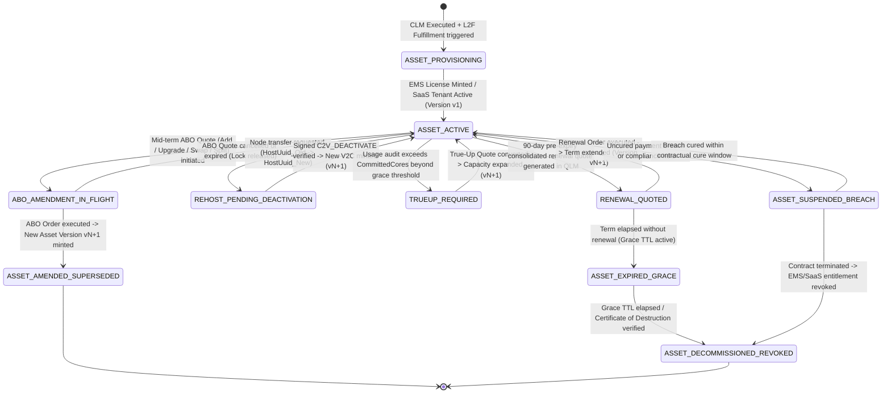

# The Asset Lifecycle Management (ALM) & Asset-Based Ordering (ABO) Process for CPQ Workflows (TDD & UAT Specification)

**Asset Lifecycle Management (ALM) for CPQ (Configure, Price, Quote) Workflows** is the post-fulfillment commercial state engine and Installed-Base governance framework that tracks every customer's live software entitlements, hardware bindings, capacity pools, and support contracts over time, and feeds that Installed Base back into **[Sales Pipeline Management (SPM)](sales-pipeline-management-cpq.md)**, **[CPQ Product Management](cpq-product-management-lifecycle.md)**, **[Quote Lifecycle Management (QLM)](quote-lifecycle-management-cpq.md)**, and **[Contract Lifecycle Management (CLM)](contract-lifecycle-management-cpq.md)** for **Asset-Based Ordering (ABO)**.

In the **Project Aegis** Quote-to-Cash (Q2C) architecture, ALM closes the loop between downstream fulfillment (**[On-Premises L2F](lead-to-fulfillment-onprem.md)** and **[SaaS L2F](lead-to-fulfillment-saas.md)**) and upstream commercial expansions, upgrades, splits/merges, re-hostings, true-ups, renewals, and decommissioning. Because a single defect in ALM state tracking can allow customers to purchase orphaned add-on modules, double-claim upgrade credits, duplicate licensed CPU cores during air-gapped node transfers, or retain active software after contract termination, this specification establishes a **Test-Driven Development (TDD)** and **executable User Acceptance Testing (UAT)** architecture aligned with **Project Aegis** (`.NET` / C# / xUnit determinism standards).

---

## Part I: The Five Phases of Asset Lifecycle Management (ALM) for CPQ

### 1. Order-to-Asset Minting, Hierarchical Installed-Base Registry & Lineage Binding
The ALM lifecycle begins when an order is fulfilled in [On-Premises L2F](lead-to-fulfillment-onprem.md) (`ENTITLEMENT_MINTED` / `UAT_ACCEPTED`) or [SaaS L2F](lead-to-fulfillment-saas.md) (`TENANT_ACTIVE`) under an executed [CLM Contract](contract-lifecycle-management-cpq.md) (`EXECUTED_ACTIVE`).
* **Idempotent Order-to-Asset Minting:** Converting fulfilled order lines into canonical, immutable `CustomerAsset` records keyed by `(CustomerId, OriginContractId, ErpOrderLineId)` so duplicate ERP/EMS fulfillment webhooks never create duplicate installed-base capacities.
* **Hierarchical Asset Tree Modeling:** Preserving the parent-child bundle structure from CPQ (`RootBundleAsset` $\rightarrow$ `CoreEngineAsset` $\rightarrow$ `AdapterModuleAssets` & `MaintenanceSupportAsset`) so downstream amendments and renewals can traverse the customer's exact deployed topology.
* **Cryptographic & Financial Lineage Binding:** Stamping every asset version with its origin `QuoteCanonicalFingerprintSha256`, `ExecutedContractSha256`, ASC 606 Performance Obligation ID, net annualized run-rate (`NetUnitArr` / `NetPurchasePrice`), active term window (`StartDateUtc`, `EndDateUtc`), and deployment binding (`HostUuid`, `HsmDongleSerial`, or `SaasTenantId`).

### 2. Asset-Based Ordering (ABO) — Mid-Term Delta Quoting (`ADD`, `UPGRADE`, `SWAP`, `DOWNGRADE`)
Rather than quoting existing customers from a blank slate, ALM feeds the customer's active Installed Base directly into CPQ and QLM to power **Asset-Based Ordering (ABO)**.
* **Installed-Base-Aware DAG Validation:** Evaluating `REQUIRES` and `EXCLUDES` catalog rules against the **union** of `(ActiveInstalledBaseAssets ∪ ProposedQuoteDeltaLines)`. A customer who already owns an active `AEGIS-CORE-SIM-ENGINE` asset can purchase `AEGIS-ADAPTER-UNITY-C2` on a standalone expansion quote without re-buying the parent engine.
* **Delta Quantity & Co-Term Proration:** Expressing mid-term modifications as explicit state deltas (`AboAction = AddCapacity | UpgradeTier | SwapModule | ReduceCapacityAtRenewal`) that automatically inherit the parent contract's `EndDateUtc` and calculate exact daily 128-bit `decimal` proration (`MidpointRounding.ToEven`).
* **Penny-Exact Upgrade Credit & Rebill Waterfall:** When upgrading an active asset mid-term (e.g., upgrading `TIER-2-THEATER-PRO` to `TIER-3-SOVEREIGN-ENT` on day 146 of a 365-day annual basis), ALM computes the exact unused prepaid credit on the retired asset version ($\text{UnusedCredit} = -\text{RoundEven}(\text{PriorNetAnnualPrice} \times \frac{T_{\text{remaining}}}{T_{\text{annual\_basis}}}, 2)$) and applies it against the prorated charge of the new asset version so net cash and ASC 606 contract modification ledgers balance to $\$0.00$.

### 3. License Re-Hosting, Pool Split/Merge & RMA Hardware Replacement
For self-hosted enterprise and defense deployments, ALM governs physical and logical asset reconfigurations across data centers and classified enclaves without leaking capacity.
* **Cryptographic License Re-Hosting (`REHOST`):** Transferring an on-premises or air-gapped asset from a decommissioned server (`HostUuid_Old`) to replacement hardware (`HostUuid_New`). For air-gapped environments, ALM enforces a strict **Deactivation-Before-Reissue Gate**: the customer must upload a signed offline Challenge-to-Vendor deactivation proof (`C2V_DEACTIVATE` signed by the target node's agent/TPM) before the EMS mints the replacement Vendor-to-Customer (`V2C`) license key.
* **Enterprise Capacity Pool Split & Merge (`SPLIT` / `MERGE`):** Allowing a customer to split a 128-core enterprise license asset into multiple smaller deployment assets (e.g., $2 \times 64$-core theater lab clusters) or merge multiple fragmented mid-term add-on assets into a single consolidated asset record while strictly conserving total licensed capacity ($\sum \text{PostSplitCores} == \text{PreSplitCores}$).
* **RMA & Emergency Failover Grace Tokens:** Issuing time-bounded (e.g., 14-day) emergency RMA replacement tokens when a physical HSM dongle fails, automatically revoking the temporary token once the permanent replacement hardware fingerprint is bound.

### 4. Usage Telemetry Reconciliation, True-Up Quoting & Support Level Parity
Throughout the active asset term, ALM monitors entitlement compliance and support alignment across the customer's deployment footprint.
* **Connected & Air-Gapped Usage Reconciliation:** Comparing actual peak consumption (via automated SaaS metering or signed offline air-gapped usage audit logs submitted quarterly) against `Asset.CommittedCapacity`.
* **Automated Overage & True-Up Quote Generation:** When verified usage exceeds contracted capacity beyond policy grace limits, ALM automatically initializes a co-termed **True-Up Quote** in [QLM](quote-lifecycle-management-cpq.md) for the delta capacity plus any applicable back-dated maintenance/usage fees.
* **Homogeneous Support-Tier Parity Enforcement:** Enforcing the **All-or-Nothing Support Parity Rule**—within any single deployment cluster or parent asset hierarchy, all active software modules must carry the same Maintenance & Support SLA tier (e.g., all `PLATINUM_SUPPORT`), preventing customers from buying `PLATINUM_SUPPORT` on a 1-core add-on while keeping 64 base cores on `BRONZE_SUPPORT`.

### 5. Installed-Base Renewal Consolidation, Tech-Refresh SKU Migration & Decommissioning
As assets approach expiration or obsolescence, ALM orchestrates multi-asset renewal consolidation, catalog migrations, and end-of-life revocation.
* **Consolidated Renewal Forecasting & Rollup:** Automatically aggregating the base asset and all mid-term co-termed expansion/upgrade assets under a contract into a single, unified renewal quote (`ANNUAL_RENEWAL`) at `90`, `60`, and `30` days before `EndDateUtc`, enforcing [PLM](pricing-lifecycle-management.md) and [CLM](contract-lifecycle-management-cpq.md) contractual uplift caps (`MaxAnnualUpliftPct`).
* **Guided Tech-Refresh & End-of-Sale SKU Migration:** When an installed asset references a SKU in state `GRANDFATHERED_RENEWAL_ONLY` or `END_OF_SALE` (e.g., `AEGIS-BALTIC-V1-PACK`), ALM maps the legacy asset to its designated replacement SKU (`AEGIS-BALTIC-V3-PACK`) via the catalog migration table while preserving historical price-hold lineage.
* **Parent-Before-Child Decommissioning Guard & Certificate of Destruction:** Preventing the cancellation or decommissioning of a parent/foundation asset while dependent child assets remain `ASSET_ACTIVE`, and requiring either automated SaaS tenant teardown or a signed **Certificate of Destruction / Deactivation Token** upon full contract termination (`ASSET_DECOMMISSIONED_REVOKED`).

---

## Part II: Project Aegis TDD Architecture for ALM-CPQ Workflows

To align with **Project Aegis** engineering standards ([`AGENTS.md`](../../AGENTS.md) and [`determinism-and-replay.md`](../../docs/engineering/determinism-and-replay.md)), the ALM domain is engineered using immutable C# records, pure deterministic evaluators, append-only versioned asset ledgers, and zero ambient nondeterminism (`no float/double` in credit/proration math, `no DateTime.UtcNow` inside domain evaluators).

### 1. ALM Customer Asset Lifecycle State Machine



### 2. Core TDD Domain Invariants (Red-Green-Refactor Contracts)

Every ALM service and ABO evaluator must satisfy these seven deterministic invariants in unit and integration tests:

1. **Idempotent Order-to-Asset Minting & Lineage Invariant (`INV-ALM-MINT-01`):** Given an executed `(ContractId, QuoteCanonicalFingerprintSha256, ErpOrderLineId)`, `AssetMintingService.MintOrGet(...)` must be strictly idempotent—replaying the fulfillment event $N$ times must yield the exact same `AssetId` and `AssetVersion = 1` without duplicating licensed capacity or ARR.
2. **Closed-Loop Installed-Base + Delta Quote DAG Invariant (`INV-ALM-DAG-01`):** For any ABO quote applying delta actions $\Delta$ to a customer's active Installed Base $I_{\text{active}}$, the post-transaction projected asset state $I' = (I_{\text{active}} \setminus \Delta_{\text{retire}}) \cup \Delta_{\text{add}}$ must satisfy all catalog `REQUIRES` and `EXCLUDES` rules (`INV-CPQ-DAG-01`). Attempting to retire or decommission a parent asset $P \in I_{\text{active}}$ while any child asset $C \in I'$ still `REQUIRES` $P$ must fail with `ERR_ALM_ORPHANED_DEPENDENT_ASSET`.
3. **Penny-Exact Upgrade Credit & Prorated Charge Conservation Invariant (`INV-ALM-PRORATE-01`):** When upgrading asset $A_{\text{old}}$ to $A_{\text{new}}$ at `EffectiveDateUtc` with $T_{\text{rem}}$ days remaining in the current billing period and annual day basis $T_{\text{annual}}$ (e.g., `MasterAnnualBasisDays = 365`, or using full-term contract price over total contract days $T_{\text{total}}$):
   - $\text{UnusedCredit} = -\text{RoundEven}(A_{\text{old}}.\text{AnnualNetPrice} \times \frac{T_{\text{rem}}}{T_{\text{annual}}}, 2)$;
   - $\text{ProratedNewCharge} = \text{RoundEven}(A_{\text{new}}.\text{AnnualNetPrice} \times \frac{T_{\text{rem}}}{T_{\text{annual}}}, 2)$;
   - $\text{NetUpgradeInvoiceAmount} == \text{ProratedNewCharge} + \text{UnusedCredit}$ using 128-bit `decimal` arithmetic (`MidpointRounding.ToEven`), and $|\text{UnusedCredit}|$ may never exceed the amount actually billed for the remaining period on $A_{\text{old}}$.
4. **Asset Split, Merge & Re-Host Capacity Conservation Invariant (`INV-ALM-CAP-01`):** Any non-commercial structural asset mutation (`SPLIT`, `MERGE`, or `REHOST`) must strictly conserve total licensed quantity and ARR: $\sum_{a \in \text{Outputs}} a.\text{CommittedQuantity} == \sum_{b \in \text{Inputs}} b.\text{CommittedQuantity}$ and $\sum_{a \in \text{Outputs}} a.\text{AnnualNetArr} == \sum_{b \in \text{Inputs}} b.\text{AnnualNetArr}$. Furthermore, a `REHOST` transition on an `AIR_GAPPED` or hardware-bound asset must reject new license issuance with `ERR_ALM_DEACTIVATION_PROOF_MISSING` unless a valid cryptographic `C2V_DEACTIVATE` signature from `HostUuid_Old` (or an approved CFO/Compliance RMA waiver token) is verified.
5. **Homogeneous Cluster Support-Tier Parity Invariant (`INV-ALM-SUP-01`):** Within any single `DeploymentClusterId` (or parent-child asset tree), all active software license assets must map to the identical Maintenance & Support SLA tier (`SupportTier`). Any ABO quote that attempts to add a module with a mismatched support tier (`BRONZE` vs. `PLATINUM`) must be blocked with `ERR_ALM_SUPPORT_TIER_MISMATCH`.
6. **Deterministic Usage Audit & True-Up Invariant (`INV-ALM-TRUEUP-01`):** Given a signed `UsageAuditBundle` reporting `PeakConcurrentCoresUsed` over an audit window, if `PeakConcurrentCoresUsed > Asset.CommittedCores`, `TrueUpEvaluator` must deterministically compute `OverageCores = PeakConcurrentCoresUsed - Asset.CommittedCores` and generate a co-termed True-Up quote line for `OverageCores` from the exact breach timestamp (`BreachDetectedUnixSecondsUtc`) through `Asset.EndDateUtc`.
7. **Consolidated Renewal Rollup & Uplift Cap Conservation Invariant (`INV-ALM-RENEW-01`):** Generating a renewal quote for a contract with base asset $A_0$ and mid-term co-termed expansion assets $A_1, \dots, A_m$ of the same SKU must consolidate them into a single renewal line with $\text{RenewalQuantity} = \sum_{i=0}^{m} A_i.\text{CommittedQuantity}$ and unit price clamped by $\text{RenewalUnitPrice} \le \text{RoundEven}(\text{WeightedBaselineUnitPrice} \times (1 + \text{MaxAnnualUpliftPct}), 2)$.

### 3. Project Aegis C# Domain Contracts & Test Naming Conventions

Following `AGENTS.md` conventions (`sealed record`, `readonly record struct`, 128-bit `decimal` for financial math, explicit UTC timestamps passed as parameters, and xUnit `[Scenario]_[Expected]` test naming):

```csharp
namespace ProjectAegis.Alm.Domain;

public enum AssetLifecycleState { AssetProvisioning, AssetActive, AboAmendmentInFlight, AssetAmendedSuperseded, RehostPendingDeactivation, TrueUpRequired, RenewalQuoted, AssetExpiredGrace, AssetSuspendedBreach, AssetDecommissionedRevoked }
public enum AboActionType { AddCapacity, UpgradeTier, SwapModule, SplitPool, MergePools, RehostNode, TrueUpOverage, RenewConsolidated, DecommissionRetire }
public enum SupportSlaTier { StandardBronze, EnterpriseSilver, MissionCriticalPlatinum }

public sealed record CustomerAssetSnapshot(
    string AssetId,
    int AssetVersion,
    string CustomerId,
    string DeploymentClusterId,
    string? ParentAssetId,
    string SkuCode,
    int CommittedQuantity,
    decimal AnnualUnitNetPrice,
    decimal AnnualTotalNetArr,
    SupportSlaTier SupportTier,
    string DeploymentIsolationMode,
    string BoundHardwareOrTenantId,
    long TermStartUnixSecondsUtc,
    long TermEndUnixSecondsUtc,
    string OriginQuoteFingerprintSha256,
    string OriginContractSha256,
    AssetLifecycleState State,
    string AssetCanonicalFingerprintSha256);

public sealed record AboUpgradeFinancialDelta(
    string RetiredAssetId,
    string NewTargetSkuCode,
    int RemainingTermDays,
    int TotalTermDays,
    decimal UnusedPrepaidCreditAmount,
    decimal ProratedNewChargeAmount,
    decimal NetUpgradeInvoiceAmount);

public sealed record RehostDeactivationCertificate(
    string AssetId,
    string OldHostUuid,
    string NewTargetHostUuid,
    long DeactivatedAtUnixSecondsUtc,
    string Ed25519DeactivationSignatureHex);
```

**TDD Test Pyramid & xUnit Mapping:**

| Test Layer | Assembly / Location | Target System Under Test (SUT) | Naming Convention (`[Scenario]_[Expected]`) | Execution Budget |
| :--- | :--- | :--- | :--- | :--- |
| **1. Pure Domain Unit Tests** | `src/ProjectAegis.Alm.Tests/` | `InstalledBaseDagEvaluator`, `AboUpgradeProrationCalculator`, `AssetSplitMergeCoordinator`, `RehostDeactivationVerifier`, `SupportParityValidator`, `RenewalAssetConsolidator` | `RetireParentEngineWhileChildC2AdapterActive_ReturnsOrphanedDependentAssetError` | $< 10\text{ ms}$ per `[Fact]` / `[Theory]` |
| **2. Ledger & Idempotency Tests** | `src/ProjectAegis.Data.Tests/` | `CustomerAssetLedgerRepository`, `OrderToAssetMintingGate` | `DuplicateFulfillmentWebhook_ReturnsExistingAssetV1WithoutDoubleMinting` | $< 100\text{ ms}$ (in-memory SQLite) |
| **3. Golden Regression Tests** | `tests/regression/alm-golden-*.txt` | `AlmGoldenLifecycleReplayTests` | `ThreeYearEnterpriseAssetLifecycleWithSplitUpgradeAndRenewal_MatchesPinnedLedgerHash` | $< 250\text{ ms}$ for full golden suite |
| **4. End-to-End UAT Scenarios** | `tests/uat/asset-lifecycle-management-cpq.md` | Full L2F Minting $\rightarrow$ ABO Upgrade/Add $\rightarrow$ Re-Host/Split $\rightarrow$ True-Up $\rightarrow$ Consolidated Renewal & Decommission | `UAT-ALM-01` through `UAT-ALM-06` | Pre-release & RevOps/CS sign-off gate |

---

## Part III: Executable User Acceptance Testing (UAT) Scenarios

The following Behavior-Driven Development (BDD / Gherkin) scenarios define the mandatory acceptance gates across all five phases of the Asset Lifecycle Management (ALM) and Asset-Based Ordering (ABO) process for CPQ.

### UAT-ALM-01: Idempotent Order-to-Asset Minting & Hierarchical Installed-Base Lineage (Phase 1)
```gherkin
Feature: Idempotent Order-to-Asset Creation and Hierarchical Installed-Base Registry
  As a Fulfillment Operations Lead and Revenue Accountant
  I want fulfilled orders converted idempotently into a hierarchical Customer Asset tree with cryptographic lineage
  So that the Installed Base ledger matches provisioned entitlements and ERP revenue schedules 1:1

  Scenario: Fulfilled air-gapped defense bundle mints a root asset and child module assets idempotently
    Given CLM Contract "CLM-2026-701" (`ExecutedContractSha256: 88aa99bb`) and CPQ Quote "Q-2026-701" (`Fingerprint: 9f86d081`) are fulfilled in On-Premises L2F
    And the fulfilled order lines for Customer "CUST-DEF-01" (`Cluster: CLUSTER-BALTIC-01`) are:
      | Order_Line_ID | SKU_Code                | Parent_Line_ID | Quantity | Annual_Net_ARR | Hardware_Binding     |
      | OL-1001       | AEGIS-CORE-SIM-ENGINE   | NONE           | 64       | $76,800.00     | HOST-UUID-BALTIC-A1  |
      | OL-1002       | AEGIS-ADAPTER-UNITY-C2  | OL-1001        | 64       | $19,200.00     | HOST-UUID-BALTIC-A1  |
      | OL-1003       | AEGIS-SUP-PLATINUM      | OL-1001        | 1        | $19,200.00     | HOST-UUID-BALTIC-A1  |
    When the ALM `AssetMintingService` processes the fulfillment webhook 3 times with the same idempotency key
    Then exactly 1 hierarchical asset tree (`ASSET-1001` v1 -> children `ASSET-1002` v1, `ASSET-1003` v1) MUST be created in state "ASSET_ACTIVE"
    And total active customer ARR in the Installed Base MUST equal exactly "$115,200.00"
    And every asset record MUST store `OriginQuoteFingerprintSha256 = 9f86d081` and `OriginContractSha256 = 88aa99bb`
```

### UAT-ALM-02: Asset-Based Ordering (ABO) — Standalone Add-On & Mid-Term Tier Upgrade Credit/Rebill (Phase 2)
```gherkin
Feature: Asset-Based Ordering (ABO) Delta Quoting, Installed-Base DAG Validation, and Upgrade Proration
  As an Account Executive and Deal Desk Analyst
  I want CPQ to validate add-on dependencies against already-owned assets and calculate penny-exact upgrade credits
  So that existing customers can expand or upgrade mid-term without re-buying base modules or overpaying

  Scenario: Customer owning active Core Sim Engine asset purchases standalone C2 Adapter add-on without re-buying parent
    Given Customer "CUST-DEF-01" holds active parent asset "ASSET-1001" (`SKU: AEGIS-CORE-SIM-ENGINE`, `State: ASSET_ACTIVE`)
    And Catalog Rule `AEGIS-MOD-DELEGATION REQUIRES AEGIS-CORE-SIM-ENGINE` is active
    When the Account Executive creates an ABO Add-On Quote containing only `AEGIS-MOD-DELEGATION` (Quantity: 64) linked to `Cluster: CLUSTER-BALTIC-01`
    Then the `InstalledBaseDagEvaluator` MUST validate the union `(ActiveInstalledBase ∪ QuoteDelta)` as "CONFIG_VALID"
    And the quote MUST NOT require re-adding `AEGIS-CORE-SIM-ENGINE` as a net-new charge

  Scenario: Mid-term tier upgrade from Theater Pro to Sovereign Enterprise calculates exact unused credit and prorated charge
    Given Customer "CUST-ENT-02" holds active Asset "ASSET-2001" v1 (`SKU: TIER-2-THEATER-PRO`, `AnnualNetArr: $60,000.00`)
    And the asset term runs from `2026-01-01T00:00:00Z` to `2027-01-01T00:00:00Z` (365 total days)
    When the customer executes an ABO Upgrade to `TIER-3-SOVEREIGN-ENT` (`AnnualNetPrice: $110,000.00`) effective `2026-05-27T00:00:00Z` (219 days remaining, ratio `0.6000000000`)
    Then `AboUpgradeProrationCalculator` MUST compute:
      | Calculation_Component            | Amount        |
      | Unused_Prepaid_Credit (ASSET-2001)| -$36,000.00   |
      | Prorated_New_Charge (TIER-3)     | $66,000.00    |
      | Net_Upgrade_Invoice_Total        | $30,000.00    |
    And upon order execution, "ASSET-2001" v1 MUST transition to "ASSET_AMENDED_SUPERSEDED"
    And replacement Asset "ASSET-2001" v2 (`SKU: TIER-3-SOVEREIGN-ENT`, `AnnualNetArr: $110,000.00`) MUST be minted in state "ASSET_ACTIVE"
```

### UAT-ALM-03: Air-Gapped License Re-Hosting (`C2V_DEACTIVATE`) & Capacity Pool Split/Merge (Phase 3)
```gherkin
Feature: Cryptographic License Re-Hosting and Zero-Leakage Capacity Pool Split/Merge
  As a Customer Infrastructure Admin and Entitlement Compliance Officer
  I want node transfers gated by cryptographic deactivation proofs and pool splits/merges to conserve total capacity
  So that hardware refreshes never duplicate licensed cores across servers

  Scenario: Air-gapped license re-host blocks new V2C issuance until signed C2V deactivation proof from old host is verified
    Given Asset "ASSET-1001" v1 (64 cores, `AIR_GAPPED`) is bound to `OldHostUuid = HOST-UUID-BALTIC-A1`
    When the customer requests a re-host to `NewTargetHostUuid = HOST-UUID-BALTIC-B9` without uploading a deactivation certificate
    Then the ALM service MUST keep the request in "REHOST_PENDING_DEACTIVATION" and block new license generation with "ERR_ALM_DEACTIVATION_PROOF_MISSING"
    When the customer uploads a valid Ed25519-signed `RehostDeactivationCertificate` (`C2V_DEACTIVATE`) from `HOST-UUID-BALTIC-A1`
    Then ALM MUST mark `HOST-UUID-BALTIC-A1` as permanently deactivated, mint "ASSET-1001" v2 bound to `HOST-UUID-BALTIC-B9` (64 cores), and issue the new `V2C` license file

  Scenario: Splitting a 128-core enterprise asset into two lab clusters strictly conserves capacity and ARR
    Given Customer "CUST-DEF-01" holds active Asset "ASSET-3000" v1 (`CommittedQuantity: 128 cores`, `AnnualNetArr: $153,600.00`)
    When the customer executes an ABO Pool Split (`50% / 50%`) across `CLUSTER-EAST` and `CLUSTER-WEST`
    Then "ASSET-3000" v1 MUST transition to "ASSET_AMENDED_SUPERSEDED"
    And two active child assets (`ASSET-3000A` v1: 64 cores, `$76,800.00`; `ASSET-3000B` v1: 64 cores, `$76,800.00`) MUST be minted
    And total post-split cores (`64 + 64 = 128`) and ARR (`$76,800.00 + $76,800.00 = $153,600.00`) MUST equal the pre-split asset exactly
```

### UAT-ALM-04: Homogeneous Support-Tier Parity & Usage Overage True-Up Quoting (Phase 4)
```gherkin
Feature: Cluster Support-Tier Parity Enforcement and Automated Usage Overage True-Up Quoting
  As a Customer Success Operations Lead and Finance Controller
  I want mismatched support tiers blocked within the same cluster and capacity overages converted into co-termed True-Up quotes
  So that support SLA obligations are unambiguous and burst consumption is properly monetized

  Scenario: ABO quote attempting to attach Bronze Support to a cluster running Platinum Support is hard-blocked
    Given `Cluster: CLUSTER-BALTIC-01` has active core assets governed by `SupportTier = MissionCriticalPlatinum`
    When a Sales Rep configures an ABO add-on quote for `Cluster: CLUSTER-BALTIC-01` with `SupportTier = StandardBronze`
    Then `SupportParityValidator` MUST reject the quote configuration with error code "ERR_ALM_SUPPORT_TIER_MISMATCH: Cluster CLUSTER-BALTIC-01 requires MissionCriticalPlatinum"

  Scenario: Signed quarterly usage audit reporting 96 peak cores against 64 committed cores triggers a co-termed True-Up quote
    Given Asset "ASSET-1001" v2 has `CommittedQuantity = 64 cores`, `AnnualUnitNetPrice = $1,200.00/core/year`, and `TermEndUtc = 2027-01-01T00:00:00Z` (365-day annual basis)
    When the customer uploads a signed `UsageAuditBundle` showing `PeakConcurrentCoresUsed = 96` starting `2026-09-17T00:00:00Z` (106 days remaining until `2027-01-01T00:00:00Z`)
    Then Asset "ASSET-1001" v2 MUST transition to "TRUEUP_REQUIRED" with `OverageCores = 32`
    And ALM MUST automatically generate co-termed QLM True-Up Quote "Q-2026-TU-1001" for 32 cores prorated over `106 / 365` days at "$11,151.78" (`32 * $1,200.00 * 106 / 365` rounded via `MidpointRounding.ToEven`)
```

### UAT-ALM-05: Consolidated Installed-Base Renewal Rollup & Tech-Refresh SKU Migration (Phase 5)
```gherkin
Feature: Consolidated Multi-Asset Renewal Rollup and Guided End-of-Sale SKU Migration
  As a Renewal Specialist and CPQ Product Manager
  I want fragmented mid-term add-on assets consolidated into a single renewal line and End-of-Sale SKUs mapped to modern replacements
  So that customer renewals are clean, uplift-capped, and free of deprecated catalog technical debt

  Scenario: Base asset and two mid-term co-termed expansion assets consolidate into a single uplift-capped renewal quote line
    Given Customer "CUST-DEF-01" has three co-termed active assets for `AEGIS-CORE-SIM-ENGINE` expiring `2027-01-01T00:00:00Z` under a 5.0% contractual uplift cap:
      | Asset_ID     | Origin_Transaction      | Committed_Cores | Annualized_Unit_Net_Price | Annualized_ARR |
      | ASSET-4001   | Initial Land Order      | 64              | $1,200.00                 | $76,800.00     |
      | ASSET-4002   | Q2 Co-Term Expansion    | 32              | $1,200.00                 | $38,400.00     |
      | ASSET-4003   | Q3 True-Up Expansion    | 32              | $1,200.00                 | $38,400.00     |
    When the ALM `RenewalAssetConsolidator` generates the 90-day pre-expiry renewal quote for `2027-01-01` to `2028-01-01`
    Then the renewal quote MUST consolidate `ASSET-4001`, `ASSET-4002`, and `ASSET-4003` into a single line item of `128 cores`
    And the renewal unit price MUST be capped at "$1,260.00/core/year" (`$1,200.00 * 1.05`) for a consolidated Renewal ARR of "$161,280.00"

  Scenario: Installed asset referencing an End-of-Sale SKU is automatically migrated to its successor SKU on renewal
    Given Customer "CUST-DEF-01" holds active Asset "ASSET-4010" (`SKU: AEGIS-BALTIC-V1-PACK`, `State: ASSET_ACTIVE`)
    And Catalog Snapshot "CAT-2026-Q4" marks `AEGIS-BALTIC-V1-PACK` as `END_OF_SALE` with mandatory migration target `AEGIS-BALTIC-V3-PACK`
    When the ALM Renewal Engine generates the renewal quote
    Then the renewal quote line MUST substitute `AEGIS-BALTIC-V3-PACK` with `MigratedFromAssetId = ASSET-4010` and preserve the customer's contracted 5.0% renewal uplift cap
```

### UAT-ALM-06: Parent-Before-Child Decommissioning Guard & Certificate of Destruction Revocation (Phase 5)
```gherkin
Feature: Dependency-Safe Asset Decommissioning and Post-Termination Entitlement Revocation
  As a Compliance Officer and Fulfillment Architect
  I want partial decommissioning blocked if it orphans active child assets and full termination to revoke all downstream entitlements
  So that the Installed Base never enters an invalid technical state or leaves terminated licenses active

  Scenario: Attempting to decommission the Core Simulation Engine while the Unity C2 Adapter asset remains active is blocked
    Given Customer "CUST-DEF-01" has active parent asset "ASSET-1001" (`AEGIS-CORE-SIM-ENGINE`) and active child asset "ASSET-1002" (`AEGIS-ADAPTER-UNITY-C2`)
    When a Renewal Specialist attempts to decommission only "ASSET-1001" while renewing "ASSET-1002"
    Then `InstalledBaseDagEvaluator` MUST reject the transaction with error "ERR_ALM_ORPHANED_DEPENDENT_ASSET: Cannot retire AEGIS-CORE-SIM-ENGINE while AEGIS-ADAPTER-UNITY-C2 remains active"

  Scenario: Full contract termination transitions all hierarchical assets to DECOMMISSIONED_REVOKED and blocks EMS/SaaS access
    Given Customer "CUST-DEF-01" submits a formal non-renewal notice and signed "Certificate of Destruction" (`COD-2027-01`) upon contract expiration
    When ALM processes the decommissioning event for `Cluster: CLUSTER-BALTIC-01`
    Then parent asset "ASSET-1001" and all child assets ("ASSET-1002", "ASSET-1003") MUST atomically transition to "ASSET_DECOMMISSIONED_REVOKED"
    And the On-Premises EMS MUST revoke `HOST-UUID-BALTIC-B9` from future patch downloads or key renewals
    And Customer "CUST-DEF-01" active Installed Base ARR for `CLUSTER-BALTIC-01` MUST equal "$0.00"
```

---

## Part IV: Requirements Traceability, KPIs & UAT Sign-Off Matrix

| Phase | Requirement ID | Domain Invariant | TDD Test Suite (`ProjectAegis.*.Tests`) | UAT Scenario | Operational KPI & Pass Threshold | Sign-Off Owner |
| :--- | :--- | :--- | :--- | :--- | :--- | :--- |
| **1. Order-to-Asset Minting** | `REQ-ALM-01` | `INV-ALM-MINT-01` (Idempotent minting & cryptographic lineage) | `OrderToAssetMintingGateTests`, `CustomerAssetLedgerTests` | `UAT-ALM-01` | $0$ duplicate assets on webhook replay; $100\%$ lineage match to CPQ/CLM hashes. | Fulfillment Ops / Finance Controller |
| **2. ABO Delta Quoting** | `REQ-ALM-02` | `INV-ALM-DAG-01`, `INV-ALM-PRORATE-01` (Union DAG & `decimal` upgrade credit) | `InstalledBaseDagEvaluatorTests`, `AboUpgradeProrationCalculatorTests` | `UAT-ALM-02` | $0$ penny-rounding variance across 10,000 mid-term upgrade `[Theory]` cases; $100\%$ union DAG accuracy. | CPQ Product Manager / Deal Desk Lead |
| **3. Re-Host, Split & Merge** | `REQ-ALM-03` | `INV-ALM-CAP-01` (Capacity conservation & `C2V_DEACTIVATE` gate) | `AssetSplitMergeCoordinatorTests`, `RehostDeactivationVerifierTests` | `UAT-ALM-03` | $0$ core/ARR leakage across splits & merges; $100\%$ of air-gapped re-hosts gated on deactivation proof. | InfoSec / Licensing Engineering Lead |
| **4. Usage True-Up & Support Parity** | `REQ-ALM-04` | `INV-ALM-SUP-01`, `INV-ALM-TRUEUP-01` (Cluster support parity & true-up math) | `SupportParityValidatorTests`, `TrueUpEvaluatorTests` | `UAT-ALM-04` | $0$ split-support cluster violations; $100\%$ deterministic true-up calculation from signed audit logs. | VP Customer Success / RevOps Lead |
| **5. Renewal Rollup & Decommission** | `REQ-ALM-05` | `INV-ALM-RENEW-01` (Consolidated renewal rollup & orphan-safe retirement) | `RenewalAssetConsolidatorTests`, `AssetDecommissioningGuardTests` | `UAT-ALM-05`, `UAT-ALM-06` | $100\%$ consolidation of co-termed add-ons at renewal; $0$ orphaned child assets or unrevoked terminations. | Renewal Ops Lead / General Counsel |

### UAT Entry & Exit Criteria

* **UAT Entry Criteria (Pre-Staging Gate):**
  1. All TDD unit, ledger idempotency, and golden asset lifecycle replay tests pass (`0 errors, 0 warnings`) with $100\%$ branch coverage on `InstalledBaseDagEvaluator`, `AboUpgradeProrationCalculator`, `AssetSplitMergeCoordinator`, `RehostDeactivationVerifier`, `SupportParityValidator`, and `RenewalAssetConsolidator`.
  2. Static determinism audit verifies zero binary floating-point (`float`/`double`), zero ambient `DateTime.UtcNow`, and culture-invariant SHA-256 asset ledger fingerprinting across all ABO and renewal evaluators.
  3. Golden asset lifecycle fixtures (`tests/regression/alm-golden-*.txt`) pass 100% intra-run (`Run A == Run B`) and baseline fingerprint checks.
* **UAT Exit Criteria (Production ALM-CPQ Release Gate):**
  1. All six UAT feature suites (`UAT-ALM-01` through `UAT-ALM-06`) pass in staging with zero open Severity-1 or Severity-2 defects.
  2. Closed-loop Installed Base integration verified end-to-end from [On-Premises L2F](lead-to-fulfillment-onprem.md) and [SaaS L2F](lead-to-fulfillment-saas.md) fulfillment into ALM asset minting, and back into [CPQ](cpq-product-management-lifecycle.md), [QLM](quote-lifecycle-management-cpq.md), [CLM](contract-lifecycle-management-cpq.md), and [PLM](pricing-lifecycle-management.md) for mid-term ABO upgrades, splits, true-ups, and renewals.
  3. Formal UAT sign-off recorded by the CPQ Product Manager, Fulfillment Operations Lead, Deal Desk Manager, Finance Revenue Controller, and VP of Customer Success.
