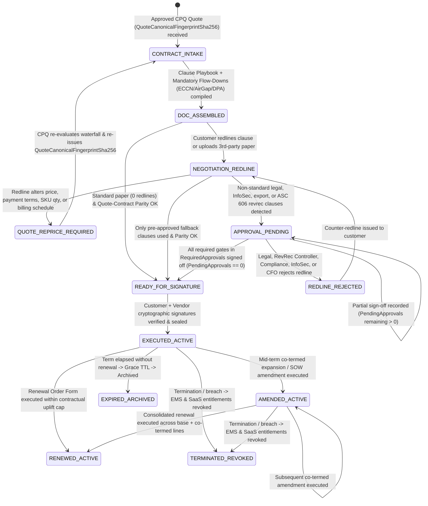

# The Contract Lifecycle Management (CLM) Process for CPQ Workflows (TDD & UAT Specification)

**Contract Lifecycle Management (CLM) for CPQ (Configure, Price, Quote) Workflows** is the end-to-end legal, commercial, and regulatory governance framework that transforms an approved CPQ quote (`QUOTE_APPROVED` / `QUOTE_PRESENTED`) into an executed, cryptographically sealed, and machine-enforceable commercial agreement. In the **Project Aegis** Quote-to-Cash (Q2C) architecture, CLM bridges **[Quote Lifecycle Management (QLM)](quote-lifecycle-management-cpq.md)**, **[CPQ Product Management](cpq-product-management-lifecycle.md)**, and **[Pricing Lifecycle Management (PLM)](pricing-lifecycle-management.md)** upstream with **[Asset Lifecycle Management (ALM)](asset-lifecycle-management-cpq.md)**, **[On-Premises Lead-to-Fulfillment](lead-to-fulfillment-onprem.md)**, and **[SaaS Lead-to-Fulfillment](lead-to-fulfillment-saas.md)** downstream.

Because a single unvetted contract redline can invalidate **ASC 606 / IFRS 15** point-in-time revenue recognition, introduce uncapped intellectual property or cybersecurity liability, breach `ECCN 5D002` / `ITAR` export controls, or cause silent drift between the quoted Bill of Materials (BoM) and the signed Order Form, this specification establishes a **Test-Driven Development (TDD)** and **executable User Acceptance Testing (UAT)** architecture tailored to **Project Aegis** (`.NET` / C# / xUnit determinism standards).

---

## Part I: The Five Phases of Contract Lifecycle Management (CLM) for CPQ

### 1. Quote-to-Contract Intake, Clause Library & Dynamic Document Assembly
The CLM lifecycle begins the moment a CPQ quote passes technical and commercial validation (`QUOTE_APPROVED`) and requests contract generation.
* **Immutable CPQ Payload Intake:** Consuming the pinned CPQ quote envelope—including `CatalogSnapshotSha256`, `QuoteCanonicalFingerprintSha256`, SKU hierarchy, deployment isolation mode (`CONNECTED`, `PROXY_RESTRICTED`, `AIR_GAPPED`), export classification (`COMMERCIAL`, `ECCN_5D002`, `ITAR_DEFENSE`), payment terms, and ASC 606 Standalone Selling Price (SSP) allocations.
* **Modular Clause Playbook & Template Engine:** Dynamically assembling the legal instrument stack—Master License Agreement (`MLA`) for on-premises deployments, Master Subscription Agreement (`MSA`) for SaaS, Order Form, Statement of Work (`SOW`), Data Processing Addendum (`DPA`), and Service Level Agreement (`SLA`)—from a version-controlled, staged Clause Library (`STANDARD`, `FALLBACK_PRE_APPROVED`, `CUSTOM_EXCEPTION`).
* **Mandatory Regulatory & Technical Flow-Down Injection:** Automatically injecting non-removable legal exhibits dictated by CPQ attributes (e.g., `DFARS 252.227-7014` / `FAR 52.227-19` Government Rights for defense accounts, `ITAR` / `EAR` non-re-export covenants for `ECCN_5D002` SKUs, and the *Air-Gapped Zero-Telemetry & Offline C2V/V2C Verification Annex* when `DeploymentIsolationMode == AirGapped`).

### 2. Playbook Guardrails, Redline Risk Scoring & Cumulative Escalation Routing
During negotiation, the CLM engine parses customer redlines or third-party paper and enforces deterministic risk guardrails before any agreement can be dispatched for signature.
* **Automated Clause Diffing & Playbook Classification:** Comparing negotiated text against the approved Clause Playbook to classify every modified paragraph as `STANDARD_MATCH`, `FALLBACK_PRE_APPROVED` (e.g., raising the super-cap on data breach liability from $1\times$ to $2\times$ 12-month fees), or `NON_STANDARD_EXCEPTION` (e.g., uncapped consequential damages or customer ownership of core simulation IP).
* **ASC 606 / IFRS 15 Revenue-Recognition Guardrails:** Detecting non-standard commercial or legal redlines that jeopardize upfront or ratable revenue recognition—such as subjective post-delivery acceptance windows ($> 30$ days), termination-for-convenience with pro-rata refund rights, custom feature delivery contingencies, or unbundled future upgrade promises—and automatically routing them to the **Revenue Accounting Controller**.
* **Cumulative Multi-Department Approval Routing:** Evaluating all redline risk dimensions (`LEGAL_COUNSEL`, `REVENUE_ACCOUNTING_CONTROLLER`, `INFOSEC_ARB`, `TRADE_COMPLIANCE_OFFICER`, `DEAL_DESK_CFO`) as a cumulative required set (`RequiredApprovals`), blocking transition to `READY_FOR_SIGNATURE` until every required authority signs off (`PendingApprovals.Count == 0`).

### 3. Bi-Directional CPQ Parity, Cryptographic Execution & Order Conversion
Before and during signature execution, CLM guarantees that the legal document and the underlying CPQ quote remain 100% commercially synchronized.
* **Bi-Directional CPQ-to-CLM Commercial Parity Gate:** Enforcing a hard-stop parity check across all financial and entitlement variables (`TotalNetPrice`, line-item quantities, SKU codes, `PaymentTermsDays`, `BillingFrequency`, `ContractTermMonths`, and `MaxAnnualUpliftPct`). If a redline alters any commercial parameter, CLM transitions to `QUOTE_REPRICE_REQUIRED`, forcing CPQ to re-run the pricing waterfall and emit a new `QuoteCanonicalFingerprintSha256` before signature dispatch.
* **Multi-Party E-Signature & Wet-Signature Orchestration:** Routing the finalized contract package to authorized signatories (Customer Procurement Officer, Customer Legal, Vendor VP/CFO) with strict signing-order enforcement, identity verification, and tamper-evident audit trails.
* **Cryptographic Package Sealing & Order Conversion Handover:** Sealing the executed PDF/A and structured JSON contract manifest with an Ed25519 / PKCS#7 digital signature and SHA-256 digest (`ExecutedContractSha256`), and emitting an idempotent `ContractExecutedEvent` that transitions the CPQ quote to `ORDER_CONVERTED` and triggers downstream [On-Premises L2F](lead-to-fulfillment-onprem.md) or [SaaS L2F](lead-to-fulfillment-saas.md).

### 4. Post-Signature Obligation Extraction, Entitlement Governance & Compliance Auditing
Once executed, the contract is not treated as a static PDF; CLM extracts structured, machine-enforceable obligations and distributes them to runtime and financial systems.
* **Structured Obligation Extraction & Provisioning Sync:** Compiling contractual commitments into strongly typed `ContractObligation` records pushed to the Entitlement Management System (EMS), SaaS Control Plane, and ERP—including `MaxLicensedCores`, `DeploymentIsolationMode`, `DataResidencyRegion`, `AirGappedTelemetryProhibition`, `SlaUptimeTargetPct`, `SourceCodeEscrowRequired`, and `CustomerAuditNoticeDays`.
* **Runtime SLA & Compliance Monitoring:** Binding contracted SLA response/uptime tiers (`STANDARD_99_5`, `PLATINUM_99_95`, `MISSION_CRITICAL_AIRGAP`) and security obligations (e.g., 24-hour CVE notification window) to automated Customer Success and Support ticketing monitors.
* **Audit & Revenue Schedule Verification:** Linking the sealed `ExecutedContractSha256` and ASC 606 clause flags directly to the ERP revenue recognition ledger so external auditors can trace every recognized dollar back to an immutable quote fingerprint and signed contract clause set.

### 5. Mid-Term Amendments, Co-Terming Proration, Renewals & Sunset/Revocation
Throughout the multi-year contract lifecycle, CLM governs expansions, restructurings, renewals, and expirations with penny-exact determinism.
* **Mid-Term Capacity Expansions & Co-Terming (`AMENDMENT_CO_TERM`):** Allowing customers to purchase additional simulation cores, adapter modules, or operator seats mid-term via an Amendment Order Form that automatically co-terms (`ContractEndDateUtc`) with the Master Agreement using exact daily or monthly 128-bit `decimal` proration (`MidpointRounding.ToEven`).
* **Contractual Price-Hold & Renewal Uplift Enforcement:** Generating automated renewal quotes (`90`, `60`, and `30` days prior to `ContractEndDateUtc`) that enforce contracted price protections—capping annual price increases at `contract.MaxAnnualUpliftPct` (e.g., $5.0\%$ CPI/uplift cap) and honoring grandfathered SKU rules from [PLM](pricing-lifecycle-management.md) and [CPQ](cpq-product-management-lifecycle.md).
* **Termination, Expiration & Automated Entitlement Revocation:** Governing formal termination notices, cure periods, or non-renewal expirations by dispatching deterministic revocation webhooks to the On-Premises EMS (blocking future renewal keys/updates) and SaaS Control Plane (transitioning tenants to `READ_ONLY_GRACE` $\rightarrow$ `DEPROVISIONED_ARCHIVED`).

---

## Part II: Project Aegis TDD Architecture for CLM-CPQ Workflows

To align with **Project Aegis** engineering standards ([`AGENTS.md`](../../AGENTS.md) and [`determinism-and-replay.md`](../../docs/engineering/determinism-and-replay.md)), the CLM domain is engineered using immutable C# records, pure deterministic evaluators, staged clause-playbook write-gates, and zero ambient nondeterminism (`no float/double` in financial/proration math, `no DateTime.UtcNow` inside evaluators).

### 1. CLM Contract Lifecycle State Machine



### 2. Core TDD Domain Invariants (Red-Green-Refactor Contracts)

Every CLM service and domain evaluator must satisfy these seven deterministic invariants in unit and integration tests:

1. **Deterministic Clause Assembly & Regulatory Flow-Down Invariant (`INV-CLM-ASM-01`):** Given a `(CpqQuoteSnapshot, ClausePlaybookSnapshotHash)`, document assembly must be a pure function that deterministically injects all mandatory regulatory and architectural exhibits (`DFARS_FLOWDOWN` when `IsDefenseContract == true`, `EAR_ITAR_COMPLIANCE_EXHIBIT` when `ExportTier != Commercial`, `AIR_GAPPED_C2V_ANNEX` when `IsolationMode == AirGapped`, and `GDPR_DPA_EXHIBIT` when `Region == EU`). Attempting to strip a mandatory regulatory clause must fail with `ERR_CLM_MANDATORY_CLAUSE_REMOVED`.
2. **Quote-to-Contract Commercial Parity & Bi-Directional Sync Invariant (`INV-CLM-SYNC-01`):** A contract draft cannot transition to `READY_FOR_SIGNATURE` or `EXECUTED_ACTIVE` unless its commercial terms (`TotalNetAmount`, `CurrencyIso3`, `PaymentTermsDays`, `TermMonths`, and line-by-line `(SkuCode, Quantity, NetLineTotal)`) exactly match the bound `QuoteCanonicalFingerprintSha256`. Any redline that mutates a commercial parameter must immediately transition the contract to `QUOTE_REPRICE_REQUIRED` with `ERR_CLM_QUOTE_PARITY_DRIFT`.
3. **Cumulative Clause Risk & ASC 606 Escalation Invariant (`INV-CLM-APR-01`):** The required contract approval set `RequiredApprovals` is a pure, cumulative function of modified clause categories:
   - Non-standard indemnification, IP, or liability cap $< 1\times$ fees $\rightarrow$ `LEGAL_COUNSEL` (+ `DEAL_DESK_CFO` if uncapped);
   - Non-standard acceptance window ($> 30$ days), termination-for-convenience refund, or custom feature contingency $\rightarrow$ `REVENUE_ACCOUNTING_CONTROLLER` (and flags `Asc606RecognitionImpact.RequiresDeferralUntilAcceptance`);
   - Custom cybersecurity/audit/data-residency addendum $\rightarrow$ `INFOSEC_ARB`;
   - Export/re-export/end-user certificate modification $\rightarrow$ `TRADE_COMPLIANCE_OFFICER`.
   Transitioning from `APPROVAL_PENDING` to `READY_FOR_SIGNATURE` requires **every** gate in `RequiredApprovals` to be recorded as approved (`PendingApprovals.Count == 0`).
4. **Cryptographic Signature Envelope & Tamper-Evident Seal Invariant (`INV-CLM-SIG-01`):** Upon final execution, the CLM engine must compute `ExecutedContractSha256` over the canonical contract text, structured commercial manifest, and `QuoteCanonicalFingerprintSha256`, and sign the envelope with the vendor's Ed25519/PKCS#7 authority key. Modifying a single byte of the executed PDF/manifest or forging a signatory timestamp must fail verification in $< 10\text{ ms}$ with `ERR_CLM_SIGNATURE_ENVELOPE_INVALID`.
5. **Post-Signature Machine-Enforceable Obligation Invariant (`INV-CLM-OBL-01`):** Transitioning to `EXECUTED_ACTIVE` must deterministically emit an immutable `ContractObligationManifest` whose entitlements (`MaxCores`, `IsolationMode`, `AllowedSkus`, `DataResidencyRegion`, `MaxAnnualUpliftPct`, `Asc606RecognitionSchedule`) match the executed clauses 1:1. Downstream EMS/SaaS provisioning must reject any activation request that violates an active contract obligation.
6. **Mid-Term Co-Term Proration & Uplift Cap Conservation Invariant (`INV-CLM-COTERM-01`):** For any mid-term expansion amendment (`AMENDMENT_CO_TERM`) effective at `AmendmentEffectiveDateUtc` under a Master Contract ending at `MasterEndDateUtc` ($T_{\text{remaining}} = \text{Days}(MasterEndDateUtc - AmendmentEffectiveDateUtc)$, with explicit annual day basis $T_{\text{annual}} = \text{MasterAnnualBasisDays}$, e.g., $365$ days per contract year):
   - All proration math must use 128-bit `decimal` arithmetic against the annual basis: $\text{ProratedNetAmount} = \text{RoundEven}(\text{AnnualNetPrice} \times \frac{T_{\text{remaining}}}{T_{\text{annual}}}, 2)$ (or equivalently $\text{FullTermNetPrice} \times \frac{T_{\text{remaining}}}{T_{\text{total}}}$ when priced over the full multi-year term $T_{\text{total}}$);
   - On renewal, the renewal unit price for any contracted SKU must satisfy $\text{RenewalUnitPrice} \le \text{RoundEven}(\text{PriorContractUnitPrice} \times (1 + \text{MaxAnnualUpliftPct}), 2)$ unless an explicit tier-upgrade amendment is signed.
7. **Staged Clause Playbook Write-Gate & In-Flight Contract Pinning Invariant (`INV-CLM-GATE-01`):** Updates to the Clause Playbook follow an extend-only `Propose` $\rightarrow$ `Validate` $\rightarrow$ `Approve` write-gate. Publishing a new playbook snapshot (`PB-CLM-2026-Q4`) must never retroactively alter or invalidate contracts already in `READY_FOR_SIGNATURE` or `EXECUTED_ACTIVE` states.

### 3. Project Aegis C# Domain Contracts & Test Naming Conventions

Following `AGENTS.md` conventions (`sealed record`, `readonly record struct`, 128-bit `decimal` for financial math, explicit UTC ticks/timestamps injected via parameters, and xUnit `[Scenario]_[Expected]` test naming):

```csharp
namespace ProjectAegis.Clm.Domain;

public enum ClauseTier { Standard, FallbackPreApproved, NonStandardException, MandatoryRegulatory }
public enum ContractApprovalRole { AutoApproved, LegalCounsel, RevenueAccountingController, InfoSecArb, TradeComplianceOfficer, DealDeskCfo }
public enum Asc606ContractImpact { StandardPointInTimeAndRatable, DeferLicenseUntilFormalAcceptance, DeferAllUntilContingencyCleared }
public enum ContractState { ContractIntake, DocAssembled, NegotiationRedline, QuoteRepriceRequired, ApprovalPending, RedlineRejected, ReadyForSignature, ExecutedActive, AmendedActive, RenewedActive, TerminatedRevoked, ExpiredArchived }

public readonly record struct ContractTermWindow(long StartUnixSecondsUtc, long EndUnixSecondsUtc)
{
    public int TotalDays => (int)((EndUnixSecondsUtc - StartUnixSecondsUtc) / 86_400L);
}

public sealed record ContractClauseEntry(
    string ClauseId,
    string Category,
    ClauseTier Tier,
    Asc606ContractImpact RevenueImpact,
    string CanonicalTextSha256);

public sealed record ClmParityEvaluation(
    bool IsParityValid,
    string BoundQuoteFingerprintSha256,
    IReadOnlyList<string> DriftErrorCodes);

public sealed record CoTermAmendmentQuote(
    string MasterContractId,
    string AmendmentId,
    string SkuCode,
    int AddedQuantity,
    decimal AnnualUnitNetPrice,
    int RemainingTermDays,
    int MasterAnnualBasisDays,
    decimal ProratedNetTotal);

public sealed record ContractObligationManifest(
    string ContractId,
    string ExecutedContractSha256,
    string BoundQuoteFingerprintSha256,
    int MaxLicensedCores,
    string DeploymentIsolationMode,
    string DataResidencyRegion,
    bool ProhibitOutboundTelemetry,
    decimal MaxAnnualUpliftPct,
    Asc606ContractImpact RevenueRecognitionMode,
    ContractTermWindow ActiveTermWindow);
```

**TDD Test Pyramid & xUnit Mapping:**

| Test Layer | Assembly / Location | Target System Under Test (SUT) | Naming Convention (`[Scenario]_[Expected]`) | Execution Budget |
| :--- | :--- | :--- | :--- | :--- |
| **1. Pure Domain Unit Tests** | `src/ProjectAegis.Clm.Tests/` | `ClausePlaybookAssembler`, `RedlineRiskClassifier`, `CpqClmParityValidator`, `CoTermProrationCalculator`, `ObligationManifestExtractor` | `RedlineAdding60DayAcceptanceClause_RequiresRevRecControllerAndDefersLicenseRevenue` | $< 10\text{ ms}$ per `[Fact]` / `[Theory]` |
| **2. Write-Gate & Envelope Tests** | `src/ProjectAegis.Data.Tests/` | `ClausePlaybookWriteGate`, `ContractEnvelopeSigner`, `ContractSnapshotRepository` | `TamperedExecutedContractPdfByte_FailsEd25519EnvelopeVerification` | $< 100\text{ ms}$ (in-memory SQLite) |
| **3. Golden Regression Tests** | `tests/regression/clm-golden-*.txt` | `ClmGoldenContractReplayTests` | `AirGappedDefenseMlaWithCoTermExpansion_MatchesPinnedObligationHash` | $< 250\text{ ms}$ for full golden suite |
| **4. End-to-End UAT Scenarios** | `tests/uat/contract-lifecycle-management-cpq.md` | Full CPQ $\rightarrow$ CLM Assembly $\rightarrow$ Redline Approval $\rightarrow$ Execution $\rightarrow$ EMS/ERP/Co-Term | `UAT-CLM-01` through `UAT-CLM-06` | Pre-release & playbook rollout gate |

---

## Part III: Executable User Acceptance Testing (UAT) Scenarios

The following Behavior-Driven Development (BDD / Gherkin) scenarios define the mandatory acceptance gates across all five phases of the CLM-for-CPQ lifecycle.

### UAT-CLM-01: Deterministic Contract Assembly & Mandatory Regulatory Flow-Downs (Phase 1)
```gherkin
Feature: Dynamic Contract Document Assembly and Mandatory Regulatory Clause Injection
  As a Legal Operations Manager and CPQ Product Manager
  I want approved CPQ quotes automatically assembled into complete contract packages with mandatory regulatory exhibits
  So that defense, air-gapped, and international deals never omit required compliance clauses

  Scenario: Air-gapped defense quote automatically injects MLA, DFARS, ITAR/EAR, and Offline C2V Annexes
    Given CPQ Quote "Q-2026-701" is in state "QUOTE_APPROVED" with fingerprint "9f86d081884c7d65"
    And the quote specifies:
      | Attribute                | Value                      |
      | Customer_Segment         | US_DEFENSE_CONTRACTOR      |
      | Deployment_Isolation     | AIR_GAPPED                 |
      | Export_Classification    | ITAR_DEFENSE               |
      | Included_SKUs            | AEGIS-CORE-64, AEGIS-LIC-OFFLINE-C2V, AEGIS-SUP-PLATINUM |
    When the CLM Document Assembler generates Contract Draft "CLM-2026-701" against Playbook Snapshot "PB-CLM-2026-Q4"
    Then the assembled contract package MUST include:
      | Document_Component                        | Clause_Tier          | Removable_By_Rep |
      | Master_License_Agreement_OnPrem_v4        | STANDARD             | false            |
      | Order_Form_Q-2026-701                     | STANDARD             | false            |
      | Exhibit_A_DFARS_252_227_7014_Rights       | MANDATORY_REGULATORY | false            |
      | Exhibit_B_ITAR_EAR_NonReExport_Covenant   | MANDATORY_REGULATORY | false            |
      | Exhibit_C_AirGapped_ZeroTelemetry_C2V_SLA | MANDATORY_REGULATORY | false            |
    And the contract state MUST transition from "CONTRACT_INTAKE" to "DOC_ASSEMBLED"

  Scenario: Attempting to delete a mandatory ITAR or Air-Gapped exhibit is hard-blocked
    Given Contract Draft "CLM-2026-701" is in state "DOC_ASSEMBLED"
    When a Sales Rep or Deal Desk analyst attempts to remove "Exhibit_B_ITAR_EAR_NonReExport_Covenant"
    Then the CLM guardrail engine MUST reject the edit with error code "ERR_CLM_MANDATORY_CLAUSE_REMOVED"
    And the exhibit MUST remain locked in the contract package
```

### UAT-CLM-02: Redline Risk Scoring, ASC 606 Revenue-Deferral Gate & Cumulative Approvals (Phase 2)
```gherkin
Feature: Automated Redline Risk Classification, ASC 606 Revenue Guardrails, and Cumulative Approval Routing
  As a General Counsel and Finance Revenue Controller
  I want customer redlines automatically classified against our Clause Playbook and routed for cumulative sign-off
  So that non-standard liability or revenue-deferring acceptance terms are never signed without executive and accounting approval

  Scenario Outline: Redline analyzer classifies clause modifications and computes cumulative required approvals
    Given Contract Draft "CLM-2026-702" is in state "DOC_ASSEMBLED" with standard commercial terms
    When the customer uploads a redlined document modifying "<modified_clause_category>" to "<redline_change>"
    Then the CLM Risk Classifier MUST classify the redline as "<clause_tier>"
    And the ASC 606 revenue impact flag MUST be "<asc606_impact>"
    And the contract state MUST transition to "<expected_state>" with cumulative required approvals "<required_approvals>"

    Examples:
      | modified_clause_category          | redline_change                                        | clause_tier            | asc606_impact                                  | expected_state      | required_approvals                                                     |
      | Limitation_Of_Liability           | Pre-approved fallback: Super-cap raised from 1x to 2x | FALLBACK_PRE_APPROVED  | StandardPointInTimeAndRatable                  | READY_FOR_SIGNATURE | AUTO_APPROVE                                                           |
      | Indemnification_And_IP            | Uncapped third-party IP & consequential damages       | NON_STANDARD_EXCEPTION | StandardPointInTimeAndRatable                  | APPROVAL_PENDING    | LEGAL_COUNSEL + DEAL_DESK_CFO                                          |
      | Acceptance_And_Refund_Rights      | 90-day subjective UAT acceptance with full refund     | NON_STANDARD_EXCEPTION | DeferLicenseUntilFormalAcceptance              | APPROVAL_PENDING    | LEGAL_COUNSEL + REVENUE_ACCOUNTING_CONTROLLER                          |
      | Acceptance_IP_And_Export_Combined | 90-day acceptance + uncapped IP + custom ITAR clause  | NON_STANDARD_EXCEPTION | DeferLicenseUntilFormalAcceptance              | APPROVAL_PENDING    | LEGAL_COUNSEL + DEAL_DESK_CFO + REVENUE_ACCOUNTING_CONTROLLER + TRADE_COMPLIANCE_OFFICER |

  Scenario: Cumulative approval gate blocks READY_FOR_SIGNATURE until all required legal, finance, and compliance authorities sign off
    Given Contract Draft "CLM-2026-703" is in state "APPROVAL_PENDING" with required approvals "LEGAL_COUNSEL + REVENUE_ACCOUNTING_CONTROLLER + TRADE_COMPLIANCE_OFFICER"
    When "LEGAL_COUNSEL" and "REVENUE_ACCOUNTING_CONTROLLER" record their approvals
    Then the contract state MUST remain "APPROVAL_PENDING" with pending approval "TRADE_COMPLIANCE_OFFICER"
    When "TRADE_COMPLIANCE_OFFICER" subsequently records approval
    Then "PendingApprovals" MUST be empty and the contract state MUST transition to "READY_FOR_SIGNATURE"
```

### UAT-CLM-03: Bi-Directional CPQ Parity Check, Re-Price Sync & Cryptographic Execution (Phase 3)
```gherkin
Feature: Quote-to-Contract Commercial Parity Enforcement and Tamper-Evident Contract Execution
  As a Revenue Operations Lead and Deal Desk Manager
  I want any commercial change made during contract redlining to force a CPQ quote re-evaluation before signature
  So that the signed Order Form and the CPQ/ERP ledger never drift by a single cent or payment term day

  Scenario: Redline altering payment terms or net price blocks signature until CPQ re-evaluates and re-approves the quote
    Given Contract Draft "CLM-2026-704" is bound to CPQ Quote "Q-2026-704" (`TotalNetPrice: $84,984.00`, `PaymentTerms: Net 30`, `Fingerprint: a1b2c3d4`)
    When a negotiator edits the Order Form table in CLM to change `PaymentTerms` from "Net 30" to "Net 90"
    And attempts to transition the contract to "READY_FOR_SIGNATURE"
    Then the CLM Parity Validator MUST block the transition with error "ERR_CLM_QUOTE_PARITY_DRIFT: PaymentTermsDays (90 != 30)"
    And the contract state MUST transition to "QUOTE_REPRICE_REQUIRED"
    When CPQ ingests the "Net 90" update, routes Quote "Q-2026-704-v2" through "DEAL_DESK + CFO" approval, and emits new fingerprint "e5f6g7h8"
    Then CLM MUST re-bind "CLM-2026-704" to fingerprint "e5f6g7h8" and allow transition to "READY_FOR_SIGNATURE"

  Scenario: Multi-party cryptographic signature seals the contract and triggers idempotent CPQ order conversion
    Given Contract "CLM-2026-704" is in state "READY_FOR_SIGNATURE" with verified parity against Quote "Q-2026-704-v2"
    When the Customer Authorized Signatory and Vendor CFO complete cryptographic e-signature execution
    Then the CLM Envelope Signer MUST seal the contract package with an Ed25519 signature and SHA-256 digest "ExecutedContractSha256"
    And the contract state MUST transition to "EXECUTED_ACTIVE"
    And CLM MUST emit "ContractExecutedEvent" to transition CPQ Quote "Q-2026-704-v2" to "ORDER_CONVERTED"
    And tampering with any byte of the sealed PDF or JSON manifest MUST cause `ContractEnvelopeVerifier.Verify()` to fail with "ERR_CLM_SIGNATURE_ENVELOPE_INVALID"
```

### UAT-CLM-04: Post-Signature Obligation Extraction & Downstream EMS / ERP Enforcement (Phase 4)
```gherkin
Feature: Post-Signature Obligation Extraction and Downstream Entitlement & Revenue Governance
  As a Fulfillment Operations Lead and Finance Controller
  I want signed contract clauses compiled into machine-enforceable obligations for EMS, SaaS, and ERP
  So that runtime entitlements, telemetry locks, and ASC 606 revenue schedules strictly honor the executed contract

  Scenario: Executed contract with 90-day acceptance clause defers ERP license revenue recognition until UAT sign-off
    Given Contract "CLM-2026-705" transitions to "EXECUTED_ACTIVE" with `Asc606ContractImpact = DeferLicenseUntilFormalAcceptance`
    And the contract includes "$69,230.77" SSP-allocated On-Premises License and "$19,230.77" SSP-allocated Annual Support
    When the CLM Obligation Extractor publishes the `ContractObligationManifest` to the ERP and On-Premises EMS
    Then the On-Premises EMS MUST mint the production license key immediately so deployment can proceed
    And the ERP Revenue Ledger MUST book "$88,461.54" to "Deferred Revenue (Contract Liability)" and "$0.00" to "Recognized Point-in-Time Revenue"
    When the customer subsequently signs the formal "Certificate of UAT Acceptance" (`UAT_ACCEPTED` in On-Premises L2F)
    Then the ERP Revenue Ledger MUST release "$69,230.77" to "Recognized License Revenue" and begin ratable recognition of Support

  Scenario: Executed air-gapped sovereign contract enforces zero-telemetry and data residency obligations in downstream provisioning
    Given Contract "CLM-2026-706" transitions to "EXECUTED_ACTIVE" with obligations:
      | Obligation_Key              | Value          |
      | MaxLicensedCores            | 128            |
      | DeploymentIsolationMode     | AIR_GAPPED     |
      | ProhibitOutboundTelemetry   | true           |
      | MaxAnnualUpliftPct          | 5.0            |
    When the `ContractObligationManifest` is synced to the Entitlement Management System (EMS)
    Then the minted license payload MUST hard-code `max_cores = 128`, `isolation_mode = AIR_GAPPED`, and `telemetry_mode = DISABLED_HARD_LOCK`
```

### UAT-CLM-05: Mid-Term Co-Termed Capacity Expansion & Exact Proration Math (Phase 5)
```gherkin
Feature: Mid-Term Co-Termed Contract Amendments and Deterministic Decimal Proration
  As an Account Executive and Customer Procurement Lead
  I want mid-term capacity add-ons to co-term with the existing Master Agreement using exact daily proration
  So that all entitlements share a single annual renewal date without rounding discrepancies

  Scenario: Mid-term expansion adds 32 simulation cores exactly 146 days into a 365-day contract term
    Given Master Contract "CLM-2026-800" is in state "EXECUTED_ACTIVE" with:
      | Field                    | Value                  |
      | Start_Date_UTC           | 2026-01-01T00:00:00Z   |
      | End_Date_UTC             | 2027-01-01T00:00:00Z   |
      | Total_Term_Days          | 365                    |
      | Base_SKU                 | AEGIS-CORE-SIM-ENGINE  |
      | Base_Quantity_Cores      | 64                     |
      | Annual_Net_Price_Per_Core| $1,200.00              |
    When the customer executes Amendment "AMD-2026-800-01" effective "2026-05-27T00:00:00Z" (219 days remaining) to add 32 cores at "$1,200.00/core/year"
    Then the `CoTermProrationCalculator` MUST compute the remaining term ratio as `219 / 365` (`0.6000000000`)
    And the Prorated Amendment Net Total MUST equal exactly "$23,040.00" (`32 * $1,200.00 * 219 / 365` rounded via `MidpointRounding.ToEven`)
    And the Amendment End Date MUST be locked to "2027-01-01T00:00:00Z"
    And Master Contract "CLM-2026-800" MUST transition to "AMENDED_ACTIVE" with consolidated entitlement `MaxLicensedCores = 96`
```

### UAT-CLM-06: Renewal Uplift Cap Enforcement & Termination Entitlement Revocation (Phase 5)
```gherkin
Feature: Contractual Renewal Price-Hold Governance and Termination Entitlement Revocation
  As a Customer Success Renewal Manager and Compliance Officer
  I want renewal quotes to respect contractual uplift caps and terminated contracts to revoke active entitlements
  So that we never breach customer price protections or leave unentitled software active after termination

  Scenario: Automated renewal quote clamps a 12% catalog price book increase to the contract's 5% annual uplift cap
    Given Contract "CLM-2026-800" is in state "AMENDED_ACTIVE" with 96 cores at "$1,200.00/core/year" ("$115,200.00" annualized baseline)
    And the executed `ContractObligationManifest` specifies `MaxAnnualUpliftPct = 5.0%`
    And the current active Price Book "PB-2027-Q1" lists "AEGIS-CORE-SIM-ENGINE" at "$1,344.00/core/year" (+12.0% list increase)
    When the CLM Renewal Engine generates the 90-day pre-expiration Renewal Quote "Q-2027-800-REN"
    Then the renewal unit price MUST be clamped to "$1,260.00/core/year" (`$1,200.00 * 1.05`)
    And the consolidated Renewal Quote Net Total for 96 cores MUST equal "$120,960.00"
    And attempting to override the renewal unit price above "$1,260.00" without a customer-signed tier-expansion amendment MUST fail with "ERR_CLM_UPLIFT_CAP_EXCEEDED"

  Scenario: Contract termination for non-payment or breach revokes downstream SaaS and On-Premises EMS entitlements
    Given Contract "CLM-2026-850" is in state "EXECUTED_ACTIVE" with linked SaaS Tenant "tenant-aegis-850" and On-Premises Entitlement "ENT-850"
    When Legal Counsel records a formal termination event (`TerminationReason = UNCURED_MATERIAL_BREACH`) after the 30-day cure window expires
    Then the contract state MUST transition from "EXECUTED_ACTIVE" to "TERMINATED_REVOKED"
    And CLM MUST dispatch an idempotent `ContractTerminatedRevocationEvent` to the SaaS Control Plane and On-Premises EMS
    And SaaS Tenant "tenant-aegis-850" MUST transition to "SUSPENDED_GRACE_PERIOD" (blocking new simulation launches while permitting data export)
    And On-Premises Entitlement "ENT-850" MUST be marked "REVOKED_BLOCKED" in the ESD/EMS portal so no further binary updates or renewal keys can be minted
```

---

## Part IV: Requirements Traceability, KPIs & UAT Sign-Off Matrix

| Phase | Requirement ID | Domain Invariant | TDD Test Suite (`ProjectAegis.*.Tests`) | UAT Scenario | Operational KPI & Pass Threshold | Sign-Off Owner |
| :--- | :--- | :--- | :--- | :--- | :--- | :--- |
| **1. Intake & Document Assembly** | `REQ-CLM-01` | `INV-CLM-ASM-01`, `INV-CLM-GATE-01` (Deterministic assembly & playbook write-gate) | `ClausePlaybookAssemblerTests`, `ClausePlaybookWriteGateTests` | `UAT-CLM-01` | $100\%$ of mandatory DFARS/ITAR/Air-Gapped/DPA exhibits injected; draft assembly $< 200\text{ ms}$. | Legal Ops Lead / CPQ Product Manager |
| **2. Playbook & Redline Escalation** | `REQ-CLM-02` | `INV-CLM-APR-01` (Cumulative risk & ASC 606 revrec routing) | `RedlineRiskClassifierTests`, `CumulativeContractApprovalTests` | `UAT-CLM-02` | $100\%$ of ASC 606 revenue-deferring & uncapped liability clauses gated; $0$ partial-approval bypasses. | General Counsel / Revenue Controller |
| **3. Parity & Execution** | `REQ-CLM-03` | `INV-CLM-SYNC-01`, `INV-CLM-SIG-01` (Quote parity & Ed25519 seal) | `CpqClmParityValidatorTests`, `ContractEnvelopeSignerTests` | `UAT-CLM-03` | $0.00\%$ price/term drift between signed Order Form and CPQ quote; signature verification $< 10\text{ ms}$. | Deal Desk Lead / InfoSec Officer |
| **4. Obligation Extraction** | `REQ-CLM-04` | `INV-CLM-OBL-01` (Machine-enforceable obligation manifest) | `ObligationManifestExtractorTests`, `Asc606DeferralScheduleTests` | `UAT-CLM-04` | $100\%$ fidelity between signed SLA/telemetry/uplift terms and EMS/ERP provisioned records. | Fulfillment Ops / Finance Controller |
| **5. Amendments, Co-Term & Renewals** | `REQ-CLM-05` | `INV-CLM-COTERM-01` (`decimal` co-term proration & uplift cap) | `CoTermProrationCalculatorTests`, `RenewalUpliftCapValidatorTests`, `ContractRevocationWebhookTests` | `UAT-CLM-05`, `UAT-CLM-06` | $0$ penny-rounding variance across 10,000 leap-year/mid-term `[Theory]` cases; $0$ uplift cap breaches. | VP Customer Success / VP RevOps |

### UAT Entry & Exit Criteria

* **UAT Entry Criteria (Pre-Staging Gate):**
  1. All TDD unit, write-gate, and golden contract replay tests pass (`0 errors, 0 warnings`) with $100\%$ branch coverage on `ClausePlaybookAssembler`, `RedlineRiskClassifier`, `CpqClmParityValidator`, `CoTermProrationCalculator`, and `ContractEnvelopeSigner`.
  2. Static determinism audit verifies zero binary floating-point (`float`/`double`), zero ambient `DateTime.UtcNow`, and culture-invariant SHA-256 canonicalization across all contract assembly, proration, and signature verification paths.
  3. Golden contract regression fixtures (`tests/regression/clm-golden-*.txt`) pass 100% intra-run (`Run A == Run B`) and baseline fingerprint checks.
* **UAT Exit Criteria (Production CLM-CPQ Release Gate):**
  1. All six UAT feature suites (`UAT-CLM-01` through `UAT-CLM-06`) pass in staging with zero open Severity-1 or Severity-2 defects.
  2. Bi-directional contract parity (`QUOTE_APPROVED` $\leftrightarrow$ `EXECUTED_ACTIVE` $\rightarrow$ `ORDER_CONVERTED`) and downstream obligation handoffs are verified end-to-end against [CPQ Product Management](cpq-product-management-lifecycle.md), [On-Premises L2F](lead-to-fulfillment-onprem.md), and [SaaS L2F](lead-to-fulfillment-saas.md).
  3. Formal UAT sign-off recorded by General Counsel, Finance Revenue Controller, Deal Desk Lead, Trade Compliance Officer, and VP of Revenue Operations.
