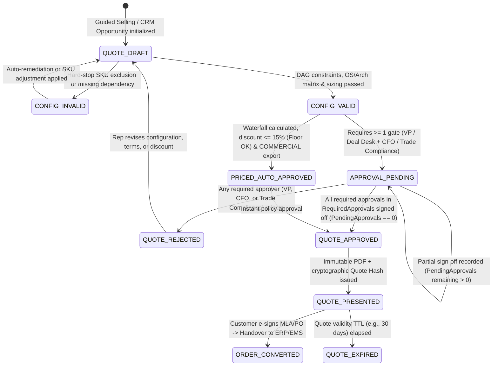

# The Product Management Lifecycle for CPQ Workflows (TDD & UAT Specification)

The **Product Management Lifecycle for CPQ (Configure, Price, Quote) Workflows** is the specialized framework product managers (PMs), revenue operations (RevOps), and engineering teams use to design, validate, launch, and govern complex product catalogs, configuration constraint engines, pricing books, and quote-to-order pipelines. CPQ acts as the critical commercial and technical bridge between product development, enterprise sales, **[Quote Lifecycle Management (QLM)](quote-lifecycle-management-cpq.md)**, **[Contract Lifecycle Management (CLM)](contract-lifecycle-management-cpq.md)**, **[Asset Lifecycle Management (ALM)](asset-lifecycle-management-cpq.md)**, and downstream fulfillment ([On-Premises L2F](lead-to-fulfillment-onprem.md) and [SaaS L2F](lead-to-fulfillment-saas.md)).

Because a single defect in CPQ rules can allow technically impossible deployments to be sold, violate export controls, or miscalculate legally binding contracts, this specification integrates **Test-Driven Development (TDD)**, **deterministic rule evaluation**, **extend-only catalog write-gates**, and **executable User Acceptance Testing (UAT)** tailored to the **Project Aegis** (`.NET 8` / C# / xUnit) architecture and product suite.

---

## Part I: The Five Phases of the CPQ Product Management Lifecycle

### 1. Discovery, Scoping & Deterministic Catalog Data Modeling
The lifecycle begins with translating commercial strategy and technical architecture into an explicit, machine-verifiable product catalog schema.
* **Persona & Friction Identification:** Interviewing Sales Operations, Account Executives, Solutions Engineers (SEs), and Deal Desk teams to identify quoting bottlenecks, manual spreadsheet overrides, and historical configuration errors (e.g., selling an air-gapped defense deployment without an offline activation bundle).
* **Product Relationship & Dependency Graph (DAG) Mapping:** Modeling parent-child bundle hierarchies, mandatory inclusion dependencies (`REQUIRES`), mutual exclusion constraints (`EXCLUDES`), and quantity co-scaling rules (`SCALES_WITH`) as a cycle-free Directed Acyclic Graph (DAG).
* **Attribute & Environment Matrix Definition:** Defining strongly typed configuration dimensions that drive compatibility and pricing—such as Deployment Mode (`CONNECTED`, `PROXY_RESTRICTED`, `AIR_GAPPED`), Target OS/Architecture (`RHEL_9_X86_64`, `UBUNTU_22_AARCH64`, `WIN_SERVER_2022`), Simulation Scale (CPU cores, concurrent theater entities, operator seats), and Security Clearance / Export Tier (`COMMERCIAL`, `ECCN_5D002`, `ITAR_RESTRICTED`).

### 2. Workflow Design, Configuration Guardrails & Approval Routing
The CPQ PM codifies commercial and architectural rules into deterministic software guardrails that prevent invalid quotes from advancing downstream.
* **Guided Selling Flow Design:** Structuring a deterministic, step-by-step discovery questionnaire (Mission Profile $\rightarrow$ Infrastructure Footprint $\rightarrow$ Modules & Content Packs $\rightarrow$ Support SLA Tier) that maps buyer requirements to a valid Bill of Materials (BoM).
* **Hard-Stop Constraint & Compatibility Rules:** Enforcing real-time validation gates that block incompatible SKU combinations (e.g., selecting the *Unity C2 Presentation Adapter* without the *Core Simulation & Delegation Spine*, or selecting *Cloud Telemetry Sidecar* in an *Air-Gapped* environment) with actionable remediation messages.
* **Dynamic Approval Chain Architecture:** Designing deterministic, multi-stage workflow routing based on discount thresholds, non-standard payment terms, or technical exceptions (e.g., *Line discount $\le 15\%$ auto-approves; $> 15\%$ and $\le 30\%$ routes to Regional VP of Sales; $> 30\%$ or custom EULA/MLA terms route to Deal Desk + CFO; `ITAR_RESTRICTED` SKUs route to Trade Compliance Officer*).

### 3. Price Book, Discount Strategy & Revenue Allocation Management
This phase guarantees that the pricing waterfall calculates list prices, tiered discounts, margins, and accounting allocations with zero floating-point drift.
* **Multi-Dimensional Pricing Engine Modeling:** Supporting hybrid monetization models across a single quote—including perpetual node/core licenses, annual Maintenance & Support (% of net license), recurring term subscriptions (MRR/ARR), tiered volume/graduated brackets, and fixed-fee Professional Services implementation packages.
* **Pricing Waterfall & Margin Floor Control:** Enforcing a strict, ordered calculation waterfall (`List Price` $\rightarrow$ `Volume/Tier Adjustment` $\rightarrow$ `Bundle/Promotional Discount` $\rightarrow$ `Discretionary Rep Discount` $\rightarrow$ `Net Price`) with hard floor-price guardrails and minimum gross-margin locks.
* **Multi-Currency, Localization & ASC 606 SSP Mapping:** Applying pinned foreign-exchange (FX) conversion tables with banker's rounding (`MidpointRounding.ToEven`), regional tax/VAT rules, and **ASC 606 / IFRS 15** Standalone Selling Price (SSP) allocations so upfront license revenue and ratable support revenue split accurately to the cent.

### 4. TDD Implementation, Combinatorial QA & Staged Rollout
Because CPQ changes directly affect active deals and ERP ledgers, catalog and rule updates follow an **extend-only staged write-gate** and rigorous automated verification before release.
* **Staged Catalog Write-Gate (`Propose` $\rightarrow$ `Validate` $\rightarrow$ `Approve`):** Modeled on Project Aegis's `CatalogWriteGate` pattern, CPQ catalog mutations (new SKUs, price book versions, constraint rules) are authored as immutable JSON/markdown fixtures, validated in a staging gate, and promoted as version-locked snapshots so in-flight quotes remain bound to their original catalog snapshot version.
* **Property-Based & Combinatorial Matrix Testing:** Running automated xUnit `[Theory]` suites and pairwise combinatorial generators across thousands of SKU/attribute permutations to prove the engine never produces negative prices, `NaN`/rounding drift, circular dependency deadlocks, or orphaned approval states.
* **Cross-System Contract Verification & Shadow UAT:** Verifying schema contracts across `CRM` $\leftrightarrow$ `CPQ` $\leftrightarrow$ `ERP` $\leftrightarrow$ `Entitlement Management System (EMS)`, replaying golden quote fixtures against candidate price books, and executing role-based UAT with Sales, Deal Desk, and Finance prior to production activation.

### 5. Post-Launch Telemetry, Governance & Lifecycle Optimization
The final phase continuously measures quoting performance and retires catalog technical debt without breaking historical renewals or amendments.
* **Funnel & Velocity Analytics:** Tracking operational KPIs including **Time-to-Quote (TTQ)**, **First-Time-Right Quote Accuracy Rate (% of quotes requiring zero Deal Desk rework)**, approval cycle latency per tier, and rule-violation frequency by SKU.
* **Catalog Hygiene & Sunset Governance:** Managing SKU lifecycle states (`DRAFT` $\rightarrow$ `ACTIVE` $\rightarrow$ `GRANDFATHERED_RENEWAL_ONLY` $\rightarrow$ `END_OF_SALE` $\rightarrow$ `END_OF_SUPPORT`), ensuring deprecated SKUs cannot be quoted to net-new prospects while preserving mid-term co-terming and renewal paths for existing customers.
* **Feedback-Driven Backlog Iteration:** Converting frequent constraint exceptions, rep override requests, and Deal Desk bottlenecks into new TDD test cases and guided-selling refinements for subsequent CPQ releases.

---

## Part II: Project Aegis TDD Architecture for CPQ Workflows

To align with **Project Aegis** engineering standards ([`AGENTS.md`](../../AGENTS.md) and [`determinism-and-replay.md`](../../docs/engineering/determinism-and-replay.md)), the CPQ domain is modeled using immutable C# records, pure deterministic evaluators, staged write-gates, and golden regression fixtures.

### 1. CPQ Quote & Catalog Lifecycle State Machine



### 2. Core TDD Domain Invariants (Red-Green-Refactor Contracts)

Every CPQ domain component must enforce these deterministic invariants in unit and contract tests:

1. **DAG Acyclicity & Closure Invariant (`INV-CPQ-DAG-01`):** A catalog snapshot cannot be approved through the write-gate if its `REQUIRES` / `EXCLUDES` graph contains a directed cycle ($A \rightarrow B \rightarrow A$) or a contradictory constraint ($A \text{ REQUIRES } B$ and $A \text{ EXCLUDES } B$).
2. **Hard-Stop Constraint Completeness Invariant (`INV-CPQ-CFG-01`):** A quote cannot transition from `QUOTE_DRAFT` to `CONFIG_VALID` if any active SKU violates an OS/architecture compatibility rule, misses a required parent/companion SKU, or violates deployment isolation constraints (e.g., `AIR_GAPPED` quote must include `SKU-OFFLINE-ACT-BUNDLE` and exclude cloud-only SKUs).
3. **Deterministic Pricing Waterfall & Currency Invariant (`INV-CPQ-PRC-01`):** All monetary calculations must use 128-bit `decimal` arithmetic (never `float` or `double`), apply discounts in strict canonical sequence (`List` $\rightarrow$ `Tier` $\rightarrow$ `Promo` $\rightarrow$ `Discretionary`), round only at defined ledger boundaries using `MidpointRounding.ToEven`, and enforce `net_unit_price >= sku.floor_price` unless an explicit `CFO_FLOOR_OVERRIDE` token is attached.
4. **Monotonic & Cumulative Approval Routing Invariant (`INV-CPQ-APR-01`):** The required approval set `RequiredApprovals` is a pure, deterministic, cumulative function of `(max_line_discount_pct, total_blended_discount_pct, margin_pct, export_classification, payment_terms_days)`. Lowering a price, extending net payment terms (e.g., `Net 30` $\rightarrow$ `Net 90`), or adding an export-controlled SKU must only add to (never remove from) `RequiredApprovals`, and transitioning from `APPROVAL_PENDING` to `QUOTE_APPROVED` requires **every** gate in `RequiredApprovals` to be satisfied (`PendingApprovals.Count == 0`).
5. **Catalog Snapshot Immutability & Pinning Invariant (`INV-CPQ-SNAP-01`):** Every quote binds to an immutable `catalog_snapshot_sha256` and `pricebook_version` at creation. Publishing a new catalog version (`v2026.11`) via the write-gate must never mutate prices or invalidate configurations of quotes already in `QUOTE_APPROVED` or `QUOTE_PRESENTED` states.
6. **ASC 606 SSP Penny-Exact Allocation Invariant (`INV-CPQ-REV-01`):** When a bundled quote is discounted, the discount must be allocated across performance obligations (`PERPETUAL_LICENSE`, `MAINTENANCE_SUPPORT`, `PRO_SERVICES`) proportional to their Standalone Selling Prices (SSP), with any $0.01 rounding remainder deterministically assigned to the highest-SSP line item so $\sum \text{allocated\_net\_amounts} == \text{quote\_total\_net\_amount}$.
7. **Golden Quote Fingerprint Invariant (`INV-CPQ-HASH-01`):** Given the same `(CatalogSnapshotHash, QuoteInputRequest)`, the engine must emit a bit-for-bit identical `QuoteCanonicalFingerprint` (SHA-256 hex over culture-invariant formatted line items, discounts, approvals, and SSP allocations).

### 3. Project Aegis C# Domain Contracts & Test Naming Conventions

Following `AGENTS.md` conventions (`sealed record`, `readonly record struct`, no `DateTime.UtcNow` or `double` in pricing/rule paths, xUnit `[Scenario]_[Expected]` naming):

```csharp
namespace ProjectAegis.Cpq.Domain;

public enum DeploymentIsolationMode { Connected, ProxyRestricted, AirGapped }
public enum ApprovalTier { AutoApproved, RegionalVp, DealDeskCfo, TradeCompliance }
public enum SkuLifecycleState { Draft, Active, GrandfatheredRenewalOnly, EndOfSale }

public readonly record struct Money(decimal Amount, string CurrencyIso3);

public sealed record CpqQuoteLine(
    string SkuCode,
    int Quantity,
    Money ListUnitPrice,
    decimal TierDiscountPct,
    decimal DiscretionaryDiscountPct,
    Money NetLineTotal,
    Money SspAllocatedRevenue);

public sealed record CpqEvaluationResult(
    bool IsConfigurationValid,
    IReadOnlyList<string> ConstraintErrorCodes,
    IReadOnlyList<ApprovalTier> RequiredApprovals,
    Money TotalListPrice,
    Money TotalNetPrice,
    string CatalogSnapshotSha256,
    string QuoteCanonicalFingerprintSha256);
```

**TDD Test Pyramid & xUnit Mapping:**

| Test Layer | Assembly / Location | Target System Under Test (SUT) | Naming Convention (`[Scenario]_[Expected]`) | Execution Budget |
| :--- | :--- | :--- | :--- | :--- |
| **1. Pure Domain Unit Tests** | `src/ProjectAegis.Cpq.Tests/` | `DagConstraintEvaluator`, `PricingWaterfallCalculator`, `ApprovalMatrixRouter`, `Asc606SspAllocator` | `AirGappedQuoteWithoutOfflineBundle_ReturnsMissingDependencyError` | $< 10\text{ ms}$ per `[Fact]` / `[Theory]` |
| **2. Write-Gate & Snapshot Tests** | `src/ProjectAegis.Data.Tests/` | `CpqCatalogWriteGate`, `PriceBookSnapshotSerializer` | `ProposeCatalogWithCyclicRequiresRule_RejectsBeforeApproval` | $< 100\text{ ms}$ (in-memory SQLite) |
| **3. Golden Regression Tests** | `tests/regression/cpq-golden-*.txt` | `CpqGoldenReplaySuiteTests` | `BalticEnterpriseDefenseBundle_MatchesPinnedQuoteFingerprint` | $< 250\text{ ms}$ for full golden catalog |
| **4. End-to-End UAT Scenarios** | `tests/uat/cpq-product-management-lifecycle.md` | Full Guided Selling $\rightarrow$ CPQ $\rightarrow$ Deal Desk $\rightarrow$ ERP/EMS handoff | `UAT-CPQ-01` through `UAT-CPQ-06` | Pre-release & catalog rollout gate |

---

## Part III: Executable User Acceptance Testing (UAT) Scenarios

The following Behavior-Driven Development (BDD / Gherkin) scenarios define the mandatory UAT gates across all five phases of the CPQ Product Management Lifecycle.

### UAT-CPQ-01: Catalog DAG Modeling, Write-Gate Validation & Dependency Enforcement (Phase 1)
```gherkin
Feature: Product Catalog Dependency Graph and Staged Write-Gate Validation
  As a CPQ Product Manager
  I want catalog bundle rules and attribute matrices validated via a staged write-gate
  So that cyclic dependencies or contradictory SKU rules can never reach production

  Scenario: Staged write-gate rejects a catalog proposal containing a circular dependency
    Given an active catalog snapshot "CAT-2026-Q4" in the CatalogWriteGate
    When the CPQ PM proposes a rule change where:
      | Source_SKU                | Relation | Target_SKU                |
      | AEGIS-MOD-DELEGATION      | REQUIRES | AEGIS-CORE-SIM-ENGINE     |
      | AEGIS-CORE-SIM-ENGINE     | REQUIRES | AEGIS-MOD-DELEGATION      |
    Then the CatalogWriteGate validation step MUST reject the proposal with error "ERR_CPQ_DAG_CYCLE_DETECTED"
    And the active production snapshot "CAT-2026-Q4" MUST remain unchanged

  Scenario: Validating Project Aegis module dependencies and exclusion rules
    Given active catalog snapshot "CAT-2026-Q4" defines:
      | Source_SKU                | Relation | Target_SKU                |
      | AEGIS-ADAPTER-UNITY-C2    | REQUIRES | AEGIS-CORE-SIM-ENGINE     |
      | AEGIS-ADAPTER-UNITY-C2    | REQUIRES | AEGIS-MOD-DELEGATION      |
      | AEGIS-ENV-AIRGAP-DEFENSE  | EXCLUDES | AEGIS-ADDON-CLOUD-HINDSIGHT |
      | AEGIS-ENV-AIRGAP-DEFENSE  | REQUIRES | AEGIS-LIC-OFFLINE-C2V     |
    When a Solutions Engineer selects "AEGIS-ADAPTER-UNITY-C2" and "AEGIS-ENV-AIRGAP-DEFENSE"
    Then the CPQ engine MUST automatically suggest adding "AEGIS-CORE-SIM-ENGINE", "AEGIS-MOD-DELEGATION", and "AEGIS-LIC-OFFLINE-C2V"
    And the UI MUST disable selection of "AEGIS-ADDON-CLOUD-HINDSIGHT" with reason "Excluded by Air-Gapped Defense Environment"
```

### UAT-CPQ-02: Guided Selling Guardrails & Dynamic Approval Routing (Phase 2)
```gherkin
Feature: Guided Selling Questionnaire, Hard-Stop Validation, and Approval Matrix Routing
  As an Account Executive and Deal Desk Analyst
  I want guided selling to prevent invalid configurations and route discounts to the proper approvers
  So that every submitted quote is technically deployable and commercially compliant

  Scenario: Hard-stop blocks submission of an air-gapped quote missing mandatory offline activation SKU
    Given an Account Executive configures Quote "Q-2026-501" with Deployment Mode "AIR_GAPPED"
    And manually removes "AEGIS-LIC-OFFLINE-C2V" from the quote lines
    When the Account Executive attempts to transition the quote from "QUOTE_DRAFT" to "CONFIG_VALID"
    Then the CPQ guardrail engine MUST block the transition with error "ERR_MISSING_REQUIRED_SKU: AEGIS-LIC-OFFLINE-C2V"
    And provide a one-click remediation action "Add Offline C2V Activation Bundle ($0.00 included entitlement)"

  Scenario Outline: Dynamic approval chain routes quotes by discount tier, payment terms, and export control
    Given a technically valid Quote "Q-2026-502" with list price "$200,000"
    When the rep applies a discretionary discount of <discount_pct>% with payment terms "<payment_terms>" and export tier "<export_tier>"
    Then the quote state MUST transition to "<expected_state>"
    And the cumulative required approval set MUST be "<approval_queue>"

    Examples:
      | discount_pct | payment_terms | export_tier   | expected_state       | approval_queue                                        |
      | 10.0         | Net 30        | COMMERCIAL    | PRICED_AUTO_APPROVED | AUTO_APPROVE                                          |
      | 22.5         | Net 30        | COMMERCIAL    | APPROVAL_PENDING     | REGIONAL_VP_SALES                                     |
      | 35.0         | Net 30        | COMMERCIAL    | APPROVAL_PENDING     | DEAL_DESK + CFO                                       |
      | 10.0         | Net 90        | COMMERCIAL    | APPROVAL_PENDING     | DEAL_DESK + CFO                                       |
      | 5.0          | Net 30        | ITAR_DEFENSE  | APPROVAL_PENDING     | TRADE_COMPLIANCE_OFFICER                              |
      | 22.5         | Net 30        | ITAR_DEFENSE  | APPROVAL_PENDING     | REGIONAL_VP_SALES + TRADE_COMPLIANCE_OFFICER          |
      | 35.0         | Net 30        | ITAR_DEFENSE  | APPROVAL_PENDING     | DEAL_DESK + CFO + TRADE_COMPLIANCE_OFFICER            |

  Scenario: Cumulative approval gate prevents QUOTE_APPROVED until both commercial and export compliance sign-offs complete
    Given Quote "Q-2026-503" is in state "APPROVAL_PENDING" with cumulative required approvals "DEAL_DESK + CFO + TRADE_COMPLIANCE_OFFICER"
    When "DEAL_DESK" and "CFO" record their commercial sign-offs
    Then the quote state MUST remain "APPROVAL_PENDING" with remaining pending approval "TRADE_COMPLIANCE_OFFICER"
    When "TRADE_COMPLIANCE_OFFICER" subsequently records export control clearance
    Then "PendingApprovals" MUST be empty and the quote state MUST transition to "QUOTE_APPROVED"
```

### UAT-CPQ-03: Multi-Dimensional Price Book Waterfall, Floor Locks & ASC 606 Allocation (Phase 3)
```gherkin
Feature: Deterministic Pricing Waterfall, Margin Floor Enforcement, and ASC 606 SSP Allocation
  As a RevOps Pricing Manager and Finance Controller
  I want multi-tiered pricing, currency conversions, and ASC 606 revenue splits calculated deterministically
  So that quotes never breach margin floors or cause penny-rounding discrepancies in ERP ledgers

  Scenario: Graduated core-tier pricing waterfall with promotional and discretionary discounts
    Given Price Book "PB-2026-USD-ENT" defines graduated core pricing for "AEGIS-CORE-SIM-ENGINE":
      | Tier_Band     | Cores_Range | Unit_Price_Per_Core | Floor_Price_Per_Core |
      | Tier 1        | 1 - 32      | $1,500.00           | $1,000.00            |
      | Tier 2        | 33 - 64     | $1,200.00           | $800.00              |
    And "AEGIS-SUP-PLATINUM" Maintenance & Support is priced at 20% of Net License Price (Floor: $15,000.00)
    When a quote is configured for 64 cores with a 10% promotional bundle discount and a 10% rep discretionary discount
    Then the Tiered List License Price MUST equal "$86,400.00" (32 * $1,500 + 32 * $1,200)
    And after the compound waterfall (10% promo -> $77,760.00; 10% rep -> $69,984.00), Net License Price MUST equal "$69,984.00"
    And the Platinum Support Net Price MUST equal "$15,000.00" (since 20% of $69,984.00 = $13,996.80 is clamped to the $15,000.00 floor)
    And Total Quote Net Price MUST equal "$84,984.00" with deterministic SHA-256 quote fingerprint verification

  Scenario: Penny-exact ASC 606 SSP allocation across bundled license, support, and onboarding services
    Given a bundled quote with Total Net Price "$100,000.00" (discounted from "$130,000.00" total SSP):
      | Line_Item           | Revenue_Recognition_Type | Standalone_Selling_Price (SSP) |
      | AEGIS-CORE-64       | POINT_IN_TIME_LICENSE    | $90,000.00                     |
      | AEGIS-SUP-1YR       | RATABLE_12_MONTHS        | $25,000.00                     |
      | AEGIS-PS-DEPLOY     | MILESTONE_COMPLETION     | $15,000.00                     |
    When the ASC 606 SSP Allocator computes the revenue split using MidpointRounding.ToEven
    Then the allocated revenue amounts MUST be:
      | Line_Item           | Allocated_Net_Revenue |
      | AEGIS-CORE-64       | $69,230.77            |
      | AEGIS-SUP-1YR       | $19,230.77            |
      | AEGIS-PS-DEPLOY     | $11,538.46            |
    And the sum of allocated net revenue MUST equal exactly "$100,000.00" with "$0.00" unallocated variance
```

### UAT-CPQ-04: Combinatorial Matrix QA, Snapshot Pinning & Downstream ERP/EMS Handover (Phase 4)
```gherkin
Feature: Combinatorial Quote Verification, Snapshot Isolation, and Order-to-Fulfillment Handover
  As a Release Engineer and Fulfillment Operations Lead
  I want new catalog rollouts isolated from in-flight quotes and verified against downstream ERP/EMS contracts
  So that catalog updates never corrupt active customer negotiations or entitlement minting

  Scenario: In-flight presented quote remains pinned to its original catalog snapshot during a price increase rollout
    Given Quote "Q-2026-610" is in state "QUOTE_PRESENTED" bound to catalog snapshot "CAT-2026-Q3" at "$84,984.00"
    When the CPQ PM approves and activates catalog snapshot "CAT-2026-Q4" which raises list prices by 12%
    And the customer e-signs Quote "Q-2026-610" within its 30-day validity window
    Then the CPQ-to-ERP conversion payload MUST honor snapshot "CAT-2026-Q3" at exactly "$84,984.00"
    And only net-new quotes or explicitly re-versioned quotes MUST evaluate against "CAT-2026-Q4"

  Scenario: Converted CPQ quote dispatches idempotent entitlement payload to On-Premises EMS
    Given Quote "Q-2026-610" transitions to "ORDER_CONVERTED" upon Purchase Order "PO-99201"
    When the CPQ Order Handover service emits the fulfillment event to the ERP and Entitlement Management System (EMS)
    Then the payload MUST contain the exact hardware sizing parameters (`max_cores: 64`, `mode: AIR_GAPPED`, `skus: [...]`)
    And replaying the webhook event 3 times with the same `idempotency_key` MUST produce exactly 1 ERP invoice and 1 EMS entitlement record
```

### UAT-CPQ-05: SKU Sunset Governance, Grandfathered Renewals & Co-Terming (Phase 5)
```gherkin
Feature: Post-Launch SKU Deprecation, Grandfathered Renewal Protection, and Telemetry Governance
  As a CPQ Product Manager and Customer Success Operations Lead
  I want legacy SKUs blocked for new prospects while permitting renewals and mid-term capacity add-ons
  So that we reduce catalog technical debt without disrupting existing enterprise deployments

  Scenario: End-of-Sale SKU is blocked on net-new prospect quotes but allowed on grandfathered renewal quotes
    Given SKU "AEGIS-BALTIC-V1-PACK" has lifecycle state "GRANDFATHERED_RENEWAL_ONLY" and replacement SKU "AEGIS-BALTIC-V3-PACK"
    When a Sales Rep creates a "NET_NEW" quote and searches the catalog for "AEGIS-BALTIC-V1-PACK"
    Then the SKU MUST be hidden from guided selling and rejected by the API with "ERR_SKU_NOT_AVAILABLE_FOR_NEW_BUSINESS"
    And the system MUST suggest replacement SKU "AEGIS-BALTIC-V3-PACK"
    When a Renewal Specialist generates an "ANNUAL_RENEWAL" quote for an existing customer holding an active entitlement to "AEGIS-BALTIC-V1-PACK"
    Then the renewal quote MUST permit "AEGIS-BALTIC-V1-PACK" or offer a guided migration path to "AEGIS-BALTIC-V3-PACK"
```

---

## Part IV: Requirements Traceability, KPIs & UAT Sign-Off Matrix

| Phase | Requirement ID | Domain Invariant | TDD Test Suite (`ProjectAegis.*.Tests`) | UAT Scenario | Operational KPI & Pass Threshold | Sign-Off Owner |
| :--- | :--- | :--- | :--- | :--- | :--- | :--- |
| **1. Discovery & Data Modeling** | `REQ-CPQ-01` | `INV-CPQ-DAG-01` (DAG acyclicity & attribute matrix) | `CatalogDagValidatorTests`, `CpqCatalogWriteGateTests` | `UAT-CPQ-01` | $0$ cyclic or contradictory rules admitted; $100\%$ of incompatible OS/Arch combinations caught. | CPQ Product Manager / Data Architect |
| **2. Workflow & Guardrails** | `REQ-CPQ-02` | `INV-CPQ-CFG-01`, `INV-CPQ-APR-01` (Hard-stops & monotonic routing) | `GuidedSellingConstraintTests`, `ApprovalMatrixRouterTests` | `UAT-CPQ-02` | $100\%$ of invalid configurations blocked pre-submission; approval routing latency $< 50\text{ ms}$. | Sales Ops / Deal Desk Lead |
| **3. Price Book & Discounting** | `REQ-CPQ-03` | `INV-CPQ-PRC-01`, `INV-CPQ-REV-01` (`decimal` waterfall & ASC 606 SSP) | `PricingWaterfallCalculatorTests`, `Asc606SspAllocatorTests`, `MultiCurrencyRoundingTests` | `UAT-CPQ-03` | $0$ penny-rounding variance across 10,000 `[Theory]` permutations; floor breaches $100\%$ gated. | Finance Controller / RevOps Lead |
| **4. Testing & Deployment** | `REQ-CPQ-04` | `INV-CPQ-SNAP-01`, `INV-CPQ-HASH-01` (Snapshot pinning & golden hash) | `CpqGoldenReplaySuiteTests`, `QuoteSnapshotIsolationTests`, `ErpEmsHandoverContractTests` | `UAT-CPQ-04` | Golden quote fingerprints $100\%$ bit-for-bit reproducible; 0 in-flight quotes mutated by catalog rollout. | Release Engineering / QA Lead |
| **5. Post-Launch Governance** | `REQ-CPQ-05` | SKU lifecycle state machine & TTQ telemetry | `SkuLifecycleGovernanceTests`, `CoTermRenewalCalculationTests` | `UAT-CPQ-05` | Time-to-Quote (TTQ) $< 3\text{ min}$ for standard bundles; First-Time-Right quote accuracy $\ge 99.5\%$. | VP Revenue Operations |

### UAT Entry & Exit Criteria

* **UAT Entry Criteria (Pre-Sandbox Promotion):**
  1. All TDD unit, write-gate, and combinatorial `[Theory]` tests pass (`0 errors, 0 warnings`) with $100\%$ branch coverage on `PricingWaterfallCalculator`, `DagConstraintEvaluator`, `ApprovalMatrixRouter`, and `Asc606SspAllocator`.
  2. Static determinism audit confirms zero use of binary floating-point (`float`/`double`), `DateTime.UtcNow`, or unordered dictionary iteration in pricing or fingerprint calculation paths.
  3. Golden quote regression suite (`tests/regression/cpq-golden-*.txt`) passes 100% intra-run (`Run A == Run B`) and baseline hash comparisons.
* **UAT Exit Criteria (Production Price Book / Catalog Activation Gate):**
  1. All five UAT feature suites (`UAT-CPQ-01` through `UAT-CPQ-05`) pass in staging with zero open Severity-1 or Severity-2 defects.
  2. End-to-end handover verified from `ORDER_CONVERTED` via [Contract Lifecycle Management (CLM)](contract-lifecycle-management-cpq.md) into both [On-Premises L2F](lead-to-fulfillment-onprem.md) (EMS license minting + ESD/air-gapped C2V activation) and [SaaS L2F](lead-to-fulfillment-saas.md) provisioning pipelines.
  3. Formal sign-off recorded by the CPQ Product Manager, Deal Desk Lead, Finance Controller, Release Engineering Lead, and Sales Operations Sponsor.
