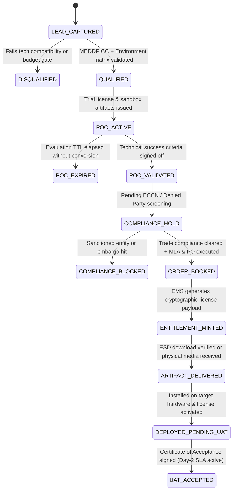

# The On-Premises Software Lead-to-Fulfillment (L2F) Process & UAT/TDD Specification

The **lead-to-fulfillment (L2F) process for on-premises software products** is the end-to-end lifecycle that transforms a prospective organization into an operational customer by delivering software binaries, cryptographic entitlements, and deployment artifacts for installation within a customer-managed environment (local data centers, bare-metal servers, or private clouds).

Unlike SaaS—where fulfillment occurs instantaneously via automated multi-tenant provisioning—on-premises fulfillment requires rigorous architectural sizing, export and trade compliance screening, cryptographic license generation, secure Electronic Software Delivery (ESD) or physical media distribution, and guided installation and acceptance verification.

This document serves both as the **cross-functional process specification** (spanning marketing, sales, solutions engineering, legal, finance, release engineering, and professional services) and as an **executable Test-Driven Development (TDD) and User Acceptance Testing (UAT) specification**.

---

## Part I: The Five Phases of On-Premises Lead-to-Fulfillment

### 1. Lead Generation, Capture & Qualification
The pipeline begins by identifying organizations that require strict data sovereignty, deterministic performance, regulatory isolation, or air-gapped operations.
* **Targeted Outbound & Regulated-Sector Marketing:** Focusing on verticals such as financial services, healthcare, telecommunications, public sector, and defense, where regulatory mandates or security policies restrict public cloud SaaS adoption.
* **Technical Lead Capture:** Gathering baseline environmental parameters alongside stakeholder contact data—including target operating systems (e.g., RHEL, Windows Server), hypervisors (e.g., VMware vSphere, Nutanix), container platforms (e.g., OpenShift, vanilla Kubernetes), and network isolation mode (`CONNECTED`, `PROXY_RESTRICTED`, or `AIR_GAPPED`).
* **Deep Discovery & Qualification:** Screening prospects using enterprise frameworks (e.g., MEDDPICC) alongside technical readiness criteria: hardware procurement timelines, database dependencies, internal IT administration capacity, and capital/operating budget (CapEx vs. OpEx).

### 2. Enterprise Sales, Sizing & Proof of Concept (PoC)
Because on-premises software runs on infrastructure the vendor does not control, the evaluation cycle requires thorough technical validation before commercial commitment.
* **Collaborative Architecture & Sizing:** Solutions Engineers (SEs) partner with the customer's infrastructure architects to validate reference architectures, compute/storage/network sizing, High Availability (HA) and Disaster Recovery (DR) topologies, and firewall port matrices.
* **Controlled PoC & Trial Fulfillment:** Issuing a time-bound evaluation license key and provisioning temporary access to pre-production binaries, virtual appliances (OVAs), or Helm charts so the prospect can validate functionality and performance against formal PoC success criteria in a sandbox lab.
* **Supply Chain & InfoSec Validation:** Providing Software Bills of Materials (SBOMs), vulnerability scan reports (CVEs), and cryptographic signing policies to satisfy the customer's Enterprise Architecture Review Board (ARB) and information security teams.

### 3. Order Processing, Compliance & Contract Execution
The transactional phase navigates complex legal, regulatory, and accounting requirements specific to self-hosted software distribution.
* **Master License Agreement (MLA) & Support Terms:** Negotiating custom enterprise terms governing intellectual property protections, audit rights, liability caps, and separate Maintenance & Support Service Level Agreements (SLAs) for bug fixes, security patches, and upgrade rights.
* **Entitlement Structuring & CPQ:** Configuring the Bill of Materials (BoM) in Configure-Price-Quote (CPQ) systems (see [CPQ Product Management Lifecycle](cpq-product-management-lifecycle.md))—defining licensing models (perpetual licenses with annual Maintenance & Support vs. fixed-term subscription licenses), DAG bundle dependencies, pricing waterfall guardrails, and enforcement metrics (CPU cores, sockets, nodes, cluster capacity, or named/concurrent users).
* **Export Control & Trade Compliance:** Executing automated Denied Party Screening and verifying Export Control Classification Numbers (ECCN / EAR / ITAR) prior to releasing dual-use or strong-cryptography software artifacts.
* **Purchase Order (PO), ERP & Revenue Recognition:** Processing formal corporate POs through ERP systems (e.g., SAP, Oracle NetSuite), issuing net-term invoices, and splitting revenue recognition in accordance with **ASC 606 / IFRS 15** (recognizing distinct license revenue upon delivery/key availability versus ratable recognition for ongoing support and maintenance).

### 4. Software Product Fulfillment & Entitlement Delivery
Fulfillment is executed via Entitlement Management Systems (EMS) and Electronic Software Delivery (ESD) portals—or physical media for classified/air-gapped environments.
* **Cryptographic License Generation:** The licensing engine (e.g., Flexera, Thales Sentinel, Reprise, or an internal Ed25519/RSA signing service) mints a license file, activation token, or license server certificate bound to the customer's entitlement ID and hardware fingerprint (e.g., MAC address, host UUID, or HSM dongle). For air-gapped deployments, offline challenge-response activation files are generated.
* **Artifact Packaging & Integrity Verification:** Release engineering publishes version-locked production binaries, OS packages (`.rpm`, `.deb`, `.msi`), virtual machine images (`.ova`, `.qcow2`), or container bundles and Helm charts, accompanied by SHA-256 checksums, GPG/Cosign digital signatures, and offline dependency bundles.
* **Secure Delivery (ESD or Physical Media):** Granting the customer's designated system administrators authenticated access to an enterprise download portal or private registry (e.g., JFrog Artifactory, Harbor, or customer portal) to pull signed artifacts—or shipping tamper-evident, encrypted physical media for strictly air-gapped facilities.

### 5. Deployment, Acceptance Verification & Day-2 Handoff
Fulfillment concludes when the software is verified operational within the customer's perimeter and transitions into long-term lifecycle support.
* **Professional Services & TAM Handover:** Transitioning the account from Sales/SEs to Professional Services Engineers or Technical Account Managers (TAMs) with a documented implementation blueprint.
* **Environment Deployment & Enterprise Integration:** Installing the software across target nodes, applying cryptographic license keys, integrating with enterprise identity providers (Active Directory, LDAP, SAML/OIDC), connecting external databases and secret stores (e.g., HashiCorp Vault), and configuring observability/log forwarding (SIEM/Syslog).
* **User Acceptance Testing (UAT) & Sign-Off:** Executing formal post-installation health checks, failover tests, and UAT scripts. Customer sign-off on the Certificate of Acceptance formally closes the implementation milestone and transitions the deployment to Day-2 Support.
* **Lifecycle & Patch Management:** Establishing ongoing cadence for security advisories, minor/major version upgrades, annual license true-ups or renewals, and telemetry/usage reporting.

---

## Part II: Domain State Machine & Invariants (TDD Specification)

To support **Test-Driven Development (TDD)** across CRM, CPQ, ERP, Entitlement Management (EMS), and Electronic Software Delivery (ESD) services, implementations must enforce the following state machine and domain invariants.

### 1. L2F Lifecycle State Machine



### 2. Core Domain Invariants (Red-Green-Refactor TDD Contracts)
Every service implementation must satisfy these deterministic unit and integration test contracts before promotion:

1. **Compatibility Gate Invariant (`INV-QUAL-01`):** A lead cannot transition to `QUALIFIED` or `POC_ACTIVE` unless the target OS, CPU instruction set (`x86_64` / `aarch64`), kernel version, and connectivity mode (`CONNECTED` | `AIR_GAPPED`) match the supported Release Matrix.
2. **PoC Time-Bomb & Watermark Invariant (`INV-POC-01`):** Evaluation licenses (`license_type = EVALUATION`) must enforce a hard maximum TTL (e.g., $\le 30$ days), disallow production cluster scale limits, and reject renewal without an approved Deal Desk exception token.
3. **Trade Compliance Hard-Stop Invariant (`INV-COMP-01`):** The Entitlement Management System (EMS) and ESD portal must reject any license generation or binary download request if `trade_compliance_status != CLEARED` or if the requesting IP/organization matches an active OFAC/BIS/EU denied-party record.
4. **ASC 606 Revenue Split Invariant (`INV-FIN-01`):** For any booked order containing both an on-premises license SKU and a Maintenance & Support SKU, the billing engine must split the transaction price according to Standalone Selling Price (SSP) allocations: recognizing the license allocation at point-in-time (`ENTITLEMENT_MINTED` + `ARTIFACT_DELIVERED`) and deferring the support allocation ratably over the contract term ($\sum \text{allocations} == \text{total\_po\_amount}$).
5. **Cryptographic Binding & Tamper Invariant (`INV-ENT-01`):** Production licenses must be signed with the vendor's private key (Ed25519/RSA-4096) and bound to at least one immutable customer hardware fingerprint (`host_uuid`, `mac_address`, `tpm_ek_pub`, or `cluster_id`). Modifying any byte of the license payload (e.g., `max_cores`, `expiry_date`, or `customer_id`) must cause signature verification to fail in $< 10\text{ ms}$ with `ERR_LICENSE_SIGNATURE_INVALID`.
6. **Air-Gapped Zero-Egress Invariant (`INV-AIR-01`):** When deployed with `connectivity_mode = AIR_GAPPED`, the software and license verifier must perform zero outbound DNS queries or HTTP/TCP telemetry calls to external vendor endpoints; activation must succeed solely via an offline Challenge-to-Vendor (`C2V`) / Vendor-to-Customer (`V2C`) signed token exchange.
7. **Idempotent Fulfillment Invariant (`INV-IDEM-01`):** Duplicate ERP webhook dispatches for the same `purchase_order_id` and `entitlement_line_id` must return the existing `entitlement_id` without minting duplicate license seats or emitting duplicate invoice ledger entries.

### 3. TDD Test Pyramid Mapping

| Test Layer | Scope | Target Components | Execution SLA |
| :--- | :--- | :--- | :--- |
| **Unit Tests (TDD Core)** | Pure domain logic, cryptographic signing/verification, hardware fingerprint parsers, capacity enforcement math, ASC 606 SSP calculators, state machine guards. | `LicenseSigner`, `LicenseVerifier`, `CompatibilityValidator`, `RevenueAllocator`, `OrderStateMachine` | $< 50\text{ ms}$ per test; zero network/DB I/O |
| **Integration & Contract Tests** | Cross-service API contracts (OpenAPI / AsyncAPI), webhook idempotency, database transactions, registry token scoping, SBOM/Cosign signature verification. | CRM $\leftrightarrow$ CPQ $\leftrightarrow$ ERP $\leftrightarrow$ EMS $\leftrightarrow$ ESD Portal (Artifactory/Harbor) | $< 2\text{ s}$ per test via Testcontainers |
| **End-to-End & UAT Tests** | Full lifecycle workflows from lead capture to air-gapped/connected binary installation, enterprise IdP integration, HA failover, and UAT sign-off. | Staging appliance / Kubernetes cluster + simulated customer perimeter | Automated nightly + pre-release UAT gate |

---

## Part III: Executable User Acceptance Testing (UAT) Scenarios

The following Behavior-Driven Development (BDD / Gherkin) scenarios define the mandatory acceptance gates across the five L2F phases.

### UAT-01: Technical Lead Qualification & Environment Compatibility Gate (Phase 1)
```gherkin
Feature: Technical Lead Capture and Architectural Qualification
  As a Solutions Engineer
  I want incoming enterprise leads validated against the supported infrastructure matrix
  So that incompatible environments are flagged before PoC provisioning

  Scenario: Prospect with supported RHEL air-gapped environment qualifies for PoC
    Given a prospect in the "Defense" vertical submits a technical lead form
    And the target environment specifies OS "RHEL 9.4", architecture "x86_64", cores "64", and network mode "AIR_GAPPED"
    When the Qualification Service evaluates the technical profile against Release Matrix "v4.2"
    Then the compatibility status MUST be "SUPPORTED"
    And the fulfillment routing profile MUST be set to "OFFLINE_BUNDLE_AND_CHALLENGE_RESPONSE"
    And the lead state MUST transition from "LEAD_CAPTURED" to "QUALIFIED"

  Scenario: Prospect with unsupported legacy OS is blocked from automated PoC provisioning
    Given a prospect submits a technical lead form with OS "CentOS 6.10" and architecture "i386"
    When the Qualification Service evaluates the technical profile against Release Matrix "v4.2"
    Then the compatibility status MUST be "UNSUPPORTED"
    And the system MUST return error code "ERR_ENV_INCOMPATIBLE" with remediation "Requires RHEL 8.8+ or Ubuntu 22.04+ on x86_64/aarch64"
    And the lead state MUST remain "LEAD_CAPTURED" pending architectural remediation
```

### UAT-02: Controlled PoC Provisioning & Evaluation License Expiry (Phase 2)
```gherkin
Feature: Time-Bound Proof of Concept (PoC) Fulfillment
  As a Prospect Infrastructure Architect
  I want a time-bound trial license and signed pre-production appliance
  So that I can validate software functionality and InfoSec compliance in my test lab

  Scenario: Issuing a 30-day evaluation license with SBOM and CVE attestation
    Given a lead in state "QUALIFIED" has an approved PoC Charter "POC-2026-8841"
    When the Solutions Engineer triggers PoC provisioning for version "v4.2.0"
    Then the EMS MUST generate an evaluation license with:
      | license_type | max_cores | validity_days | watermark_enabled |
      | EVALUATION   | 16        | 30            | true              |
    And the ESD portal MUST grant temporary download access to the signed OVA, SPDX SBOM, and Cosign public key
    And the lead state MUST transition to "POC_ACTIVE"

  Scenario: Evaluation license enforces expiry after 30 days
    Given an on-premises PoC instance is running with an "EVALUATION" license issued 31 days ago
    When a user attempts to execute a workload or API request on the PoC instance
    Then the license enforcement middleware MUST reject the request with HTTP 402 / "ERR_POC_LICENSE_EXPIRED"
    And all existing test configuration data MUST remain intact for upgrade to a commercial license key
```

### UAT-03: Export Compliance Gate, Order Booking & ASC 606 Revenue Split (Phase 3)
```gherkin
Feature: Enterprise Order Processing, Trade Compliance, and ASC 606 Accounting
  As Deal Desk and Finance Operations
  I want every on-premises order screened for export compliance and split for ASC 606 revenue recognition
  So that we prevent illegal software exports and maintain audit-compliant financial ledgers

  Scenario: Denied party or embargoed jurisdiction blocks fulfillment
    Given a quote "Q-9001" for cryptographic enterprise binaries under ECCN "5D002"
    When the order is submitted for an organization matching the Denied Party Screening watchlist
    Then the order state MUST transition to "COMPLIANCE_BLOCKED"
    And the EMS MUST refuse to generate a license key with error "ERR_EXPORT_CONTROL_HOLD"
    And a high-priority compliance alert MUST be logged in the immutable audit trail

  Scenario: Valid Purchase Order books order and splits upfront license vs. ratable support revenue
    Given a quote "Q-9002" with trade compliance status "CLEARED" and executed MLA "MLA-2026-441"
    And the Purchase Order totals "$120,000" comprising:
      | SKU                  | Type          | Amount   | Term_Months |
      | ONPREM-CORE-64       | PERPETUAL_LIC | $96,000  | N/A         |
      | ONPREM-SUP-PLATINUM  | MAINTENANCE   | $24,000  | 12          |
    When the ERP processes Purchase Order "PO-77812"
    Then the order state MUST transition to "ORDER_BOOKED"
    And the revenue sub-ledger MUST allocate "$96,000" to point-in-time recognition upon key/artifact delivery
    And the revenue sub-ledger MUST schedule 12 monthly deferred revenue recognition entries of "$2,000" each
```

### UAT-04: Connected ESD Delivery, Hardware Binding & Tamper Protection (Phase 4A)
```gherkin
Feature: Cryptographic License Minting and Connected Electronic Software Delivery
  As a Customer System Administrator
  I want to download verified production binaries and activate a hardware-bound license key
  So that my production cluster runs authentic, properly licensed software

  Scenario: Customer downloads signed binary and activates node-locked license
    Given an order in state "ORDER_BOOKED" for 64 CPU cores bound to host UUID "550e8400-e29b-41d4-a716-446655440000"
    When the EMS mints the production license file "customer-prod.lic" signed with Ed25519
    And the customer administrator downloads the release bundle "app-v4.2.0-linux-amd64.tar.gz" from the ESD portal
    Then the SHA-256 checksum and GPG/Cosign signature of the bundle MUST verify with exit code 0
    And applying "customer-prod.lic" on host UUID "550e8400-e29b-41d4-a716-446655440000" MUST succeed
    And the fulfillment state MUST transition to "DEPLOYED_PENDING_UAT"

  Scenario: Tampered license file or mismatched hardware UUID is rejected
    Given a valid signed license file "customer-prod.lic" bound to host UUID "550e8400-e29b-41d4-a716-446655440000" for 64 cores
    When an administrator modifies the license JSON payload from "max_cores: 64" to "max_cores: 128"
    Or attempts to load the unmodified license on a different host UUID "99999999-e29b-41d4-a716-446655440000"
    Then the on-premises license daemon MUST reject activation with "ERR_LICENSE_SIGNATURE_INVALID" or "ERR_HARDWARE_FINGERPRINT_MISMATCH"
    And the application service MUST refuse to start workloads
```

### UAT-05: Air-Gapped Offline Challenge-Response Activation (Phase 4B)
```gherkin
Feature: Air-Gapped Software Delivery and Zero-Egress Offline Activation
  As an Air-Gapped Facility Security Officer
  I want to install and activate the software without any external internet connectivity
  So that our classified network perimeter remains strictly isolated

  Scenario: Offline Challenge-to-Vendor (C2V) and Vendor-to-Customer (V2C) activation
    Given an air-gapped target cluster with all outbound internet egress blocked at the firewall
    And the offline installer bundle was loaded via verified encrypted media
    When the administrator runs `app-cli license generate-challenge --out cluster.c2v` on the air-gapped host
    And uploads `cluster.c2v` to the vendor EMS portal from an internet-connected workstation
    Then the EMS portal MUST issue a signed activation response file `cluster.v2c`
    When the administrator transfers `cluster.v2c` to the air-gapped host and runs `app-cli license activate --in cluster.v2c`
    Then the cluster MUST activate 64 licensed cores with zero external DNS or TCP connection attempts
```

### UAT-06: Enterprise Integration, Capacity Enforcement & Acceptance Sign-Off (Phase 5)
```gherkin
Feature: Production Deployment Verification, Capacity Enforcement, and UAT Sign-Off
  As a Technical Account Manager and Customer Lead Architect
  I want to verify enterprise authentication, HA failover, and license capacity enforcement
  So that we can execute the Certificate of Acceptance and transition to Day-2 Support

  Scenario: Enterprise SAML/AD integration, HA failover, and capacity limit check
    Given the on-premises cluster is deployed across 3 HA nodes with a 64-core commercial license
    And SAML 2.0 / Active Directory authentication and external PostgreSQL + Vault secret stores are configured
    When an enterprise user authenticates via SAML SSO and triggers a primary node failover test
    Then the standby node MUST promote to leader within the 30-second RTO target with zero data loss
    When the administrator attempts to join a 4th worker node that raises total cluster cores from 64 to 80
    Then the cluster controller MUST block scheduling on the unlicensed cores and emit alert "WARN_LICENSE_CAPACITY_EXCEEDED"

  Scenario: Executing Certificate of Acceptance transitions account to Day-2 Support
    Given all post-installation health checks, security scans, and HA failover tests have passed
    When the customer's authorized representative signs the digital Certificate of Acceptance
    Then the lifecycle state MUST transition from "DEPLOYED_PENDING_UAT" to "UAT_ACCEPTED"
    And the Maintenance & Support SLA clock and TAM escalation routing MUST become active
```

---

## Part IV: Requirements Traceability & UAT Sign-Off Matrix

| Phase | Requirement ID | Invariant / Rule | TDD Unit / Integration Test Suite | UAT Scenario | Pass / Acceptance Metric | Sign-Off Owner |
| :--- | :--- | :--- | :--- | :--- | :--- | :--- |
| **1. Lead & Qualification** | `REQ-L2F-01` | `INV-QUAL-01` (OS/Arch/Network compatibility) | `CompatibilityValidatorTest`, `LeadQualificationIntegrationTest` | `UAT-01` | $100\%$ of unsupported OS/Arch leads flagged before PoC; air-gapped routing assigned automatically. | Solutions Engineering Lead |
| **2. Sales & PoC** | `REQ-L2F-02` | `INV-POC-01` (Evaluation TTL & SBOM delivery) | `TrialLicenseGeneratorTest`, `SbomAttestationContractTest` | `UAT-02` | Trial key enforces 30-day TTL; SPDX SBOM & Cosign signature verify with 0 critical CVEs. | InfoSec / SE Lead |
| **3. Order & Compliance** | `REQ-L2F-03` | `INV-COMP-01`, `INV-FIN-01`, `INV-IDEM-01` | `TradeComplianceGateTest`, `Asc606RevenueAllocatorTest`, `ErpWebhookIdempotencyTest` | `UAT-03` | Denied parties blocked $100\%$; ERP PO splits upfront license vs. ratable support to the cent. | Deal Desk / Finance Controller |
| **4. Fulfillment & Delivery** | `REQ-L2F-04` | `INV-ENT-01`, `INV-AIR-01` (Crypto binding & offline activation) | `Ed25519LicenseVerifierTest`, `HardwareFingerprintTest`, `AirGapChallengeResponseTest` | `UAT-04`, `UAT-05` | Tampered licenses rejected in $< 10\text{ ms}$; zero outbound packets during air-gapped activation. | Release Engineering / Security |
| **5. Deployment & UAT** | `REQ-L2F-05` | HA RTO $\le 30\text{s}$, Core capacity enforcement, Acceptance trigger | `ClusterCapacityEnforcerTest`, `SamlAuthIntegrationTest`, `AcceptanceHandoverTest` | `UAT-06` | HA failover $\le 30\text{s}$; core over-allocation blocked; Certificate of Acceptance activates SLA. | Professional Services / Customer Sponsor |

### UAT Entry & Exit Criteria

* **UAT Entry Criteria:**
  1. $100\%$ of TDD Unit and Integration/Contract tests passing in CI with $\ge 90\%$ branch coverage on `LicenseSigner`, `LicenseVerifier`, `RevenueAllocator`, and `OrderStateMachine`.
  2. Release artifacts (`.ova`, `.rpm`, `.deb`, container images, Helm charts) signed via GPG/Cosign with published SHA-256 checksums and SPDX/CycloneDX SBOMs.
  3. Staging connected and air-gapped lab environments provisioned matching the target customer reference architecture.
* **UAT Exit Criteria (Go-Live Gate):**
  1. All six UAT scenarios (`UAT-01` through `UAT-06`) executed with `PASS` status and zero open Severity-1 or Severity-2 defects.
  2. Cryptographic tamper-resistance, hardware fingerprint binding, and air-gapped zero-egress verified via packet capture (`tcpdump` showing 0 external packets).
  3. Formal sign-off recorded by Solutions Engineering, Finance/Deal Desk, Release Security, Professional Services, and the Customer Sponsor.
