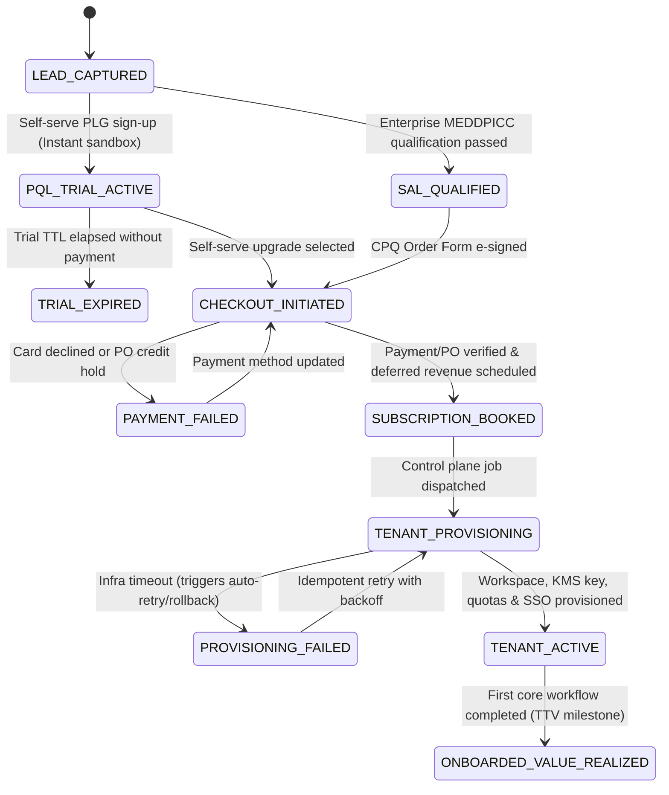

# The SaaS Lead-to-Fulfillment (L2F) Process — TDD & UAT Specification

The **lead-to-fulfillment (L2F) process for SaaS software products** is the end-to-end lifecycle that transforms a prospective organization or self-serve user into an active, paying, and fully provisioned tenant. Unlike physical goods—or [On-Premises Software L2F](lead-to-fulfillment-onprem.md) which requires customer-hosted binary distribution and hardware-bound cryptographic keys—SaaS fulfillment is digital, API-driven, and centered on instant multi-tenant or dedicated-cell provisioning, automated subscription billing, and immediate user onboarding.

This document serves both as the **cross-functional SaaS process specification** (spanning marketing, sales, deal desk/finance, cloud platform operations, and customer success) and as an **executable Test-Driven Development (TDD) and User Acceptance Testing (UAT) specification** aligned with [CPQ Workflows](cpq-product-management-lifecycle.md) and [Pricing Lifecycle Management (PLM)](pricing-lifecycle-management.md).

---

## Part I: The Five Phases of SaaS Lead-to-Fulfillment

### 1. Lead Generation, Capture & Qualification
The process begins when a prospective user or enterprise account demonstrates measurable intent.
* **Prospecting & Inbound Acquisition:** Attracting potential users through product-led content marketing, programmatic acquisition, cloud marketplace listings (AWS/Azure/GCP Marketplace), or targeted outbound outreach.
* **Telemetry-Enriched Lead Capture:** Gathering prospect identity, organization domain, estimated seat/usage volume, and data-residency requirements (`US_EAST`, `EU_CENTRAL`, `AP_SOUTHEAST`) via sign-up flows, demo requests, or gated technical assets.
* **Automated & Sales-Assisted Qualification:** Scoring leads via product-qualified lead (PQL) telemetry and enterprise frameworks (MEDDPICC / BANT) to route prospects into either the self-serve Product-Led Growth (PLG) funnel or the Sales-Led Enterprise track.

### 2. The Conversion Sales & Evaluation Cycle
The qualified lead evaluates the platform through an instant sandbox or guided enterprise trial.
* **Product-Led Growth (PLG) Self-Serve Track:** The prospect self-provisions a free trial or freemium workspace with automated usage guardrails, in-app upgrade prompts, and self-serve checkout.
* **Sales-Led (Enterprise) Track:** Account Executives and Solutions Engineers conduct discovery calls, deliver tailored demonstrations, complete security/SOC 2/GDPR questionnaires, and structure multi-year subscription proposals via [CPQ Workflows](cpq-product-management-lifecycle.md).

### 3. Order Processing, Subscription Billing & Contract Execution
Once the buyer commits, the opportunity transitions into the commercial billing and financial compliance layer.
* **Subscription & Usage Structuring:** The customer completes self-serve credit card/ACH checkout or e-signs an enterprise Master Subscription Agreement (MSA) / Order Form specifying subscription tier, seat counts, committed consumption credits, and billing cadence (monthly, annual, or multi-year ramp).
* **Payment Processing & ASC 606 Ratable Recognition:** An automated billing engine (e.g., Stripe, Chargebee) or ERP (e.g., Oracle NetSuite) validates payment methods, calculates regional sales tax/VAT, issues invoices, and schedules ratable **ASC 606 / IFRS 15** deferred revenue recognition over the subscription service period.

### 4. Digital Product Fulfillment (Automated Tenant Provisioning)
Fulfillment occurs programmatically within the cloud control plane without manual engineering intervention.
* **Idempotent Tenant & Cell Provisioning:** The SaaS control plane provisions an isolated tenant workspace, database schema/partition, encryption key (KMS), and regional data-residency boundary within the target SLA ($< 30\text{ seconds}$).
* **Entitlement, Quota & RBAC Allocation:** The entitlement service activates the purchased subscription tier, sets rate limits and seat/consumption quotas, configures SAML 2.0 / OIDC Single Sign-On (SSO), and mints initial administrator credentials or OAuth 2.0 / API tokens.
* **Cloud Marketplace & Ecosystem Integration:** For cloud marketplace procurements or enterprise integrations, webhook orchestrators bind external billing entitlements and deploy customer-specific webhook endpoints.

### 5. Onboarding, Time-to-Value (TTV) & Lifecycle Expansion
Fulfillment concludes when the tenant is operational, users are authenticated, and the account transitions to ongoing lifecycle management.
* **Automated Credential & Welcome Delivery:** The platform dispatches transactional onboarding emails containing magic-link/SSO activation URLs, quickstart guides, and API documentation.
* **Time-to-Value (TTV) & Activation Telemetry:** In-product onboarding checklists and guided workflows drive the tenant to its primary activation milestone ("Aha! moment") while emitting product usage telemetry.
* **Customer Success Handover & Expansion:** Enterprise accounts transition to Customer Success Managers (CSMs) with health-score monitoring, automated seat/usage true-up alerts, and renewal/upsell triggers governed by [Pricing Lifecycle Management (PLM)](pricing-lifecycle-management.md).

---

## Part II: Domain State Machine & Invariants (TDD Specification)

To support **Test-Driven Development (TDD)** across CRM, CPQ, Billing, Control Plane Provisioning, and Entitlement services, implementations must enforce the following state machine and domain invariants.

### 1. SaaS L2F Lifecycle State Machine



### 2. Core TDD Domain Invariants (Red-Green-Refactor Contracts)

1. **Idempotent Tenant Provisioning Invariant (`INV-SAAS-IDEM-01`):** Replaying a billing webhook (`invoice.paid` or `order.completed`) with the same `(organization_id, subscription_id, idempotency_key)` must return the existing `tenant_id` without creating duplicate workspaces, duplicate KMS keys, or duplicate welcome emails.
2. **Strict Tenant Isolation & Data Residency Invariant (`INV-SAAS-ISO-01`):** Every provisioned tenant must be bound to an immutable `data_residency_region` (e.g., `EU_CENTRAL` for GDPR accounts) and mandatory row-level / schema-level `tenant_id` scoping; cross-tenant read or write queries must be rejected at the data-access layer with `ERR_TENANT_ISOLATION_VIOLATION`.
3. **Zero-Downtime Trial-to-Paid Conversion Invariant (`INV-SAAS-CONV-01`):** Upgrading a tenant from `PQL_TRIAL_ACTIVE` to `TENANT_ACTIVE` must preserve $100\%$ of existing workspace data, configurations, and user identities while atomically lifting trial rate limits and removing trial watermarks in $< 5\text{ seconds}$.
4. **Ratable ASC 606 Deferred Revenue Invariant (`INV-SAAS-REV-01`):** Unlike point-in-time on-premises licenses, SaaS subscription bookings must record $100\%$ of collected upfront cash as `DeferredRevenue` at booking and recognize revenue ratably per service day/month across the subscription term ($\sum \text{daily\_recognitions} == \text{total\_subscription\_amount}$).
5. **Quota & Seat Enforcement Invariant (`INV-SAAS-QUOTA-01`):** Invite requests or API calls that exceed the tenant's active `max_seats` or `committed_api_rps` entitlement must be deterministically gated (returning HTTP `402 Payment Required` / `429 Too Many Requests` or triggering an auto-true-up workflow if overage billing is enabled).

### 3. TDD Test Pyramid Mapping

| Test Layer | Scope | Target Components | Execution SLA |
| :--- | :--- | :--- | :--- |
| **Unit Tests (TDD Core)** | Tenant quota math, trial-to-paid state transitions, ratable ASC 606 daily/monthly schedule calculators, residency routing rules. | `TenantProvisioningStateMachine`, `SubscriptionQuotaEnforcer`, `RatableRevenueScheduler`, `ResidencyRouter` | $< 20\text{ ms}$ per test; zero I/O |
| **Integration & Contract Tests** | Billing webhook idempotency (Stripe/ERP), database row-level tenant isolation, SAML/OIDC claim mapping, compensation rollback on provisioning failure. | `BillingWebhookHandler`, `TenantIsolationRepository`, `ControlPlaneProvisioner` | $< 1\text{ s}$ per test via Testcontainers |
| **End-to-End & UAT Tests** | Full PLG self-serve sign-up, trial upgrade, enterprise CPQ order provisioning, SSO login, and TTV telemetry verification. | Staging SaaS Control Plane + Synthetic IdP & Billing Sandbox | Automated pre-deploy UAT gate |

---

## Part III: Executable User Acceptance Testing (UAT) Scenarios

### UAT-SAAS-01: PLG Self-Serve Trial Provisioning & Seamless Paid Conversion (Phases 1 & 2)
```gherkin
Feature: Product-Led Growth (PLG) Instant Trial Provisioning and Zero-Loss Paid Upgrade
  As a Self-Serve Prospect
  I want to sign up for a free trial and upgrade to a paid tier without losing my workspace data
  So that I can evaluate the platform immediately and scale into production seamlessly

  Scenario: Prospect signs up for a 14-day EU-resident trial and converts to paid Professional tier
    Given a prospect with corporate domain "acme-defense.eu" submits the self-serve trial form selecting region "EU_CENTRAL"
    When the ControlPlaneProvisioner processes the sign-up request
    Then a new isolated tenant workspace MUST be provisioned in "EU_CENTRAL" within 30 seconds
    And the tenant state MUST be "PQL_TRIAL_ACTIVE" with `max_seats: 5` and `trial_days_remaining: 14`
    When the prospect creates 3 mission scenarios and completes checkout for the "PROFESSIONAL_25_SEATS" annual plan
    Then the tenant state MUST transition to "TENANT_ACTIVE" within 5 seconds
    And all 3 existing mission scenarios MUST remain intact while `max_seats` updates to "25"
```

### UAT-SAAS-02: Enterprise Order Booking, Webhook Idempotency & Ratable ASC 606 Schedule (Phase 3)
```gherkin
Feature: Enterprise Subscription Booking, Webhook Idempotency, and Ratable Revenue Recognition
  As Finance Operations and Platform Engineering
  I want subscription webhooks processed idempotently and recognized ratably under ASC 606
  So that duplicate webhooks never double-provision tenants or distort monthly financial statements

  Scenario: Duplicate billing webhooks produce a single tenant and a 12-month ratable revenue schedule
    Given an enterprise order "ORD-SAAS-801" for "$120,000.00" (12-month annual subscription, 100 seats) is paid
    When the billing engine dispatches webhook `invoice.paid` with idempotency key "IDEM-801-A" 3 times concurrently
    Then the ControlPlaneProvisioner MUST provision exactly 1 tenant workspace
    And the accounting sub-ledger MUST record "$120,000.00" in Deferred Revenue with 12 monthly recognition entries of "$10,000.00"
```

### UAT-SAAS-03: Multi-Tenant Isolation, SAML SSO & Seat Quota Enforcement (Phases 4 & 5)
```gherkin
Feature: Tenant Data Isolation, Enterprise SSO Onboarding, and Seat Quota Guardrails
  As an Enterprise Security Administrator
  I want strict cross-tenant isolation, SAML 2.0 SSO authentication, and seat cap enforcement
  So that our organization's data remains private and license usage stays within budget

  Scenario: Cross-tenant API access is blocked and seat cap prevents unauthorized over-provisioning
    Given Tenant A ("tenant-alpha", 10 seats) and Tenant B ("tenant-bravo", 10 seats) are active in the shared cluster
    When an authenticated user from Tenant A requests resource ID "res-bravo-001" belonging to Tenant B
    Then the API gateway and data layer MUST reject the request with HTTP 403 / "ERR_TENANT_ISOLATION_VIOLATION"
    When the Tenant A administrator attempts to invite an 11th user while `overage_auto_trueup` is disabled
    Then the invitation MUST be blocked with HTTP 402 / "ERR_SEAT_QUOTA_EXCEEDED" and prompt to purchase an expansion pack
```

---

## Part IV: Requirements Traceability & UAT Sign-Off Matrix

| Phase | Requirement ID | Invariant / Rule | TDD Unit / Integration Test Suite | UAT Scenario | Pass / Acceptance Metric | Sign-Off Owner |
| :--- | :--- | :--- | :--- | :--- | :--- | :--- |
| **1–2. Lead & PLG Conversion** | `REQ-SAAS-01` | `INV-SAAS-CONV-01` (Zero-loss trial upgrade $< 5\text{s}$) | `TrialConversionStateMachineTests`, `ResidencyRouterTests` | `UAT-SAAS-01` | Trial provisioning $< 30\text{s}$; paid upgrade $< 5\text{s}$ with $100\%$ data preservation. | Growth PM / Platform Lead |
| **3. Billing & ASC 606** | `REQ-SAAS-02` | `INV-SAAS-IDEM-01`, `INV-SAAS-REV-01` (Idempotency & ratable schedule) | `BillingWebhookIdempotencyTests`, `RatableRevenueSchedulerTests` | `UAT-SAAS-02` | $0$ duplicate tenants on webhook replay; $\$0.00$ variance on 12-month ratable schedule. | Finance Controller / RevOps |
| **4–5. Provisioning & Onboarding** | `REQ-SAAS-03` | `INV-SAAS-ISO-01`, `INV-SAAS-QUOTA-01` (Tenant isolation & seat cap) | `TenantIsolationRepositoryTests`, `SubscriptionQuotaEnforcerTests`, `SamlSsoOnboardingTests` | `UAT-SAAS-03` | $100\%$ of cross-tenant queries blocked; seat cap and SSO login verified. | Security Architect / CS Lead |
