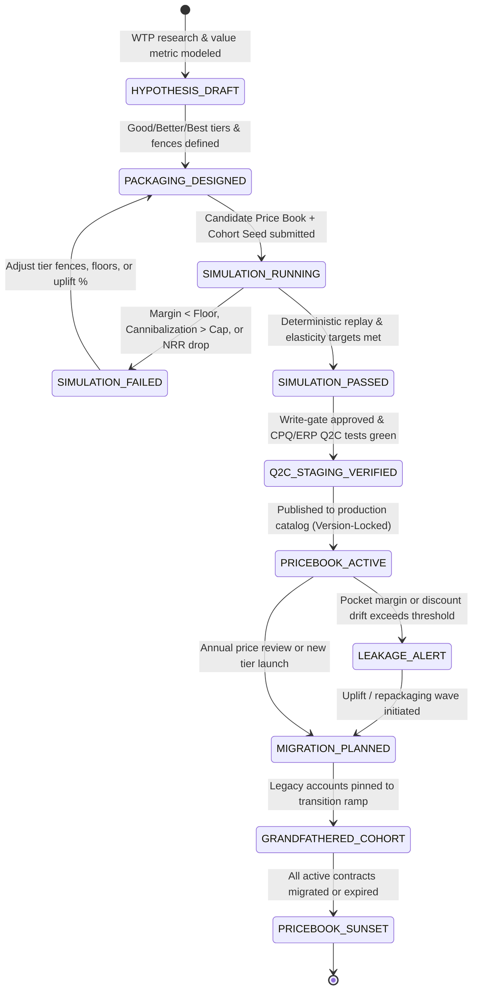

# The Product Management Lifecycle for Pricing Lifecycle Management (PLM) — TDD & UAT Specification

**Pricing Lifecycle Management (PLM)** is the continuous, end-to-end framework used to discover, simulate, design, execute, monitor, and optimize a company's monetization strategy across its entire product portfolio. While [CPQ (Configure, Price, Quote)](cpq-product-management-lifecycle.md) operates at the *deal execution level* (calculating a valid quote for a specific customer), **PLM is strategic and portfolio-wide**—governing how a product's value metrics, packaging tiers, price books, and migration policies evolve from initial launch to maturity and eventual sunsetting across both [On-Premises L2F](lead-to-fulfillment-onprem.md) and [SaaS L2F](lead-to-fulfillment-saas.md) channels.

Product Managers specializing in PLM orchestrate alignment across product development, finance, revenue operations (RevOps), deal desk, and marketing—using **deterministic pricing strategy simulation**, **Test-Driven Development (TDD)**, and **executable User Acceptance Testing (UAT)** to maximize Customer Lifetime Value (LTV), Net Revenue Retention (NRR), and gross margins without destabilizing active sales pipelines.

---

## Part I: The Five Phases of Pricing Lifecycle Management (PLM)

### 1. Discovery, Quantitative Research & Value Modeling
The lifecycle begins by quantifying market dynamics, customer economic value, and willingness-to-pay before writing a single price book rule.
* **Willingness-to-Pay (WTP) & Elasticity Assessment:** Conducting quantitative pricing research—including **Van Westendorp Price Sensitivity Meter** (*Too Cheap*, *Bargain*, *Getting Expensive*, *Too Expensive* intersection points: PMC, PME, OPP, IPP) and **Discrete Choice Conjoint Analysis**—to establish empirically validated price floors, optimal price points, and ceilings.
* **Value Metric Identification & Scaling Alignment:** Selecting the primary and secondary units of consumption that correlate directly with customer-perceived value and vendor cost-to-serve (e.g., CPU cores, concurrent simulated theater entities, autonomous AI agent delegation slots, or named C2 operator seats).
* **Competitive Benchmarking & Economic Value Estimation (EVE):** Mapping reference value plus differentiation value against competitor offerings and internal build-vs-buy workarounds to identify strategic pricing headroom or penetration wedges.

### 2. Strategy Design, Packaging Architecture & Pricing Simulation
PMs translate empirical research into a tiered commercial architecture and stress-test candidate models through **Pricing Strategy Simulation** prior to committing to implementation.
* **Packaging & Tiering Architecture:** Structuring feature gates and capacity entitlements into clear segment tiers (e.g., *Tactical Lab / Standard*, *Theater Command / Professional*, and *Air-Gapped Sovereign / Enterprise*—or Product-Led Growth Freemium-to-Enterprise progression) with strict anti-cannibalization fences.
* **Monetization Model Selection:** Selecting the structural pricing formula—such as flat-rate recurring subscription, graduated multi-dimensional consumption tiers, committed-use base plus overage drawdowns, or hybrid perpetual-plus-maintenance models.
* **Pricing Strategy Simulation & Digital-Twin Backtesting:** Running deterministic, seeded portfolio simulations (*What-If* scenario replay against historical quote/order cohorts, price elasticity $\epsilon_d$ sensitivity sweeps, tier-migration cannibalization modeling, and multi-year NRR/churn projections) to prove a candidate price book meets revenue and margin targets before promotion.
* **Downstream Billing & ASC 606 Mapping:** Defining unit economics, billing frequencies (monthly, annual, multi-year ramp), and Standalone Selling Price (SSP) boundaries to guarantee compatibility with CPQ, ERP, and revenue recognition engines.

### 3. Implementation, Systems Readiness & Operational GTM
Before a new pricing strategy or packaging tier goes live, commercial systems and field teams must be systematically prepared and verified to execute it with zero manual friction.
* **Staged Price Book & SKU Write-Gate Configuration:** Authoring immutable SKU definitions, graduated tier tables, currency conversion matrices, and SSP rules through an extend-only write-gate (`Propose` $\rightarrow$ `Simulate` $\rightarrow$ `Validate` $\rightarrow$ `Approve`) into CPQ, CRM, and ERP catalogs.
* **Sales, Deal Desk & Channel Enablement:** Publishing internal packaging playbooks, ROI/value calculators, updated discount delegation matrices, and grandfathering eligibility rules for account executives and channel partners.
* **Quote-to-Cash (Q2C) End-to-End Integration Testing:** Executing automated synthetic purchase funnels to verify penny-exact parity from the guided-selling quote through ERP invoicing, tax calculation, revenue sub-ledger allocation, and license entitlement minting.

### 4. Continuous Optimization, Leakage Governance & Elasticity Evaluation
Once active in production, pricing is governed as a closed-loop feedback system rather than a static artifact.
* **Margin & Revenue Integrity Audits:** Continuously monitoring portfolio KPIs including **Gross Margin Retention**, **Price Realization Rate (Pocket Price vs. List Price)**, **Average Discount Depth**, **Net Revenue Retention (NRR)**, and **LTV-to-CAC** ratios.
* **Price Waterfall Leakage Detection:** Auditing Deal Desk override logs, unapproved payment-term extensions, and promotional stacking to pinpoint where list price leaks into lower pocket margin.
* **Win/Loss & Realized Elasticity Analysis:** Correlating win/loss reasons and deal cycle velocity (fed automatically from **[Sales Pipeline Management (SPM)](sales-pipeline-management-cpq.md)** `PipelineLossElasticityEvent` telemetry) against realized discount bands to compute empirical price elasticity of demand ($\epsilon_d = \frac{\%\Delta Q}{\%\Delta P}$) and detect packaging friction.

### 5. Price Adjustments, Cohort Migration & Legacy Deprecation
As product value expands or macro costs shift, legacy pricing structures are systematically uplifted, migrated, or retired without triggering unplanned customer churn.
* **Price Uplift & CPI/Indexation Execution:** Formulating the renewal uplift playbook—enforcing contractual annual price escalators (e.g., CPI + $3\%$ or $7\%$ cap) and modeling churn-vs-expansion trade-offs across customer health cohorts.
* **Grandfathering vs. Forced Migration Orchestration:** Governing transition rules for legacy accounts—determining which cohorts receive time-bound rate protection (`GRANDFATHERED_UNTIL_RENEWAL`), credit-neutral tier mapping, or phased step-up ramps onto modern packaging.
* **SKU & Price Book Sunsetting:** Transitioning obsolete price books and promotional codes through deterministic lifecycle states (`ACTIVE` $\rightarrow$ `RENEWAL_ONLY` $\rightarrow$ `END_OF_SALE` $\rightarrow$ `ARCHIVED`), eliminating operational technical debt while preserving historical audit trails.

---

## Part II: Project Aegis TDD & Pricing Strategy Simulation Architecture

To align with **Project Aegis** engineering conventions ([`AGENTS.md`](../../AGENTS.md) and [`determinism-and-replay.md`](../../docs/engineering/determinism-and-replay.md)), the PLM engine and its **Pricing Strategy Simulator** are built on immutable C# domain records, 128-bit `decimal` math, coordinate-addressed seeded RNG (`SeededRng`), and golden replay regression fixtures.

### 1. PLM Portfolio Lifecycle & Simulation Gate State Machine



### 2. Pricing Strategy Simulation Engine (`PlmStrategySimulator`)

Modeled after Project Aegis's headless [`BalticReplayHarness`](../../src/ProjectAegis.Delegation.UnityAdapter/Baltic/BalticReplayHarness.cs), the **Pricing Strategy Simulator** evaluates candidate price books over $N$ simulated billing ticks (e.g., 12 to 36 monthly ticks) across historical and synthetic customer cohorts:

```
PlmStrategySimulator.Run(candidatePriceBook, baselineCohortSnapshot, simulationPolicy, seed)
  → VanWestendorpValidator.EvaluateBounds(wtpSurveyData)
  → HistoricalBacktestEngine.ReplayQuotes(historicalQuotes, candidatePriceBook)
  → CohortTickLoop (tick = 1..N):
      → ElasticityDemandModel.Step(cohort, priceDeltaPct, SeededRng(seed, RngDomain.PlmElasticity, cohortId, tick, 0))
      → TierMigrationEvaluator.ResolveUpgradesAndCannibalization(cohort, packagingFences)
      → RenewalChurnAndUpliftResolver.ApplyRenewalWave(cohort, upliftPolicy, SeededRng(...))
      → PocketMarginAuditor.ComputeWaterfall(cohort)
  → PlmSimulationResult(ArrTrajectory, NrrPct, GrossMarginPct, CannibalizationRatePct, SimulationWorldHash, ReplayFingerprintSha256)
```

### 3. Core TDD Domain Invariants (Red-Green-Refactor Contracts)

Every PLM service and simulation module must satisfy these deterministic unit and contract test invariants:

1. **Van Westendorp & Floor Ordering Invariant (`INV-PLM-WTP-01`):** For any validated WTP model, the empirical price points must satisfy `UnitCost < PointOfMarginalCheapness (PMC) <= OptimalPricePoint (OPP) <= IndifferencePricePoint (IPP) <= PointOfMarginalExpensiveness (PME)`, and `Sku.FloorPrice` must satisfy `FloorPrice >= UnitCost / (1 - MinGrossMarginPct)`.
2. **Tier Fence & Anti-Cannibalization Invariant (`INV-PLM-PKG-01`):** Across any ordered packaging hierarchy (`Tier_1_Standard < Tier_2_Pro < Tier_3_Enterprise`): (a) within any single tier or SKU, marginal unit price per value metric across volume commitment brackets must be monotonically non-increasing (`Bracket_k_UnitPrice <= Bracket_k-1_UnitPrice`), (b) across tiers, total base tier package price must be strictly increasing (`Tier_1_BasePrice < Tier_2_BasePrice < Tier_3_BasePrice`) while capability-normalized price per unit of weighted entitlement value is non-increasing, and (c) Higher-Tier exclusive entitlements cannot be unlocked or replicated via Lower-Tier base + add-on combinations at a total price $\le$ the Higher-Tier base price.
3. **Simulation Determinism & Seed Reproducibility Invariant (`INV-PLM-SIM-01`):** Given the same `(CandidatePriceBookHash, CohortSnapshotHash, SimulationPolicyId, Seed)`, two independent runs of `PlmStrategySimulator.Run(...)` must produce bit-for-bit identical `SimulationWorldHash` and `ReplayFingerprintSha256` (`Run A == Run B`), using `SeededRng` and `FingerprintFloat` / invariant `decimal` formatting with zero calls to `Random.Shared` or `DateTime.UtcNow`.
4. **Pocket Price Waterfall Conservation Invariant (`INV-PLM-LKG-01`):** For every quote and invoice audited in Phase 4, `ListPrice - OnInvoiceVolumeDiscount - OnInvoicePromotionalDiscount - DiscretionaryDiscount == InvoiceNetPrice`, and `InvoiceNetPrice - OffInvoiceRebates - PaymentTermFinancingCost - PartnerCommission - CostToServe == PocketMargin`. Any discrepancy $> \$0.00$ must fail with `ERR_PLM_WATERFALL_IMBALANCE`.
5. **Migration & Grandfathering Non-Retroactivity Invariant (`INV-PLM-MIG-01`):** Activating a price uplift or deprecating a price book must never alter the unit rates of an active contract prior to its `contract_renewal_date` unless an explicit mid-term expansion amendment (`AMENDMENT_UPGRADE`) is executed; annual renewal uplifts must be hard-capped by `contract.max_annual_uplift_pct`.
6. **Simulation Gate Pre-Approval Invariant (`INV-PLM-GATE-01`):** `PlmPriceBookWriteGate.Approve(...)` must reject any candidate price book if the attached `PlmSimulationResult` breaches portfolio safety guardrails (`ProjectedGrossMarginPct < MinTargetMarginPct`, `ProjectedNrrPct < MinTargetNrrPct`, or `SimulatedCannibalizationPct > MaxCannibalizationCapPct`).

### 4. Project Aegis C# Domain Contracts & TDD Test Pyramid

```csharp
namespace ProjectAegis.Plm.Simulation;

public readonly record struct VanWestendorpBounds(
    decimal PointOfMarginalCheapness,
    decimal OptimalPricePoint,
    decimal IndifferencePricePoint,
    decimal PointOfMarginalExpensiveness);

public sealed record PlmSimulationPolicy(
    string PolicyId,
    int HorizonMonths,
    decimal BasePriceElasticity,
    decimal MaxCannibalizationCapPct,
    decimal MinGrossMarginTargetPct,
    decimal MinNrrTargetPct);

public sealed record PlmSimulationResult(
    string CandidatePriceBookVersion,
    uint Seed,
    decimal BaselineArr,
    decimal ProjectedEndingArr,
    decimal ProjectedNrrPct,
    decimal ProjectedGrossMarginPct,
    decimal SimulatedCannibalizationPct,
    bool PassedGuardrails,
    ulong SimulationWorldHash,
    string ReplayFingerprintSha256);
```

| Test Layer | Assembly / Location | Target System Under Test (SUT) | Naming Convention (`[Scenario]_[Expected]`) | Execution Budget |
| :--- | :--- | :--- | :--- | :--- |
| **1. Pure Domain Unit Tests** | `src/ProjectAegis.Plm.Tests/` | `VanWestendorpAnalyzer`, `TierFenceValidator`, `PocketMarginWaterfallAuditor`, `ElasticityDemandCurve` | `AddOnBundleCheaperThanEnterpriseTier_ReturnsCannibalizationError` | $< 10\text{ ms}$ per `[Fact]` / `[Theory]` |
| **2. Strategy Simulation Tests** | `src/ProjectAegis.Plm.Tests/Simulation/` | `PlmStrategySimulator`, `HistoricalQuoteBacktester`, `CohortMigrationSimulator` | `TenPercentUpliftWithInelasticDefenseCohort_MatchesDeterministicArrHash` | $< 50\text{ ms}$ per 36-tick run |
| **3. Golden Replay Regression** | `tests/regression/plm-sim-golden-*.txt` | `PlmSimulationGoldenSuiteTests` | `Portfolio2026Q4PriceBookSimulation_MatchesPinnedGoldenFingerprint` | $< 250\text{ ms}$ (intra-run `A == B` + golden) |
| **4. End-to-End UAT Scenarios** | [pricing-lifecycle-management.md](pricing-lifecycle-management.md) | Full WTP $\rightarrow$ Strategy Simulation $\rightarrow$ Q2C Staging $\rightarrow$ Leakage Audit $\rightarrow$ Cohort Migration | `UAT-PLM-01` through `UAT-PLM-06` | Portfolio Price Book Release Gate |

---

## Part III: Executable User Acceptance Testing (UAT) Scenarios

The following Behavior-Driven Development (BDD / Gherkin) scenarios define the mandatory UAT gates across all five PLM phases and the Pricing Strategy Simulation engine.

### UAT-PLM-01: Willingness-to-Pay (WTP) Bounds & Cost-Plus Margin Floor Validation (Phase 1)
```gherkin
Feature: Quantitative Willingness-to-Pay (WTP) Analysis and Margin Floor Modeling
  As a Pricing Product Manager
  I want empirical Van Westendorp survey data and unit cost-to-serve validated against margin floors
  So that new value metrics and price bounds are economically viable before packaging design

  Scenario: Calculating Van Westendorp intersections and enforcing 80% gross margin floor
    Given a WTP survey dataset "SURVEY-AEGIS-2026-Q4" for value metric "CONCURRENT_AUTONOMOUS_AGENT_SLOTS"
    And the unit cost-to-serve per agent slot is "$120.00/year" with a minimum gross margin target of "80.0%"
    When the VanWestendorpAnalyzer evaluates the cumulative price sensitivity distributions
    Then the calculated price intersections MUST be:
      | Metric                                  | Code | Calculated_Value |
      | Point of Marginal Cheapness             | PMC  | $650.00          |
      | Optimal Price Point                     | OPP  | $950.00          |
      | Indifference Price Point                | IPP  | $1,100.00        |
      | Point of Marginal Expensiveness         | PME  | $1,450.00        |
    And the minimum allowable SKU Floor Price MUST be set to at least "$600.00" ($120.00 / (1 - 0.80))
    And any proposed list price outside the acceptable range "[PMC $650.00 .. PME $1,450.00]" MUST be flagged with "WARN_WTP_BOUNDARY_BREACH"
```

### UAT-PLM-02: Packaging Tier Fence Validation & Anti-Cannibalization Guardrails (Phase 2)
```gherkin
Feature: Good-Better-Best Packaging Architecture and Anti-Cannibalization Fence Validation
  As a Portfolio Pricing Architect
  I want packaging tiers validated for monotonic value scaling and fence integrity
  So that customers cannot assemble lower-tier add-ons to bypass Enterprise tier pricing

  Scenario: Detecting and blocking an add-on pricing loophole that cannibalizes the Enterprise tier
    Given a 3-tier packaging proposal for Project Aegis:
      | Tier_ID               | Base_Annual_Price | Included_Cores | AirGap_Entitlement | Swarm_Sim_Pack     |
      | TIER-1-TACTICAL       | $25,000.00        | 16             | Excluded           | Excluded           |
      | TIER-2-THEATER-PRO    | $60,000.00        | 64             | Optional Add-On    | Optional Add-On    |
      | TIER-3-SOVEREIGN-ENT  | $110,000.00       | 64             | Included           | Included           |
    When the PM configures optional add-ons for "TIER-2-THEATER-PRO" as:
      | AddOn_SKU             | Annual_Price      |
      | ADDON-AIRGAP-MODE     | $20,000.00        |
      | ADDON-SWARM-SIM-PACK  | $15,000.00        |
    Then the TierFenceValidator MUST reject the packaging proposal with "ERR_PLM_TIER_CANNIBALIZATION"
    Because "TIER-2-THEATER-PRO + ADDON-AIRGAP-MODE + ADDON-SWARM-SIM-PACK ($95,000.00)" delivers identical 64-core entitlements for "$15,000.00" less than "TIER-3-SOVEREIGN-ENT ($110,000.00)"
```

### UAT-PLM-03: Deterministic Pricing Strategy Simulation & Historical Backtesting (Phase 2 / Simulation Gate)
```gherkin
Feature: Seeded Pricing Strategy Simulation, Elasticity Modeling, and Historical Deal Replay
  As a Pricing PM and Finance VP
  I want to simulate candidate price books against historical deal cohorts and elasticity curves
  So that we can predict ARR, NRR, churn, and tier migration deterministically before launch

  Scenario: 24-month deterministic portfolio simulation passes NRR and margin guardrails
    Given baseline customer cohort snapshot "COHORT-2026-ACTIVE-500" with "$24,000,000.00" starting ARR
    And candidate price book "PB-2027-V1" introduces a 12% list price increase on "TIER-3-SOVEREIGN-ENT" and graduated core brackets
    And simulation policy "SIM-POL-DEFENSE-24M" specifies:
      | horizon_months | seed | defense_elasticity | commercial_elasticity | min_nrr_pct | min_margin_pct | max_cannibalization_pct |
      | 24             | 42   | -0.25              | -0.85                 | 108.0       | 78.0           | 3.0                     |
    When `PlmStrategySimulator.Run` executes twice (Run A and Run B) with seed "42"
    Then Run A and Run B MUST produce identical `SimulationWorldHash` and `ReplayFingerprintSha256`
    And the simulated 24-month portfolio metrics MUST satisfy:
      | Metric                         | Simulated_Result | Guardrail_Threshold | Status |
      | Projected NRR (Annualized)     | 114.25%          | >= 108.00%          | PASS   |
      | Portfolio Gross Margin         | 82.40%           | >= 78.00%           | PASS   |
      | Tier Down-Sell Cannibalization | 1.40%            | <= 3.00%            | PASS   |
    And the candidate price book state MUST transition from "SIMULATION_RUNNING" to "SIMULATION_PASSED"

  Scenario: Write-gate blocks a candidate price book when simulated elasticity predicts net ARR contraction
    Given candidate price book "PB-2027-AGGRESSIVE" proposes a 45% price hike across elastic commercial tiers (`elasticity = -1.65`)
    When `PlmStrategySimulator.Run` executes over a 12-month horizon with seed "42"
    Then the simulation predicts logo churn of "22.8%" and Projected NRR of "89.4%" (below the "108.0%" minimum floor)
    And `PlmPriceBookWriteGate.Approve("PB-2027-AGGRESSIVE")` MUST reject promotion with error "ERR_PLM_SIMULATION_GUARDRAIL_FAILED: Projected NRR 89.4% < 108.0%"
```

### UAT-PLM-04: Quote-to-Cash (Q2C) Readiness & CPQ-to-ERP Ledger Parity (Phase 3)
```gherkin
Feature: Quote-to-Cash (Q2C) System Readiness and End-to-End Price Book Verification
  As a RevOps Systems Lead
  I want newly approved price books verified across CRM, CPQ, ERP invoicing, and EMS licensing
  So that go-to-market launches execute with zero billing errors or entitlement mismatches

  Scenario: Synthetic Q2C purchase funnel verifies penny-exact parity from CPQ quote to ERP invoice
    Given price book "PB-2027-V1" has passed simulation and been promoted to staging
    When the automated Q2C harness executes a synthetic order for "TIER-3-SOVEREIGN-ENT" (128 cores, 3-year ramp, EUR currency at pinned FX rate 0.9200)
    Then the CPQ quote net total, ERP sales order total, VAT-exclusive invoice schedule, and ASC 606 revenue sub-ledger total MUST match to the exact euro cent ("0.00 EUR" variance)
    And the downstream Entitlement Management System (EMS) MUST receive the exact 128-core capacity entitlement mapped to the new SKU code
```

### UAT-PLM-05: Price Waterfall Leakage Audit & Realized Elasticity Telemetry (Phase 4)
```gherkin
Feature: Continuous Price Waterfall Leakage Auditing and Realized Elasticity Monitoring
  As a Revenue Operations Analyst
  I want off-invoice rebates, unapproved payment terms, and discount overrides audited automatically
  So that pocket margin erosion is detected and remediated in real time

  Scenario: Auditing the full List-to-Pocket price waterfall and flagging margin leakage
    Given a closed deal "DEAL-2026-991" for "TIER-2-THEATER-PRO" with List Price "$100,000.00"
    And the following waterfall deductions were recorded:
      | Deduction_Stage                     | Amount      |
      | On-Invoice Volume Tier Discount     | -$10,000.00 |
      | On-Invoice Rep Discretionary (15%)  | -$13,500.00 |
      | Invoice Net Price                   | $76,500.00  |
      | Off-Invoice Partner Rebate (8%)     | -$6,120.00  |
      | Net 120 Financing Cost (3%)         | -$2,295.00  |
      | Direct Infrastructure Cost-to-Serve | -$12,000.00 |
    When the `PocketMarginWaterfallAuditor` evaluates "DEAL-2026-991" against the target Pocket Margin floor of "60.0% of List ($60,000.00)"
    Then the calculated Pocket Price MUST equal "$68,085.00" and Pocket Margin MUST equal "$56,085.00" (56.09% of List)
    And the auditor MUST emit a leakage alert "ALERT_PLM_POCKET_MARGIN_BREACH" attributing "-$2,295.00" to unapproved Net 120 payment terms and "-$6,120.00" to stacked partner rebates
```

### UAT-PLM-06: Legacy Cohort Grandfathering, Contractual Uplift Caps & Price Book Sunset (Phase 5)
```gherkin
Feature: Legacy Cohort Migration, Contractual Uplift Caps, and Price Book Sunsetting
  As a Customer Renewal Manager and PLM Lead
  I want legacy customer cohorts migrated according to contractual uplift caps and grandfathering rules
  So that we capture expansion revenue while honoring legal rate protections and retiring legacy SKUs

  Scenario: Enforcing a 5% contractual renewal uplift cap during a 15% list price migration wave
    Given existing Customer "ACCT-DEFENSE-09" holds an active contract on legacy price book "PB-2025-LEGACY" at "$100,000.00/year"
    And the customer's Master License Agreement specifies `max_annual_renewal_uplift_pct = 5.0%`
    When the PLM migration engine transitions "PB-2025-LEGACY" to "END_OF_SALE" and maps renewals to "PB-2027-V1" (where equivalent list price is "$115,000.00/year")
    Then the automated renewal quote for "ACCT-DEFENSE-09" MUST apply a "Migration Price Protection Credit" of "-$10,000.00"
    And the net renewal price MUST be capped at exactly "$105,000.00/year" (+5.0% YoY)
    And legacy price book "PB-2025-LEGACY" MUST be transitioned to "ARCHIVED" once its remaining active contract count reaches 0
```

---

## Part IV: Requirements Traceability, KPIs & UAT Sign-Off Matrix

| Phase | Requirement ID | Domain Invariant | TDD Test Suite (`ProjectAegis.Plm.Tests`) | UAT Scenario | Portfolio KPI & Acceptance Threshold | Sign-Off Owner |
| :--- | :--- | :--- | :--- | :--- | :--- | :--- |
| **1. Discovery & Value Modeling** | `REQ-PLM-01` | `INV-PLM-WTP-01` (Van Westendorp & cost floor ordering) | `VanWestendorpAnalyzerTests`, `ValueMetricScalingTests` | `UAT-PLM-01` | $100\%$ of SKUs priced within `[PMC .. PME]` and above minimum gross margin floor ($\ge 80\%$). | VP Product Management |
| **2. Strategy & Packaging** | `REQ-PLM-02` | `INV-PLM-PKG-01` (Monotonic tier fences & anti-cannibalization) | `TierFenceValidatorTests`, `PackagingBundleMatrixTests` | `UAT-PLM-02` | $0$ add-on combinations undercut higher-tier base prices; tier value scaling $100\%$ monotonic. | Pricing Architect |
| **2B. Pricing Strategy Simulation** | `REQ-PLM-03` | `INV-PLM-SIM-01`, `INV-PLM-GATE-01` (Seeded replay & guardrail gate) | `PlmStrategySimulatorTests`, `PlmSimulationGoldenSuiteTests`, `HistoricalQuoteBacktesterTests` | `UAT-PLM-03` | $100\%$ intra-run (`A == B`) hash reproducibility; simulated NRR $\ge 108\%$ and cannibalization $\le 3\%$. | Finance VP / Pricing Lead |
| **3. Implementation & Q2C** | `REQ-PLM-04` | `INV-CPQ-SNAP-01`, `INV-CPQ-REV-01` (Q2C & ASC 606 parity) | `Q2CFunnelIntegrationTests`, `PriceBookWriteGateTests` | `UAT-PLM-04` | $\$0.00$ variance across CRM $\rightarrow$ CPQ $\rightarrow$ ERP Invoice $\rightarrow$ ASC 606 ledger $\rightarrow$ EMS entitlement. | RevOps / Release Engineering |
| **4. Leakage & Optimization** | `REQ-PLM-05` | `INV-PLM-LKG-01` (List-to-Pocket waterfall conservation) | `PocketMarginWaterfallAuditorTests`, `RealizedElasticityCalculatorTests` | `UAT-PLM-05` | $100\%$ of off-invoice rebates & term financing costs tracked; pocket margin leakage $< 2.0\%$. | Deal Desk / Finance Controller |
| **5. Migration & Sunsetting** | `REQ-PLM-06` | `INV-PLM-MIG-01` (Non-retroactivity & uplift caps) | `CohortMigrationOrchestratorTests`, `RenewalUpliftCapTests`, `PriceBookSunsetTests` | `UAT-PLM-06` | $0$ breaches of contractual MLA uplift caps; $100\%$ of zero-contract legacy price books archived. | Customer Success / Legal |

### UAT Entry & Exit Criteria

* **UAT Entry Criteria (Pre-Launch Gate):**
  1. $100\%$ of TDD unit tests, `PlmStrategySimulator` tests, and `PlmSimulationGoldenSuiteTests` passing (`0 errors, 0 warnings`).
  2. Static determinism audit verifies zero usage of `Random.Shared`, `DateTime.UtcNow`, or binary `float`/`double` across all pricing, elasticity, and cohort simulation assemblies.
  3. Candidate price book has a signed `PlmSimulationResult` artifact attached with `PassedGuardrails == true` across at least 3 distinct elasticity scenarios (*Conservative*, *Baseline*, *Stress*).
* **UAT Exit Criteria (Portfolio Go-Live Gate):**
  1. All six UAT scenarios (`UAT-PLM-01` through `UAT-PLM-06`) executed with `PASS` status in the staging Q2C environment.
  2. Historical backtesting over the prior 4 quarters of production quotes confirms zero unintended configuration breakages or unapproved margin drops.
  3. Formal sign-off recorded by VP Product Management, Pricing Architect, Finance Controller, RevOps Lead, and Legal/Deal Desk.
