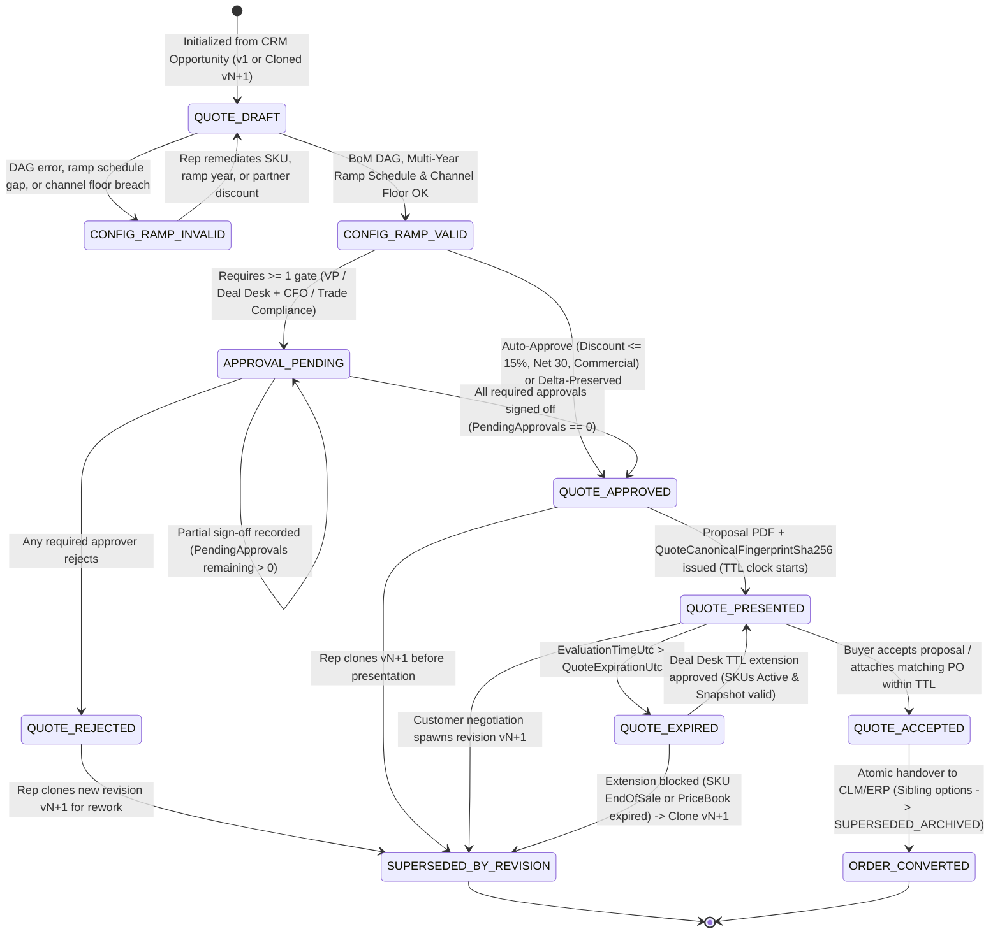

# The Quote Lifecycle Management (QLM) Process for CPQ Workflows (TDD & UAT Specification)

**Quote Lifecycle Management (QLM) for CPQ (Configure, Price, Quote) Workflows** is the operational, multi-revision, and transactional governance framework that manages individual customer quotes from **[Sales Pipeline Management (SPM)](sales-pipeline-management-cpq.md)** CRM Opportunity intake and multi-option structuring through multi-year ramp modeling, channel partner margin stacking, immutable revision branching (`v1` $\rightarrow$ `vN`), validity TTL expiration/extension gates, buyer acceptance, and atomic handover into **[Contract Lifecycle Management (CLM)](contract-lifecycle-management-cpq.md)**, **[Asset Lifecycle Management (ALM)](asset-lifecycle-management-cpq.md)**, and downstream fulfillment (**[On-Premises L2F](lead-to-fulfillment-onprem.md)** and **[SaaS L2F](lead-to-fulfillment-saas.md)**).

While **[CPQ Product Management (`cpq-product-management-lifecycle.md`)](cpq-product-management-lifecycle.md)** governs how Product Managers design and validate the **product catalog, DAG rules, and price book waterfalls**, **Quote Lifecycle Management (QLM)** governs the **stateful execution of deal quotes across sales cycles**. Because enterprise and defense deals routinely involve multiple competing proposal options, stepped multi-year ramp schedules, collaborative Deal Desk revisions, and strict validity windows, this specification establishes a **Test-Driven Development (TDD)** and **executable User Acceptance Testing (UAT)** architecture aligned with **Project Aegis** (`.NET` / C# / xUnit determinism standards).

---

## Part I: The Five Phases of Quote Lifecycle Management (QLM) for CPQ

### 1. Opportunity-to-Quote Intake, Deal Motion Scoping & Multi-Option Structuring
The quote lifecycle begins when an Account Executive, Solutions Engineer, or Renewal Specialist initiates a quote from a qualified CRM Opportunity.
* **Deal Motion & Baseline Context Binding:** Initializing the quote with an explicit deal motion (`NET_NEW_LAND`, `MID_TERM_EXPANSION`, `ANNUAL_RENEWAL`, or `MULTI_YEAR_RESTRUCTURE`), target billing currency (`ISO-4217`), customer tax/export profile (`COMMERCIAL`, `ECCN_5D002`, `ITAR_DEFENSE`), and pinned `CatalogSnapshotSha256`.
* **Multi-Option Proposal Structuring:** Allowing reps to construct parallel option quotes under a single CRM Opportunity so buyers can compare commercial structures side by side (e.g., *Option A: 3-Year Air-Gapped On-Premises Perpetual + Platinum Support* vs. *Option B: 1-Year Connected Enterprise Subscription*).
* **Single Primary Quote & CRM Forecast Synchronization:** Enforcing the **Single Primary Quote Invariant**—at most one non-expired, non-superseded quote on an Opportunity may be designated `IsPrimary = true` at any point in time, deterministically driving CRM Opportunity ARR, ACV, TCV, and line-item forecast rollups without double-counting parallel option quotes.

### 2. Multi-Year Ramp Structuring, Channel Partner Stacking & Collaborative Locking
During deal design, QLM manages time-phased quantity commitments, indirect partner margins, and multi-user concurrency.
* **Multi-Year Stepped Ramp Schedules:** Modeling annual or custom-period ramp segments (`Year 1: 32 cores`, `Year 2: 64 cores`, `Year 3: 128 cores`) with deterministic calculation of per-segment net totals, Annual Contract Value (`ACV`), Total Contract Value (`TCV`), and **Exit ARR** (final-year annualized run rate used for renewal baseline).
* **Channel Partner & Reseller Margin Stacking:** Supporting indirect fulfillment routes (`DIRECT`, `VAR_DEAL_REGISTRATION`, `DISTRIBUTOR_TWO_TIER`) by applying structured partner referral/reseller discounts in a canonical order (`Customer Tiered Net Price` $\rightarrow$ `Registered Partner Margin Discount` $\rightarrow$ `Vendor Net Wholesale Price`) while enforcing SKU margin floor locks.
* **Optimistic Concurrency & Collaborative Editing Locks:** Coordinating simultaneous edits across Sales Reps, Solutions Engineers (sizing/DAG parameters), and Deal Desk Analysts (payment terms/pricing overrides) via monotonic optimistic concurrency tokens (`RowVersion` / `ETag`), preventing lost updates or silent overwrites.

### 3. Immutable Revision Branching (`v1` $\rightarrow$ `vN`), Approval Delta Re-Evaluation & Audit Lineage
Enterprise negotiations rarely close on `v1`. QLM treats approved and presented quotes as immutable historical artifacts and governs changes through strict revision branching.
* **Immutable Snapshot & Revision Cloning:** Once a quote transitions to `APPROVAL_PENDING`, `QUOTE_APPROVED`, or `QUOTE_PRESENTED`, its line items, ramp schedule, and commercial terms are cryptographically frozen (`QuoteCanonicalFingerprintSha256`). Any customer-requested modification spawns a new revision (`Q-2026-900-v2`) linked to `ParentQuoteId` and `ParentFingerprintSha256`, while marking `v1` as `SUPERSEDED_BY_REVISION`.
* **Delta Approval Preservation vs. Invalidation Engine:** Comparing the newly cloned revision `vN+1` against approved parent `vN`:
  - If `vN+1` only reduces discretionary discount %, shortens net payment terms (e.g., `Net 60` $\rightarrow$ `Net 30`), increases quantity within approved pricing tiers, or updates non-binding customer contact metadata, prior commercial approvals are preserved (`APPROVAL_PRESERVED_BY_DELTA`).
  - If `vN+1` increases any line or blended discount %, breaches a lower margin band, lengthens payment terms, reduces a multi-year ramp commitment, or adds an `ECCN_5D002`/`ITAR_DEFENSE` SKU, all affected commercial/compliance approvals are immediately invalidated and re-routed through cumulative approval gates.
* **Cryptographic Revision Lineage Graph:** Maintaining an append-only DAG of quote revisions from `v1` to `vFinal` so Finance and Deal Desk can audit exact discount drift, scope changes, and approver sign-off history across the negotiation.

### 4. Proposal Presentation, Validity TTL Governance, Extension Gates & Buyer Acceptance
Once approved, the quote is presented to the buyer under a strict validity clock that protects the vendor against stale pricing and deprecated SKUs.
* **Tamper-Evident Proposal Issuance:** Generating a watermarked PDF/A proposal and interactive Digital Deal Room token stamped with `QuoteCanonicalFingerprintSha256`, `CatalogSnapshotSha256`, and an explicit UTC expiration timestamp (`QuoteExpirationUtc`, default $+30\text{ days}$).
* **Automated Expiration & TTL Enforcement:** Automatically transitioning presented quotes to `QUOTE_EXPIRED` when `evaluationTimeUtc > QuoteExpirationUtc`, blocking buyer e-signature acceptance or ERP order conversion on expired quotes.
* **Expired Quote Extension Revalidation Gate:** Allowing Deal Desk to grant a bounded TTL extension (e.g., $+15\text{ days}$) on an expired quote **only** if a deterministic revalidation check confirms that: (a) no included SKU has transitioned to `END_OF_SALE` in the current production catalog, and (b) the quote's pinned `CatalogSnapshotSha256` has not been revoked for compliance/floor-price updates. Otherwise, the rep must clone a new revision (`vN+1`) evaluated against the current active price book.

### 5. Atomic Acceptance, Sibling Option Supersession, CLM Handover & Velocity Telemetry
The quote lifecycle concludes when the customer accepts a valid presented quote and the deal transitions into contract execution and fulfillment.
* **Buyer Acceptance & PO Verification:** Recording customer acceptance (via e-signature or verified Purchase Order `PO` attachment matching the exact `QuoteCanonicalFingerprintSha256` and `TotalContractValue`).
* **Atomic Primary Promotion & Sibling Option Supersession:** Transitioning the accepted quote revision to `QUOTE_ACCEPTED` $\rightarrow$ `ORDER_CONVERTED`, promoting it to `IsPrimary = true` if it was a secondary option quote, and atomically transitioning all sibling option quotes and prior revisions on the same CRM Opportunity to `SUPERSEDED_ARCHIVED`.
* **Idempotent Handover to CLM & Quote Velocity Analytics:** Emitting an idempotent `QuoteConvertedToOrderEvent` to [Contract Lifecycle Management (CLM)](contract-lifecycle-management-cpq.md) and ERP/EMS, while recording structured telemetry (`TimeToFirstQuoteSeconds`, `TotalRevisionsToClose`, `ApprovalTurnaroundSeconds`, `DiscountDriftV1ToFinalPct`, and `OptionQuoteWinRate`).

---

## Part II: Project Aegis TDD Architecture for QLM-CPQ Workflows

To align with **Project Aegis** engineering standards ([`AGENTS.md`](../../AGENTS.md) and [`determinism-and-replay.md`](../../docs/engineering/determinism-and-replay.md)), the QLM domain is modeled using immutable C# records, pure deterministic evaluators, optimistic concurrency tokens, and zero ambient nondeterminism (`no float/double` in financial or ramp math, `no DateTime.UtcNow` inside domain evaluators).

### 1. QLM Quote Revision & Execution State Machine



### 2. Core TDD Domain Invariants (Red-Green-Refactor Contracts)

Every QLM service and domain evaluator must satisfy these seven deterministic invariants in unit and integration tests:

1. **Single Primary Quote & CRM Forecast Conservation Invariant (`INV-QLM-PRIM-01`):** Across all quotes belonging to a `CrmOpportunityId`, at most one non-superseded, non-rejected quote revision may have `IsPrimary == true` at any instant ($\sum_{q \in \text{Active}(Opp)} \mathbb{I}(q.\text{IsPrimary}) \le 1$). Promoting Option Quote B or Revision `v2` to `IsPrimary = true` must atomically demote the previous primary quote (`IsPrimary = false`) in the same transaction and update the Opportunity's forecasted `ACV`/`TCV` to match the new primary quote 1:1.
2. **Immutable Revision Lineage & Delta Approval Invalidation Invariant (`INV-QLM-REV-01`):** Any mutation attempt on a quote in `APPROVAL_PENDING`, `QUOTE_APPROVED`, `QUOTE_PRESENTED`, or `QUOTE_ACCEPTED` must be rejected with `ERR_QLM_IMMUTABLE_STATE_MUTATION`. Creating a child revision `vN+1` from `vN` must record `ParentQuoteId = vN.QuoteId` and `ParentFingerprintSha256 = vN.QuoteCanonicalFingerprintSha256`, and `QlmApprovalDeltaEvaluator` must invalidate prior commercial approvals whenever `vN+1.MaxLineDiscountPct > vN.MaxLineDiscountPct`, `vN+1.BlendedDiscountPct > vN.BlendedDiscountPct`, `vN+1.PaymentTermsDays > vN.PaymentTermsDays`, `vN+1.TotalContractValue < vN.TotalContractValue`, or a higher export-control tier is introduced.
3. **Multi-Year Ramp Schedule & TCV/Exit-ARR Conservation Invariant (`INV-QLM-RAMP-01`):** For any multi-year ramped quote with ordered segments $S_1, S_2, \dots, S_k$, the segments must form a contiguous, non-overlapping time partition from `StartDateUtc` to `EndDateUtc` ($\text{End}(S_i) == \text{Start}(S_{i+1})$), use 128-bit `decimal` arithmetic with `MidpointRounding.ToEven`, satisfy $\text{TCV} == \sum_{i=1}^{k} S_i.\text{SegmentNetTotal}$, and satisfy $\text{ExitArr} == S_k.\text{AnnualizedRecurringRunRate}$.
4. **Quote Validity TTL Expiration & Extension Revalidation Invariant (`INV-QLM-TTL-01`):** A presented quote cannot transition to `QUOTE_ACCEPTED` if `evaluationUnixSecondsUtc > quote.QuoteExpirationUnixSecondsUtc` (returning `ERR_QLM_QUOTE_EXPIRED`). Furthermore, `QlmTtlExtensionGate.TryExtend(...)` must reject an extension request with `ERR_QLM_EXTENSION_REPRICE_REQUIRED` if any line item's SKU is currently `EndOfSale` in the active production catalog or if the requested extension exceeds the maximum policy cap (`MaxExtensionDays = 30`).
5. **Channel Partner Deal-Registration Margin Stack & Floor Invariant (`INV-QLM-CHAN-01`):** On indirect channel quotes (`VAR_DEAL_REGISTRATION` or `DISTRIBUTOR_TWO_TIER`), the partner discount must be applied after customer tier/promotional/discretionary discounts using 128-bit `decimal` math: $\text{VendorNetWholesaleUnitPrice} = \text{RoundEven}(\text{CustomerNetUnitPrice} \times (1 - \text{PartnerMarginPct}), 2)$, and must satisfy $\text{VendorNetWholesaleUnitPrice} \ge \text{Sku.WholesaleFloorPrice}$ unless an explicit `CFO_CHANNEL_FLOOR_OVERRIDE` token is present.
6. **Atomic Acceptance, Sibling Supersession & Idempotent CLM Handover Invariant (`INV-QLM-CONV-01`):** Transitioning a quote revision `Q_win` to `ORDER_CONVERTED` must atomically: (a) set `Q_win.IsPrimary = true`, (b) transition every other open/presented quote option and prior revision under the same `CrmOpportunityId` to `SUPERSEDED_ARCHIVED`, and (c) emit an idempotent `QuoteConvertedToOrderEvent` keyed by `(CrmOpportunityId, Q_win.QuoteCanonicalFingerprintSha256)` so duplicate webhook dispatches never create duplicate CLM contracts or ERP orders.
7. **Optimistic Concurrency & Deterministic Revision Fingerprint Invariant (`INV-QLM-LOCK-01`):** Every draft update must supply the expected `RowVersion` (`uint64`); a stale `RowVersion` must fail immediately with `ERR_QLM_CONCURRENCY_CONFLICT`. Given identical `(CatalogSnapshotSha256, OpportunityId, RevisionNumber,ParentFingerprintSha256, RampSegments, ChannelConfig)`, the engine must compute a bit-for-bit identical `QuoteCanonicalFingerprintSha256`.

### 3. Project Aegis C# Domain Contracts & Test Naming Conventions

Following `AGENTS.md` conventions (`sealed record`, `readonly record struct`, 128-bit `decimal` for financial/ramp math, explicit UTC timestamps passed as parameters, and xUnit `[Scenario]_[Expected]` test naming):

```csharp
namespace ProjectAegis.Qlm.Domain;

public enum QuoteDealMotion { NetNewLand, MidTermExpansion, AnnualRenewal, MultiYearRestructure }
public enum ChannelSalesMode { Direct, VarDealRegistration, DistributorTwoTier }
public enum QuoteLifecycleState { QuoteDraft, ConfigRampInvalid, ConfigRampValid, ApprovalPending, QuoteRejected, QuoteApproved, QuotePresented, QuoteExpired, QuoteAccepted, OrderConverted, SupersededByRevision, SupersededArchived }

public readonly record struct QuoteRampSegment(
    int YearIndex,
    long SegmentStartUnixSecondsUtc,
    long SegmentEndUnixSecondsUtc,
    int CommittedCores,
    decimal CustomerUnitNetPrice,
    decimal PartnerMarginPct,
    decimal VendorWholesaleUnitNetPrice,
    decimal SegmentCustomerNetTotal,
    decimal SegmentVendorWholesaleTotal);

public sealed record QuoteRevisionSnapshot(
    string QuoteId,
    string CrmOpportunityId,
    int RevisionNumber,
    string? ParentQuoteId,
    string? ParentFingerprintSha256,
    ulong RowVersion,
    bool IsPrimary,
    QuoteDealMotion DealMotion,
    ChannelSalesMode ChannelMode,
    QuoteLifecycleState State,
    long QuoteExpirationUnixSecondsUtc,
    IReadOnlyList<QuoteRampSegment> RampSchedule,
    decimal TotalContractValueCustomerNet,
    decimal TotalContractValueVendorWholesale,
    decimal ExitAnnualRecurringRevenue,
    string CatalogSnapshotSha256,
    string QuoteCanonicalFingerprintSha256);

public sealed record QlmApprovalDeltaEvaluation(
    bool CanPreserveParentApprovals,
    IReadOnlyList<string> InvalidatedApprovalReasons,
    IReadOnlyList<string> RequiredApprovalGates);
```

**TDD Test Pyramid & xUnit Mapping:**

| Test Layer | Assembly / Location | Target System Under Test (SUT) | Naming Convention (`[Scenario]_[Expected]`) | Execution Budget |
| :--- | :--- | :--- | :--- | :--- |
| **1. Pure Domain Unit Tests** | `src/ProjectAegis.Qlm.Tests/` | `PrimaryQuoteCoordinator`, `RampScheduleCalculator`, `QlmApprovalDeltaEvaluator`, `ChannelMarginWaterfallCalculator`, `QlmTtlExtensionGate` | `CloneRevisionWithHigherDiscount_InvalidatesParentVpApprovalAndRoutesToCfo` | $< 10\text{ ms}$ per `[Fact]` / `[Theory]` |
| **2. Concurrency & Store Tests** | `src/ProjectAegis.Data.Tests/` | `QuoteRevisionRepository`, `OpportunityForecastSyncStore` | `ConcurrentDraftSaveWithStaleRowVersion_ThrowsConcurrencyConflictError` | $< 100\text{ ms}$ (in-memory SQLite) |
| **3. Golden Regression Tests** | `tests/regression/qlm-golden-*.txt` | `QlmGoldenRevisionReplayTests` | `ThreeYearRampedDefenseVarQuoteRevisionChain_MatchesPinnedFingerprints` | $< 250\text{ ms}$ for full golden suite |
| **4. End-to-End UAT Scenarios** | `tests/uat/quote-lifecycle-management-cpq.md` | Full Opportunity $\rightarrow$ Multi-Option $\rightarrow$ Ramp/Channel $\rightarrow$ Revision `v1..vN` $\rightarrow$ TTL $\rightarrow$ CLM Handover | `UAT-QLM-01` through `UAT-QLM-06` | Pre-release & sales ops sign-off gate |

---

## Part III: Executable User Acceptance Testing (UAT) Scenarios

The following Behavior-Driven Development (BDD / Gherkin) scenarios define the mandatory acceptance gates across all five phases of the Quote Lifecycle Management (QLM) process for CPQ.

### UAT-QLM-01: Multi-Option Quote Structuring & Single Primary Quote Forecast Sync (Phase 1)
```gherkin
Feature: Multi-Option Proposal Structuring and Single Primary Quote CRM Synchronization
  As an Account Executive and Sales Operations Analyst
  I want to create multiple parallel quote options on an Opportunity while keeping exactly one quote marked Primary
  So that customers can evaluate commercial alternatives without inflating CRM pipeline forecasts

  Scenario: Promoting a secondary option quote to Primary atomically demotes the prior primary quote and updates CRM forecast
    Given CRM Opportunity "OPP-2026-900" has two active quotes:
      | Quote_ID        | Option_Label                              | Is_Primary | ACV         | TCV         |
      | Q-2026-900A-v1  | Option A: 3-Year Air-Gapped Perpetual     | true       | $110,000.00 | $210,000.00 |
      | Q-2026-900B-v1  | Option B: 1-Year Connected Subscription   | false      | $75,000.00  | $75,000.00  |
    And the CRM Opportunity forecast currently reports `Forecast_ACV = $110,000.00` and `Forecast_TCV = $210,000.00`
    When the Account Executive promotes "Q-2026-900B-v1" to `Is_Primary = true`
    Then "Q-2026-900A-v1" MUST atomically transition to `Is_Primary = false` in the same transaction
    And the CRM Opportunity forecast MUST immediately update to `Forecast_ACV = $75,000.00` and `Forecast_TCV = $75,000.00`
    And the total count of primary quotes on "OPP-2026-900" MUST equal exactly 1
```

### UAT-QLM-02: Multi-Year Stepped Ramp Schedule & Channel Partner Margin Floor Enforcement (Phase 2)
```gherkin
Feature: Multi-Year Stepped Ramp Commitments and Two-Tier Channel Partner Margin Stacking
  As a Deal Desk Analyst and Channel Account Manager
  I want multi-year ramped quotes and partner deal-registration margins calculated deterministically with floor locks
  So that TCV, Exit ARR, and wholesale vendor margins are penny-exact and protected against double-discounting

  Scenario: 3-year stepped core ramp schedule computes exact Customer TCV, Wholesale TCV, and Exit ARR
    Given Quote "Q-2026-905-v1" is configured with `ChannelMode = VAR_DEAL_REGISTRATION` (15.0% Partner Margin)
    And the 3-year stepped ramp schedule for "AEGIS-CORE-SIM-ENGINE" (Wholesale Floor: "$850.00/core/year") specifies:
      | Year_Index | Start_UTC            | End_UTC              | Committed_Cores | Customer_Unit_Net_Price |
      | 1          | 2026-01-01T00:00:00Z | 2027-01-01T00:00:00Z | 32              | $1,200.00               |
      | 2          | 2027-01-01T00:00:00Z | 2028-01-01T00:00:00Z | 64              | $1,100.00               |
      | 3          | 2028-01-01T00:00:00Z | 2029-01-01T00:00:00Z | 128             | $1,000.00               |
    When the `RampScheduleCalculator` and `ChannelMarginWaterfallCalculator` evaluate Quote "Q-2026-905-v1"
    Then the calculated ramp schedule MUST equal:
      | Year_Index | Customer_Segment_Net | Vendor_Wholesale_Unit_Net | Vendor_Wholesale_Segment_Net |
      | 1          | $38,400.00           | $1,020.00                 | $32,640.00                   |
      | 2          | $70,400.00           | $935.00                   | $59,840.00                   |
      | 3          | $128,000.00          | $850.00                   | $108,800.00                  |
    And `TotalContractValueCustomerNet` MUST equal "$236,800.00"
    And `TotalContractValueVendorWholesale` MUST equal "$201,280.00"
    And `ExitAnnualRecurringRevenue` (Year 3 Customer Run Rate) MUST equal "$128,000.00"

  Scenario: Stacking partner deal-registration discount below the SKU wholesale floor triggers CFO channel approval gate
    Given Quote "Q-2026-905-v1" has Year 3 `Customer_Unit_Net_Price = $950.00` and 15.0% Partner Margin (`Vendor_Wholesale_Unit_Net = $807.50`)
    When the quote is evaluated against Wholesale Floor "$850.00/core/year"
    Then the engine MUST flag `ERR_QLM_WHOLESALE_FLOOR_BREACH ($807.50 < $850.00)`
    And route the quote to `APPROVAL_PENDING` requiring `DEAL_DESK_CFO` sign-off
```

### UAT-QLM-03: Immutable Quote Revision Branching (`v1` $\rightarrow$ `v2`) & Delta Approval Re-Evaluation (Phase 3)
```gherkin
Feature: Immutable Quote Versioning, Parent-Child Lineage, and Delta Approval Re-Evaluation
  As a Sales Rep and Regional VP of Sales
  I want presented quotes locked against in-place mutation and cloned revisions evaluated for commercial deltas
  So that non-commercial tweaks preserve existing approvals while deeper discounts require fresh sign-off

  Scenario: Attempting to edit an approved or presented quote in place is rejected
    Given Quote "Q-2026-910-v1" is in state "QUOTE_PRESENTED" with fingerprint "7c4a8d09ca3762af"
    When a Sales Rep attempts an in-place quantity or discount update on "Q-2026-910-v1"
    Then the QLM service MUST reject the request with error code "ERR_QLM_IMMUTABLE_STATE_MUTATION"
    And "Q-2026-910-v1" MUST remain unchanged with fingerprint "7c4a8d09ca3762af"

  Scenario Outline: Cloning revision v2 from approved v1 preserves or invalidates approvals based on commercial delta
    Given Quote "Q-2026-910-v1" was approved by "REGIONAL_VP_SALES" at `Discount = 22.0%`, `PaymentTerms = Net 30`, `ExportTier = COMMERCIAL`, and `TCV = $156,000.00`
    When the Sales Rep clones Revision "Q-2026-910-v2" (`ParentQuoteId = Q-2026-910-v1`) and modifies the quote to `<new_discount_pct>%`, `<new_terms>`, `<new_export_tier>`, and `<new_tcv>`
    Then "Q-2026-910-v1" MUST transition to "SUPERSEDED_BY_REVISION"
    And Revision "Q-2026-910-v2" MUST transition to "<expected_v2_state>" with required approvals "<required_approvals>"

    Examples:
      | new_discount_pct | new_terms | new_export_tier | new_tcv     | expected_v2_state | required_approvals                              |
      | 20.0             | Net 30    | COMMERCIAL      | $160,000.00 | QUOTE_APPROVED    | APPROVAL_PRESERVED_BY_DELTA                     |
      | 22.0             | Net 30    | COMMERCIAL      | $180,000.00 | QUOTE_APPROVED    | APPROVAL_PRESERVED_BY_DELTA                     |
      | 25.0             | Net 30    | COMMERCIAL      | $150,000.00 | APPROVAL_PENDING  | REGIONAL_VP_SALES                               |
      | 22.0             | Net 60    | COMMERCIAL      | $156,000.00 | APPROVAL_PENDING  | DEAL_DESK_CFO                                   |
      | 22.0             | Net 30    | ITAR_DEFENSE    | $156,000.00 | APPROVAL_PENDING  | TRADE_COMPLIANCE_OFFICER                        |
      | 32.0             | Net 60    | ITAR_DEFENSE    | $136,000.00 | APPROVAL_PENDING  | DEAL_DESK_CFO + TRADE_COMPLIANCE_OFFICER        |
```

### UAT-QLM-04: Optimistic Concurrency Guard Across Collaborative Sales & Deal Desk Edits (Phase 2/3)
```gherkin
Feature: Optimistic Concurrency Control on Collaborative Quote Drafts
  As a Solutions Engineer and Deal Desk Analyst
  I want concurrent edits on the same draft quote guarded by deterministic RowVersion tokens
  So that one collaborator never silently overwrites another's sizing or discount changes

  Scenario: Stale RowVersion update is rejected with a deterministic conflict error
    Given Draft Quote "Q-2026-915-v1" is loaded simultaneously by a Solutions Engineer and a Deal Desk Analyst at `RowVersion = 4`
    When the Solutions Engineer saves an updated 128-core sizing configuration with `ExpectedRowVersion = 4`
    Then the save MUST succeed and increment the quote to `RowVersion = 5`
    When the Deal Desk Analyst subsequently submits a payment-terms edit with stale `ExpectedRowVersion = 4`
    Then the save MUST be rejected with error code "ERR_QLM_CONCURRENCY_CONFLICT: Expected RowVersion 4 but current is 5"
```

### UAT-QLM-05: Quote Validity TTL Expiration & End-of-Sale Extension Gate (Phase 4)
```gherkin
Feature: Quote Proposal Expiration TTL Enforcement and Catalog Revalidation on Extension
  As a Revenue Operations Controller
  I want expired quotes blocked from buyer acceptance and revalidated against SKU lifecycle status before any TTL extension
  So that customers cannot execute stale quotes containing discontinued SKUs or revoked price books

  Scenario: Buyer attempting to accept a quote past its 30-day validity TTL is blocked
    Given Quote "Q-2026-920-v1" is in state "QUOTE_PRESENTED" with `QuoteExpirationUtc = 2026-10-31T23:59:59Z`
    When the buyer submits an e-signature acceptance at `EvaluationTimeUtc = 2026-11-01T00:00:01Z`
    Then the QLM engine MUST transition "Q-2026-920-v1" to "QUOTE_EXPIRED"
    And reject the acceptance request with error code "ERR_QLM_QUOTE_EXPIRED"

  Scenario: Deal Desk TTL extension is blocked when an included SKU has reached End-of-Sale
    Given Quote "Q-2026-920-v1" is in state "QUOTE_EXPIRED" and includes SKU "AEGIS-BALTIC-V1-PACK"
    And in the current production catalog "CAT-2026-Q4", SKU "AEGIS-BALTIC-V1-PACK" has lifecycle state "END_OF_SALE"
    When a Deal Desk Analyst requests a 15-day TTL extension on "Q-2026-920-v1"
    Then `QlmTtlExtensionGate` MUST reject the extension with error "ERR_QLM_EXTENSION_REPRICE_REQUIRED: SKU AEGIS-BALTIC-V1-PACK is END_OF_SALE"
    And require cloning Revision "Q-2026-920-v2" with replacement SKU "AEGIS-BALTIC-V3-PACK"
```

### UAT-QLM-06: Atomic Primary Quote Acceptance, Sibling Option Supersession & CLM Handover (Phase 5)
```gherkin
Feature: Atomic Quote Acceptance, Sibling Option Supersession, and Handover to CLM
  As a Deal Desk Manager and Legal Operations Lead
  I want buyer acceptance of an option quote to automatically supersede all competing options and trigger CLM intake
  So that only the winning quote revision converts to a contract and order

  Scenario: Buyer accepts secondary Option Quote B, automatically superseding Option Quote A and triggering CLM assembly
    Given CRM Opportunity "OPP-2026-930" has two presented option quotes within their validity TTL:
      | Quote_ID        | Is_Primary | State           | TCV         | Fingerprint      |
      | Q-2026-930A-v2  | true       | QUOTE_PRESENTED | $210,000.00 | 1111aaaa2222bbbb |
      | Q-2026-930B-v1  | false      | QUOTE_PRESENTED | $145,000.00 | 3333cccc4444dddd |
    When the buyer signs and accepts "Q-2026-930B-v1" with Purchase Order "PO-2026-930" for "$145,000.00"
    Then "Q-2026-930B-v1" MUST atomically transition to `Is_Primary = true` and state "ORDER_CONVERTED"
    And competing option quote "Q-2026-930A-v2" (along with prior revision "Q-2026-930A-v1") MUST atomically transition to `Is_Primary = false` and state "SUPERSEDED_ARCHIVED"
    And CRM Opportunity "OPP-2026-930" MUST update its closed-won TCV to exactly "$145,000.00"
    And QLM MUST emit exactly one idempotent `QuoteConvertedToOrderEvent` (`Fingerprint: 3333cccc4444dddd`) to initialize CLM Contract Intake
```

---

## Part IV: Requirements Traceability, KPIs & UAT Sign-Off Matrix

| Phase | Requirement ID | Domain Invariant | TDD Test Suite (`ProjectAegis.*.Tests`) | UAT Scenario | Operational KPI & Pass Threshold | Sign-Off Owner |
| :--- | :--- | :--- | :--- | :--- | :--- | :--- |
| **1. Intake & Multi-Option Sync** | `REQ-QLM-01` | `INV-QLM-PRIM-01` (Single primary quote & CRM forecast parity) | `PrimaryQuoteCoordinatorTests`, `OpportunityForecastSyncTests` | `UAT-QLM-01` | $0$ duplicate primary quotes per Opportunity; $100\%$ CRM forecast parity. | Sales Operations Lead |
| **2. Ramp & Channel Stacking** | `REQ-QLM-02` | `INV-QLM-RAMP-01`, `INV-QLM-CHAN-01` (`decimal` ramp math & partner floors) | `RampScheduleCalculatorTests`, `ChannelMarginWaterfallTests` | `UAT-QLM-02` | $0$ penny-rounding variance across multi-year ramps; $100\%$ of wholesale floor breaches gated. | Channel Ops / Finance Controller |
| **3. Revision Lineage & Deltas** | `REQ-QLM-03` | `INV-QLM-REV-01`, `INV-QLM-LOCK-01` (Immutable revisions & delta approvals) | `QlmApprovalDeltaEvaluatorTests`, `QuoteOptimisticConcurrencyTests` | `UAT-QLM-03`, `UAT-QLM-04` | $0$ in-place mutations of approved quotes; $100\%$ of discount/term increases re-gated. | Deal Desk Lead / VP Sales |
| **4. TTL & Extension Gate** | `REQ-QLM-04` | `INV-QLM-TTL-01` (TTL enforcement & End-of-Sale extension block) | `QlmTtlExtensionGateTests`, `QuoteExpirationEvaluatorTests` | `UAT-QLM-05` | $0$ expired quotes accepted without extension; $100\%$ of `END_OF_SALE` SKUs blocked on extension. | CPQ Product Manager / RevOps Lead |
| **5. Acceptance & CLM Handover** | `REQ-QLM-05` | `INV-QLM-CONV-01` (Atomic sibling supersession & CLM handover) | `QuoteAcceptanceCoordinatorTests`, `QlmToClmHandoverContractTests` | `UAT-QLM-06` | $100\%$ atomic supersession of unselected options; idempotent 1:1 handover into CLM. | Legal Ops / Fulfillment Ops Lead |

### UAT Entry & Exit Criteria

* **UAT Entry Criteria (Pre-Staging Gate):**
  1. All TDD unit, concurrency, and golden revision replay tests pass (`0 errors, 0 warnings`) with $100\%$ branch coverage on `PrimaryQuoteCoordinator`, `RampScheduleCalculator`, `ChannelMarginWaterfallCalculator`, `QlmApprovalDeltaEvaluator`, and `QlmTtlExtensionGate`.
  2. Static determinism audit verifies zero binary floating-point (`float`/`double`), zero ambient `DateTime.UtcNow`, and culture-invariant SHA-256 fingerprint generation across all ramp, channel, and revision evaluators.
  3. Golden quote revision chain fixtures (`tests/regression/qlm-golden-*.txt`) pass 100% intra-run (`Run A == Run B`) and baseline hash checks.
* **UAT Exit Criteria (Production QLM-CPQ Release Gate):**
  1. All six UAT feature suites (`UAT-QLM-01` through `UAT-QLM-06`) pass in staging with zero open Severity-1 or Severity-2 defects.
  2. End-to-end integration verified from [CPQ Catalog & Pricing](cpq-product-management-lifecycle.md) through QLM revision chains (`ORDER_CONVERTED`) into [Contract Lifecycle Management (CLM)](contract-lifecycle-management-cpq.md), [On-Premises L2F](lead-to-fulfillment-onprem.md), and [SaaS L2F](lead-to-fulfillment-saas.md).
  3. Formal UAT sign-off recorded by the Sales Operations Lead, Deal Desk Manager, Channel Operations Lead, Finance Controller, and CPQ Product Manager.
