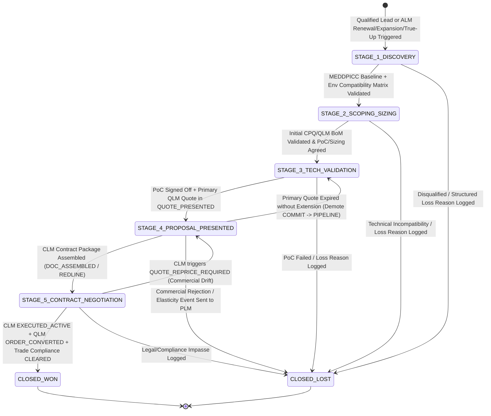

# The Sales Pipeline Management (SPM) Process for CPQ Workflows (TDD & UAT Specification)

**Sales Pipeline Management (SPM) for CPQ (Configure, Price, Quote) Workflows** is the top-of-funnel and cross-stage revenue governance framework that orchestrates how qualified leads and Installed-Base expansion/renewal triggers progress through objective sales stages, synchronize deterministically with **[Quote Lifecycle Management (QLM)](quote-lifecycle-management-cpq.md)** and **[Contract Lifecycle Management (CLM)](contract-lifecycle-management-cpq.md)** artifacts, forecast quarterly bookings via seeded Monte Carlo simulation, and attribute Closed-Won quota credits and Closed-Lost price-elasticity telemetry back into **[Pricing Lifecycle Management (PLM)](pricing-lifecycle-management.md)** and **[Asset Lifecycle Management (ALM)](asset-lifecycle-management-cpq.md)**.

In enterprise and defense software sales, unguarded CRM pipelines suffer from "phantom pipeline" (deals advanced to late stages without a valid technical configuration or approved quote), double-counted option quotes, commingled one-time and recurring ARR numbers, and subjective forecast commits. This specification establishes a **Test-Driven Development (TDD)** and **executable User Acceptance Testing (UAT)** architecture for **Sales Pipeline Management** tailored to **Project Aegis** (`.NET` / C# / xUnit determinism standards).

---

## Part I: The Five Phases of Sales Pipeline Management (SPM) for CPQ

### 1. Opportunity Intake, Territory Routing & Deal-Registration Exclusivity
The pipeline lifecycle begins when an inbound/outbound lead passes technical qualification ([On-Premises L2F](lead-to-fulfillment-onprem.md) or [SaaS L2F](lead-to-fulfillment-saas.md)) or when **[Asset Lifecycle Management (ALM)](asset-lifecycle-management-cpq.md)** emits an automated expansion, true-up, or renewal trigger.
* **Multi-Source Opportunity Initialization:** Creating strongly typed CRM Opportunities classified by commercial motion (`NET_NEW_LAND`, `INSTALLED_BASE_ABO_EXPANSION`, `USAGE_OVERAGE_TRUE_UP`, `ANNUAL_RENEWAL`, or `COMPETITIVE_DISPLACEMENT`) with mandatory target environment metadata (`DeploymentIsolationMode`, `ExportClassification`, `TargetOsArch`).
* **Deterministic Territory & Vertical Routing:** Assigning Opportunities to specialized sales pods (`US_DOD_SOVEREIGN`, `NATO_BALTIC_THEATER`, `PUBLIC_SECTOR_FED`, `GLOBAL_COMMERCIAL_ENT`) based on customer DUNS/CAGE code, headquarters jurisdiction, and security clearance requirements.
* **Partner Deal-Registration Conflict & Exclusivity Gate:** Validating indirect channel deal registrations (`VAR_DEAL_REGISTRATION`) against active Opportunities. Once a partner is granted Deal Registration approval for a specific `(CustomerId, DeploymentClusterScope)`, SPM enforces a 90-day exclusivity lock (`DealRegExpirationUtc`), blocking duplicate partner registrations or unauthorized direct-sales channel conflict.

### 2. MEDDPICC Qualification & CPQ/CLM Artifact-Gated Stage Progression
Rather than allowing sales reps to advance pipeline stages via subjective dropdown edits, SPM enforces hard-stop **Artifact-Verified Stage-Exit Gates** across six canonical stages:
* **Stage 1 (`STAGE_1_DISCOVERY`) $\rightarrow$ Stage 2 (`STAGE_2_SCOPING_SIZING`):** Requires structured MEDDPICC baseline fields (*Metrics, Identified Pain, Economic Buyer*) and a passed Environment Compatibility check (`INV-QUAL-01`).
* **Stage 2 (`STAGE_2_SCOPING_SIZING`) $\rightarrow$ Stage 3 (`STAGE_3_TECH_VALIDATION`):** Requires an initialized [CPQ](cpq-product-management-lifecycle.md) / [QLM](quote-lifecycle-management-cpq.md) draft quote (`CONFIG_RAMP_VALID`) with Solutions Engineer sizing sign-off and formal Proof-of-Concept (PoC) success criteria.
* **Stage 3 (`STAGE_3_TECH_VALIDATION`) $\rightarrow$ Stage 4 (`STAGE_4_PROPOSAL_PRESENTED`):** Requires technical validation sign-off (`POC_VALIDATED` or SE waiver) **and** a bound Primary QLM Quote in state `QUOTE_PRESENTED` (`QuoteCanonicalFingerprintSha256` issued).
* **Stage 4 (`STAGE_4_PROPOSAL_PRESENTED`) $\rightarrow$ Stage 5 (`STAGE_5_CONTRACT_NEGOTIATION`):** Requires an active [CLM Contract](contract-lifecycle-management-cpq.md) in state `DOC_ASSEMBLED`, `NEGOTIATION_REDLINE`, `APPROVAL_PENDING`, or `READY_FOR_SIGNATURE` bound to the Opportunity's Primary Quote.
* **Stage 5 (`STAGE_5_CONTRACT_NEGOTIATION`) $\rightarrow$ Stage 6 (`CLOSED_WON`):** Requires cryptographic proof that `CLM.State == EXECUTED_ACTIVE`, `QLM.PrimaryQuote.State == ORDER_CONVERTED`, and `TradeComplianceStatus == CLEARED`.

### 3. Quote-Locked Valuation, ARR Bucket Partitioning & Forecast Rollups
Once a quote is attached in Stage 3+, SPM eliminates manual spreadsheet or CRM amount overrides by locking Opportunity valuation directly to the active Primary CPQ Quote.
* **Quote-Locked Valuation Guard:** Blocking manual edits to Opportunity `Amount`, `ARR`, or `TCV` once a Primary Quote is bound (`ERR_SPM_QUOTE_LOCKED_VALUATION`); any commercial change must flow through a [QLM Quote Revision](quote-lifecycle-management-cpq.md) (`vN+1`).
* **Canonical Multi-Bucket Revenue Partitioning:** Decomposing every Opportunity's value into five mutually exclusive, penny-exact 128-bit `decimal` buckets (`MidpointRounding.ToEven`):
  1. `NewLogoArr`: Net-new recurring annual run-rate from new customers;
  2. `ExpansionUpsellArr`: Net positive recurring delta from ABO capacity additions or tier upgrades (`DeltaArr > 0`);
  3. `RenewalBaselineArr`: Existing recurring ARR up for renewal (`<= PriorAssetArr`);
  4. `ContractionChurnArr`: Negative recurring delta from partial downgrades or non-renewed assets (`DeltaArr < 0`);
  5. `NonRecurringOneTimeRevenue`: Point-in-time perpetual licenses, onboarding Professional Services (`SOW`), and hardware appliances.
* **Deterministic Forecast Category Rollups:** Mapping each Opportunity into a canonical Forecast Category (`OMITTED_CLOSED_LOST`, `PIPELINE`, `BEST_CASE`, `COMMIT`, `CLOSED_WON`) with automated governance rules (e.g., an Opportunity cannot be placed in `COMMIT` unless `Stage >= STAGE_4_PROPOSAL_PRESENTED`, `PrimaryQuote.State != QUOTE_EXPIRED`, and all required CPQ commercial approvals are complete).

### 4. Pipeline Velocity Hygiene, Slippage Governance & Seeded Forecast Simulation (`SpmPipelineForecastSimulator`)
RevOps and Sales Leadership continuously audit pipeline health and simulate quarterly landing scenarios using deterministic replay.
* **Stalled-Deal ("Deal Rotting") & Slippage Telemetry:** Tracking `StageAgeDays` and `CloseDatePushCount` against explicit UTC evaluation timestamps. If an Opportunity remains in Stage 3–5 beyond $1.5\times$ the segment median cycle time without a QLM revision or CLM redline event—or if its Primary Quote transitions to `QUOTE_EXPIRED`—SPM flags `DEAL_AT_RISK_STALLED` and automatically demotes the deal from `COMMIT` to `PIPELINE`.
* **Seeded Pipeline Forecast Simulator (`SpmPipelineForecastSimulator`):** Modeled on Project Aegis's headless [`BalticReplayHarness`](../../src/ProjectAegis.Delegation.UnityAdapter/Baltic/BalticReplayHarness.cs) and [`PlmStrategySimulator`](pricing-lifecycle-management.md), the simulator runs $M$ deterministic Monte Carlo trials (using `SeededRng(seed, RngDomain.SpmPipelineSim, opportunityId, trialIndex, 0)`) over the open pipeline snapshot. It models stage-specific win probabilities, historical close-date slippage distributions, and late-stage discount erosion to output bit-for-bit reproducible $P_{10}$ (Conservative), $P_{50}$ (Expected), and $P_{90}$ (Upside) quarterly bookings and quota-coverage ratios (`Run A == Run B`).

### 5. Closed-Won / Closed-Lost Attribution, Quota Split Reconciliation & PLM Feedback Loop
When an Opportunity closes, SPM reconciles sales compensation credits and routes structured market feedback upstream.
* **Margin-Weighted Quota Credit & Multi-Role Splits:** Upon `CLOSED_WON`, SPM calculates penny-exact quota retirement credits across contributing roles (`AccountExecutive`, `SolutionsEngineer`, `ChannelPartnerManager`, `RenewalSpecialist`) with support for **Margin-Realization Accelerators/Decelerators** (e.g., preserving $100\%$ quota credit at target pocket margin, applying a $0.85\times$ decelerator when discretionary discounts breach VP approval bands) and 100% split conservation ($\sum \text{RoleSplitPct} == 100.0\%$).
* **Mandatory Closed-Lost Reason & Competitor Price Capture:** Blocking transition to `CLOSED_LOST` unless structured loss telemetry is recorded (`PrimaryLossReason`, `CompetitorId`, `EstimatedCompetitorPricePerCore`, `MissingCapabilitySkuGap`), and publishing a `PipelineLossElasticityEvent` to [PLM](pricing-lifecycle-management.md) for Win/Loss price-sensitivity recalibration.

---

## Part II: Project Aegis TDD Architecture for SPM-CPQ Workflows

To align with **Project Aegis** engineering standards ([`AGENTS.md`](../../AGENTS.md) and [`determinism-and-replay.md`](../../docs/engineering/determinism-and-replay.md)), the SPM domain is engineered using immutable C# records, pure deterministic evaluators, `SeededRng` simulation loops, and zero ambient nondeterminism (`no float/double` in financial/quota math, `no Random.Shared`, `no DateTime.UtcNow`).

### 1. SPM Opportunity Lifecycle State Machine



### 2. Core TDD Domain Invariants (Red-Green-Refactor Contracts)

Every SPM service and simulation module must satisfy these seven deterministic invariants in unit and integration tests:

1. **Partner Deal-Registration Exclusivity Invariant (`INV-SPM-DEALREG-01`):** For any active, approved Partner Deal Registration bound to `(CustomerId, DeploymentClusterScope, PartnerId)` with `evaluationUnixSecondsUtc <= DealRegExpirationUnixSecondsUtc`, any competing Deal Registration request from `PartnerId_B != PartnerId` for the same customer cluster must be rejected with `ERR_SPM_DEAL_REG_CONFLICT_LOCKED`.
2. **Artifact-Verified Stage-Exit Gate Invariant (`INV-SPM-GATE-01`):** `OpportunityStageTransitionValidator` must reject any stage advancement unless all prerequisite CPQ/QLM/CLM artifact states are satisfied:
   - $\rightarrow$ `STAGE_4_PROPOSAL_PRESENTED`: Requires `PrimaryQuote != null && PrimaryQuote.State == QUOTE_PRESENTED`;
   - $\rightarrow$ `STAGE_5_CONTRACT_NEGOTIATION`: Requires `ActiveClmContract != null && ActiveClmContract.State >= DOC_ASSEMBLED`;
   - $\rightarrow$ `CLOSED_WON`: Requires `PrimaryQuote.State == ORDER_CONVERTED && ActiveClmContract.State == EXECUTED_ACTIVE && TradeComplianceCleared == true`.
   Any premature transition attempt must fail with `ERR_SPM_STAGE_EXIT_PREREQUISITE_UNMET`.
3. **Quote-Locked Valuation & ARR Bucket Conservation Invariant (`INV-SPM-VAL-01`):** When `Opportunity.Stage >= STAGE_3_TECH_VALIDATION`, direct mutation of Opportunity financial fields must fail with `ERR_SPM_QUOTE_LOCKED_VALUATION`. The Opportunity's derived `OpportunityArrBreakdown` must use 128-bit `decimal` arithmetic (`MidpointRounding.ToEven`) and satisfy:
   - $\text{TotalNetRecurringArr} == \text{NewLogoArr} + \text{ExpansionUpsellArr} + \text{RenewalBaselineArr} + \text{ContractionChurnArr}$ (where $\text{ContractionChurnArr} \le 0$);
   - $\text{TotalNetContractValue} == \text{TotalContractValueFromPrimaryQuote}$.
4. **Forecast Category Hygiene & Expired-Quote Auto-Demotion Invariant (`INV-SPM-FCST-01`):** An Opportunity cannot be assigned `ForecastCategory.Commit` unless `Stage >= STAGE_4_PROPOSAL_PRESENTED` and `PrimaryQuote.State == QUOTE_PRESENTED` (with zero pending CPQ approvals). If `PrimaryQuote.State` transitions to `QUOTE_EXPIRED` or `APPROVAL_PENDING`, the Opportunity's `ForecastCategory` must automatically demote from `Commit` to `BestCase` or `Pipeline` (`ERR_SPM_COMMIT_REQUIRES_VALID_PRESENTED_QUOTE`).
5. **Deterministic Seeded Pipeline Simulation Invariant (`INV-SPM-SIM-01`):** Given the same `(PipelineSnapshotHash,QuotaPolicyId, TrialCount, Seed)`, two independent executions of `SpmPipelineForecastSimulator.Run(...)` must produce bit-for-bit identical `P10BookingsArr`, `P50BookingsArr`, `P90BookingsArr`, `QuotaCoverageRatio`, and `SimulationReplayFingerprintSha256` (`Run A == Run B`), using `SeededRng` with zero calls to `Random.Shared` or `DateTime.UtcNow`.
6. **Closed-Won Quota Attribution & Split Conservation Invariant (`INV-SPM-COMP-01`):** For every `CLOSED_WON` Opportunity, the sum of role attribution split percentages within any compensation pool (e.g., Direct Sales Pool across Primary AE and Co-Selling Territory AE) must equal exactly $100.00\%$ ($\sum \text{PoolSplitPct} == 1.0000\text{m}$), and penny rounding across split quota credits must assign any $\$0.01$ remainder deterministically to the highest-percentage primary owner so $\sum \text{AllocatedRoleCredits} == \text{TotalMarginAdjustedQuotaCredit}$.
7. **Closed-Lost Structured Telemetry & PLM Feedback Invariant (`INV-SPM-LOSS-01`):** Transitioning an Opportunity from `STAGE_2`+ to `CLOSED_LOST` must fail with `ERR_SPM_LOSS_TELEMETRY_REQUIRED` if `PrimaryLossReason == Unspecified` or if `PrimaryLossReason == PriceElasticityLoss` without a populated `CompetitorBenchmarkPrice` record.

### 3. Project Aegis C# Domain Contracts & Test Naming Conventions

Following `AGENTS.md` conventions (`sealed record`, `readonly record struct`, 128-bit `decimal` for financial math, explicit UTC timestamps passed as parameters, and xUnit `[Scenario]_[Expected]` test naming):

```csharp
namespace ProjectAegis.Spm.Domain;

public enum PipelineStage { Stage1Discovery, Stage2ScopingSizing, Stage3TechValidation, Stage4ProposalPresented, Stage5ContractNegotiation, ClosedWon, ClosedLost }
public enum ForecastCategory { OmittedClosedLost, Pipeline, BestCase, Commit, ClosedWonBooked }
public enum OpportunityMotion { NetNewLand, InstalledBaseExpansion, UsageOverageTrueUp, AnnualRenewal, CompetitiveDisplacement }
public enum LossReasonCode { Unspecified, PriceElasticityTooHigh, MissingTechnicalCapability, ExportOrComplianceBlocker, BudgetFrozenNoDecision, LostToIncumbentStatusQuo }

public readonly record struct OpportunityArrBreakdown(
    decimal NewLogoArr,
    decimal ExpansionUpsellArr,
    decimal RenewalBaselineArr,
    decimal ContractionChurnArr,
    decimal NonRecurringOneTimeRevenue,
    decimal TotalNetContractValue)
{
    public decimal TotalNetRecurringArr => NewLogoArr + ExpansionUpsellArr + RenewalBaselineArr + ContractionChurnArr;
}

public sealed record SpmOpportunitySnapshot(
    string OpportunityId,
    string CustomerId,
    string DeploymentClusterScope,
    string TerritoryCode,
    OpportunityMotion Motion,
    PipelineStage Stage,
    ForecastCategory ForecastCategory,
    string? PrimaryQuoteId,
    string? PrimaryQuoteFingerprintSha256,
    string? ActiveClmContractId,
    OpportunityArrBreakdown Valuation,
    long StageEnteredUnixSecondsUtc,
    long TargetCloseUnixSecondsUtc,
    int CloseDatePushCount,
    string OpportunityCanonicalFingerprintSha256);

public sealed record SpmPipelineSimulationResult(
    string TerritoryCode,
    uint Seed,
    int TrialCount,
    decimal TargetQuarterlyQuotaArr,
    decimal UnweightedOpenPipelineArr,
    decimal P10ConservativeBookingsArr,
    decimal P50ExpectedBookingsArr,
    decimal P90UpsideBookingsArr,
    decimal QuotaAttainmentProbabilityPct,
    string SimulationReplayFingerprintSha256);
```

**TDD Test Pyramid & xUnit Mapping:**

| Test Layer | Assembly / Location | Target System Under Test (SUT) | Naming Convention (`[Scenario]_[Expected]`) | Execution Budget |
| :--- | :--- | :--- | :--- | :--- |
| **1. Pure Domain Unit Tests** | `src/ProjectAegis.Spm.Tests/` | `DealRegConflictValidator`, `OpportunityStageTransitionValidator`, `ArrBucketPartitioner`, `ForecastCategoryGuard`, `QuotaCreditAllocator` | `AdvanceToStage4WithoutPresentedPrimaryQuote_ReturnsPrerequisiteUnmetError` | $< 10\text{ ms}$ per `[Fact]` / `[Theory]` |
| **2. Simulation & Replay Tests** | `src/ProjectAegis.Spm.Tests/Sim/` | `SpmPipelineForecastSimulator`, `StageVelocityHygieneEvaluator` | `SpmPipelineSimulator_SameSeedAndSnapshot_ProducesBitIdenticalP50AndHash` | $< 50\text{ ms}$ for 1,000 Monte Carlo trials |
| **3. Golden Regression Tests** | `tests/regression/spm-golden-*.txt` | `SpmGoldenPipelineReplayTests` | `NatoTheaterQ4PipelineForecast_MatchesPinnedReplayFingerprint` | $< 250\text{ ms}$ for full golden suite |
| **4. End-to-End UAT Scenarios** | `tests/uat/sales-pipeline-management-cpq.md` | Full Lead/ALM Intake $\rightarrow$ Stage Gates $\rightarrow$ QLM/CLM Sync $\rightarrow$ Forecast Sim $\rightarrow$ Closed-Won/Lost | `UAT-SPM-01` through `UAT-SPM-06` | Pre-release & RevOps sign-off gate |

---

## Part III: Executable User Acceptance Testing (UAT) Scenarios

The following Behavior-Driven Development (BDD / Gherkin) scenarios define the mandatory acceptance gates across all five phases of the Sales Pipeline Management (SPM) process for CPQ.

### UAT-SPM-01: Opportunity Intake, Territory Routing & Partner Deal-Registration Exclusivity (Phase 1)
```gherkin
Feature: Opportunity Intake, Sovereign Territory Routing, and Partner Deal-Registration Conflict Prevention
  As a Channel Operations Manager and Sales Operations Lead
  I want incoming leads and partner deal registrations routed deterministically and guarded against channel conflicts
  So that partners receive protected 90-day exclusivity on registered customer clusters

  Scenario: Approved VAR deal registration locks out competing partner registrations for 90 days
    Given Partner "VAR-NORDIC-DEFENSE-01" submits a Deal Registration for Customer "CUST-BALTIC-MOD" (`Cluster: CLUSTER-TALLINN-01`) at `2026-10-01T00:00:00Z`
    When Channel Operations approves the Deal Registration
    Then SPM MUST initialize Opportunity "OPP-2026-950" in territory "NATO_BALTIC_THEATER" with `DealRegLockUntilUtc = 2026-12-30T00:00:00Z`
    When competing Partner "VAR-EURO-TECH-02" submits a Deal Registration for Customer "CUST-BALTIC-MOD" (`Cluster: CLUSTER-TALLINN-01`) at `2026-11-15T00:00:00Z`
    Then `DealRegConflictValidator` MUST reject the competing registration with error code "ERR_SPM_DEAL_REG_CONFLICT_LOCKED"
    And preserve "VAR-NORDIC-DEFENSE-01" as the exclusive registered partner on "OPP-2026-950"
```

### UAT-SPM-02: Artifact-Gated Stage Progression Across PoC, QLM Proposal & CLM Negotiation (Phase 2)
```gherkin
Feature: Objective CPQ, QLM, and CLM Artifact-Verified Stage-Exit Gates
  As a VP of Sales and Revenue Operations Controller
  I want Opportunity stage transitions gated by verified QLM quote and CLM contract states
  So that reps cannot advance deals to late stages without real commercial and legal artifacts

  Scenario Outline: Stage transition validator enforces downstream CPQ/QLM/CLM artifact prerequisites
    Given Opportunity "OPP-2026-951" is currently in "<current_stage>"
    And its bound Primary QLM Quote state is "<qlm_quote_state>" and bound CLM Contract state is "<clm_contract_state>" with Trade Compliance "<compliance_state>"
    When the Account Executive attempts to advance "OPP-2026-951" to "<target_stage>"
    Then the transition evaluation result MUST be "<expected_outcome>" with diagnostic "<diagnostic_code>"

    Examples:
      | current_stage                 | target_stage                  | qlm_quote_state | clm_contract_state | compliance_state | expected_outcome | diagnostic_code                       |
      | STAGE_3_TECH_VALIDATION       | STAGE_4_PROPOSAL_PRESENTED    | QUOTE_DRAFT     | NONE               | PENDING          | REJECTED         | ERR_SPM_STAGE_EXIT_PREREQUISITE_UNMET |
      | STAGE_3_TECH_VALIDATION       | STAGE_4_PROPOSAL_PRESENTED    | QUOTE_PRESENTED | NONE               | PENDING          | ALLOWED          | STAGE_TRANSITION_OK                   |
      | STAGE_4_PROPOSAL_PRESENTED    | STAGE_5_CONTRACT_NEGOTIATION  | QUOTE_PRESENTED | NONE               | PENDING          | REJECTED         | ERR_SPM_STAGE_EXIT_PREREQUISITE_UNMET |
      | STAGE_4_PROPOSAL_PRESENTED    | STAGE_5_CONTRACT_NEGOTIATION  | QUOTE_PRESENTED | NEGOTIATION_REDLINE| PENDING          | ALLOWED          | STAGE_TRANSITION_OK                   |
      | STAGE_5_CONTRACT_NEGOTIATION  | CLOSED_WON                    | ORDER_CONVERTED | EXECUTED_ACTIVE    | HOLD_PENDING     | REJECTED         | ERR_SPM_STAGE_EXIT_PREREQUISITE_UNMET |
      | STAGE_5_CONTRACT_NEGOTIATION  | CLOSED_WON                    | ORDER_CONVERTED | EXECUTED_ACTIVE    | CLEARED          | ALLOWED          | STAGE_TRANSITION_OK                   |
```

### UAT-SPM-03: Quote-Locked Valuation, ARR Bucket Partitioning & Expired-Quote Forecast Demotion (Phase 3)
```gherkin
Feature: Quote-Locked Opportunity Valuation, Multi-Bucket ARR Partitioning, and Commit Forecast Governance
  As a Chief Financial Officer and RevOps Analyst
  I want Opportunity valuations locked to the Primary CPQ Quote and partitioned into exact ARR vs. one-time buckets
  So that pipeline ARR, NRR, and Commit forecasts are 100% auditable and never inflated by manual overrides

  Scenario: Manual Opportunity amount edit is blocked in Stage 4 and valuation partitions recurring vs. one-time revenue
    Given Opportunity "OPP-2026-952" (`Motion: INSTALLED_BASE_ABO_EXPANSION`) is in "STAGE_4_PROPOSAL_PRESENTED"
    And Customer "CUST-DEF-01" has existing `RenewalBaselineArr = $76,800.00` (64 cores)
    And bound Primary Quote "Q-2026-952-v1" renews the 64 cores at `$76,800.00/yr`, adds 32 expansion cores at `$38,400.00/yr`, and includes `$15,000.00` one-time Onboarding Professional Services (`TotalNetTcv = $130,200.00`)
    When a Sales Rep attempts to manually overwrite Opportunity `Amount` to "$150,000.00" in the CRM UI
    Then SPM MUST reject the edit with error code "ERR_SPM_QUOTE_LOCKED_VALUATION"
    And `ArrBucketPartitioner` MUST report:
      | Bucket_Name                  | Amount        |
      | NewLogoArr                   | $0.00         |
      | RenewalBaselineArr           | $76,800.00    |
      | ExpansionUpsellArr           | $38,400.00    |
      | ContractionChurnArr          | $0.00         |
      | TotalNetRecurringArr         | $115,200.00   |
      | NonRecurringOneTimeRevenue   | $15,000.00    |
      | TotalNetContractValue        | $130,200.00   |

  Scenario: Expiration of the Primary CPQ Quote automatically demotes the Opportunity from COMMIT to PIPELINE
    Given Opportunity "OPP-2026-952" is in "STAGE_4_PROPOSAL_PRESENTED" with `ForecastCategory = Commit`
    When Primary Quote "Q-2026-952-v1" transitions to "QUOTE_EXPIRED" at `2026-11-01T00:00:01Z`
    Then SPM MUST automatically demote "OPP-2026-952" to `Stage = STAGE_3_TECH_VALIDATION` and `ForecastCategory = Pipeline`
    And emit alert "ALERT_SPM_COMMIT_QUOTE_EXPIRED" to the Account Executive and Regional VP
```

### UAT-SPM-04: Stalled-Deal Velocity Hygiene & Seeded Pipeline Forecast Simulation (Phase 4)
```gherkin
Feature: Deterministic Pipeline Velocity Auditing and Seeded Monte Carlo Forecast Simulation
  As a VP of Revenue Operations
  I want stalled deals flagged automatically and quarterly bookings simulated deterministically using SeededRng
  So that leadership has a bit-for-bit reproducible P10/P50/P90 quota coverage forecast

  Scenario: Seeded pipeline forecast simulator produces bit-for-bit identical P10, P50, and P90 bookings across independent runs
    Given open pipeline snapshot "PIPE-2026-Q4-NATO" (`SnapshotHash: 44aa55bb`) contains 45 active Opportunities totaling "$6,400,000.00" unweighted ARR against a quarterly quota of "$2,500,000.00"
    When `SpmPipelineForecastSimulator.Run` is executed twice (`Run A` and `Run B`) with `TrialCount = 1000` and `Seed = 20261102`
    Then `Run A` and `Run B` MUST emit the exact same `SimulationReplayFingerprintSha256`
    And report identical forecast metrics:
      | Metric                          | Value           |
      | P10_Conservative_Bookings_ARR   | $2,180,000.00   |
      | P50_Expected_Bookings_ARR       | $2,645,000.00   |
      | P90_Upside_Bookings_ARR         | $3,120,000.00   |
      | Quota_Attainment_Probability    | 68.40%          |
```

### UAT-SPM-05: Closed-Won Gate Enforcement & Margin-Weighted Multi-Role Quota Split (Phase 5)
```gherkin
Feature: Closed-Won Attribution and Penny-Exact Margin-Weighted Quota Credit Splits
  As a Sales Compensation Controller
  I want Closed-Won deals to allocate quota credits across co-selling reps with exact penny conservation and margin adjustments
  So that commission ledgers never over-allocate or drift from booked contract margin

  Scenario: Co-authored defense deal splits margin-adjusted quota credit 67% / 33% with deterministic penny remainder allocation
    Given Opportunity "OPP-2026-960" transitions to "CLOSED_WON" with `TotalNetRecurringArr = $100,000.00`
    And the deal achieved Target Pocket Margin (`MarginMultiplier = 1.0000`)
    And the Direct AE Compensation Pool specifies a 3-way co-sell split (`Primary_AE: 33.34%`, `CoSell_AE_East: 33.33%`, `CoSell_AE_West: 33.33%`)
    When `QuotaCreditAllocator` computes the quota credit distribution using `MidpointRounding.ToEven`
    Then the allocated credits MUST be:
      | Role_Recipient   | Split_Pct | Allocated_Quota_Credit |
      | Primary_AE       | 33.34%    | $33,340.00             |
      | CoSell_AE_East   | 33.33%    | $33,330.00             |
      | CoSell_AE_West   | 33.33%    | $33,330.00             |
    And the sum of allocated quota credits MUST equal exactly "$100,000.00" with "$0.00" variance
```

### UAT-SPM-06: Closed-Lost Structured Telemetry & Automated PLM Elasticity Feedback (Phase 5)
```gherkin
Feature: Mandatory Closed-Lost Reason Capture and PLM Price-Elasticity Feedback Loop
  As a Pricing Product Manager (PLM) and Competitive Intelligence Lead
  I want Closed-Lost Opportunities to require structured loss reasons and competitor price benchmarks
  So that pricing objections automatically feed back into PLM elasticity models

  Scenario: Closing an Opportunity as Lost due to price requires competitor benchmark data and emits a PLM elasticity event
    Given Opportunity "OPP-2026-970" is in "STAGE_4_PROPOSAL_PRESENTED" at `$1,350.00/core/year` (64 cores)
    When the Account Executive attempts to transition "OPP-2026-970" to "CLOSED_LOST" with `PrimaryLossReason = Unspecified`
    Then SPM MUST reject the transition with error code "ERR_SPM_LOSS_TELEMETRY_REQUIRED"
    When the Account Executive selects `PrimaryLossReason = PriceElasticityTooHigh`, `CompetitorId = COMP-LEGACY-SIM`, and `CompetitorBenchmarkPrice = $980.00/core/year`
    Then "OPP-2026-970" MUST transition to "CLOSED_LOST" (`ForecastCategory = OmittedClosedLost`)
    And Primary Quote "Q-2026-970-v1" MUST transition to "SUPERSEDED_ARCHIVED"
    And SPM MUST emit a `PipelineLossElasticityEvent` (`QuotedUnitPrice: $1,350.00`, `CompetitorUnitPrice: $980.00`, `Segment: NATO_BALTIC_THEATER`) to the PLM Win/Loss Elasticity Repository
```

---

## Part IV: Requirements Traceability, KPIs & UAT Sign-Off Matrix

| Phase | Requirement ID | Domain Invariant | TDD Test Suite (`ProjectAegis.*.Tests`) | UAT Scenario | Operational KPI & Pass Threshold | Sign-Off Owner |
| :--- | :--- | :--- | :--- | :--- | :--- | :--- |
| **1. Intake & Deal-Reg Gate** | `REQ-SPM-01` | `INV-SPM-DEALREG-01` (Territory routing & 90-day partner lock) | `DealRegConflictValidatorTests`, `TerritoryRouterTests` | `UAT-SPM-01` | $0$ duplicate partner deal-reg conflicts; $100\%$ deterministic territory assignment. | Channel Ops / Sales Ops Lead |
| **2. Stage-Exit Guardrails** | `REQ-SPM-02` | `INV-SPM-GATE-01` (Artifact-verified CPQ/QLM/CLM stage gates) | `OpportunityStageTransitionValidatorTests` | `UAT-SPM-02` | $0$ Opportunities in Stage 4+ without a presented QLM quote or Stage 5+ without a CLM contract. | VP of Sales / Deal Desk Lead |
| **3. Valuation & ARR Buckets** | `REQ-SPM-03` | `INV-SPM-VAL-01`, `INV-SPM-FCST-01` (Quote-locked valuation & Commit hygiene) | `ArrBucketPartitionerTests`, `ForecastCategoryGuardTests` | `UAT-SPM-03` | $0.00\%$ variance between Opportunity ARR and Primary Quote ARR; $0$ expired quotes in `COMMIT`. | CFO / Finance Revenue Controller |
| **4. Velocity & Forecast Sim** | `REQ-SPM-04` | `INV-SPM-SIM-01` (`SeededRng` Monte Carlo P10/P50/P90 replay) | `SpmPipelineForecastSimulatorTests`, `StageVelocityHygieneTests` | `UAT-SPM-04` | $100\%$ bit-identical replay (`Run A == Run B`); quarterly P50 forecast error $\le \pm 5.0\%$. | VP Revenue Operations |
| **5. Closed-Won/Lost & PLM Loop** | `REQ-SPM-05` | `INV-SPM-COMP-01`, `INV-SPM-LOSS-01` (Split conservation & PLM loss telemetry) | `QuotaCreditAllocatorTests`, `ClosedLostTelemetryValidatorTests` | `UAT-SPM-05`, `UAT-SPM-06` | $0$ penny-rounding variance on quota splits; $100\%$ of price-lost deals synced to PLM. | Sales Comp Controller / PLM PM |

### UAT Entry & Exit Criteria

* **UAT Entry Criteria (Pre-Staging Gate):**
  1. All TDD unit, stage-gate, and seeded forecast simulation tests pass (`0 errors, 0 warnings`) with $100\%$ branch coverage on `DealRegConflictValidator`, `OpportunityStageTransitionValidator`, `ArrBucketPartitioner`, `ForecastCategoryGuard`, `SpmPipelineForecastSimulator`, and `QuotaCreditAllocator`.
  2. Static determinism audit verifies zero binary floating-point (`float`/`double`), zero `Random.Shared`, zero ambient `DateTime.UtcNow`, and culture-invariant SHA-256 fingerprint generation across all pipeline valuation and simulation paths.
  3. Golden pipeline forecast fixtures (`tests/regression/spm-golden-*.txt`) pass 100% intra-run (`Run A == Run B`) and baseline fingerprint checks.
* **UAT Exit Criteria (Production SPM-CPQ Release Gate):**
  1. All six UAT feature suites (`UAT-SPM-01` through `UAT-SPM-06`) pass in staging with zero open Severity-1 or Severity-2 defects.
  2. Closed-loop pipeline integration verified across [PLM](pricing-lifecycle-management.md), [CPQ](cpq-product-management-lifecycle.md), [QLM](quote-lifecycle-management-cpq.md), [CLM](contract-lifecycle-management-cpq.md), [On-Premises L2F](lead-to-fulfillment-onprem.md), [SaaS L2F](lead-to-fulfillment-saas.md), and [ALM](asset-lifecycle-management-cpq.md).
  3. Formal UAT sign-off recorded by the VP of Sales, VP of Revenue Operations, Channel Operations Lead, Finance Controller, and Pricing Product Manager.
